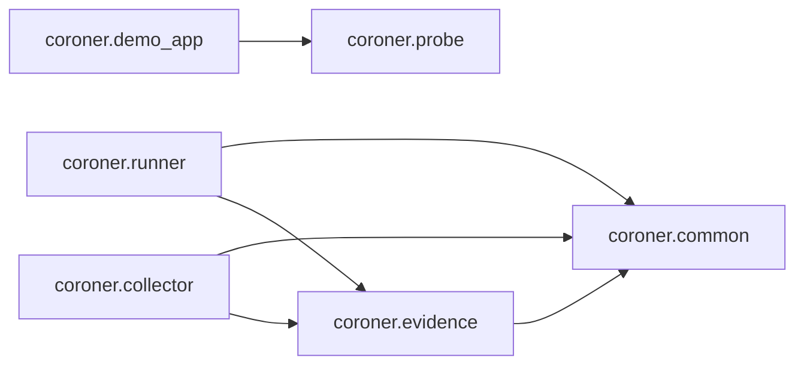
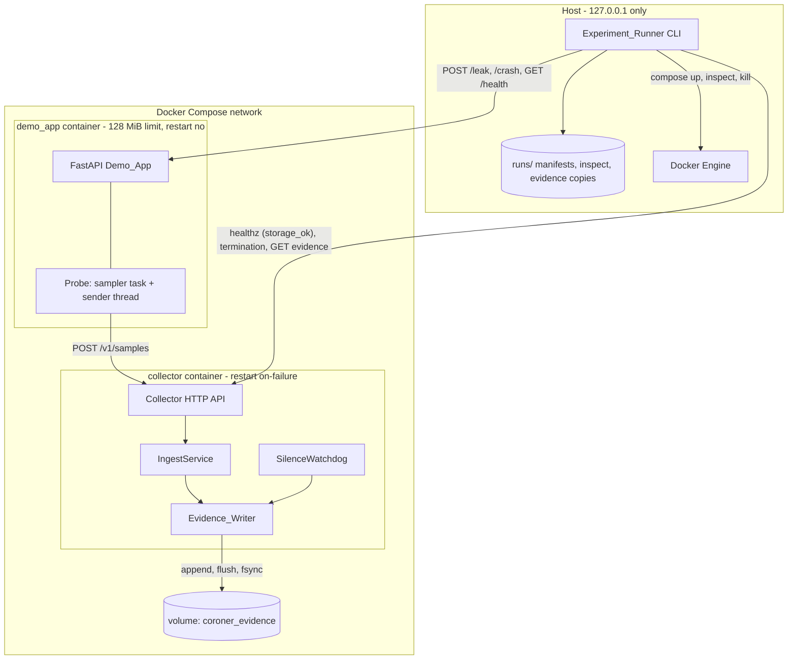
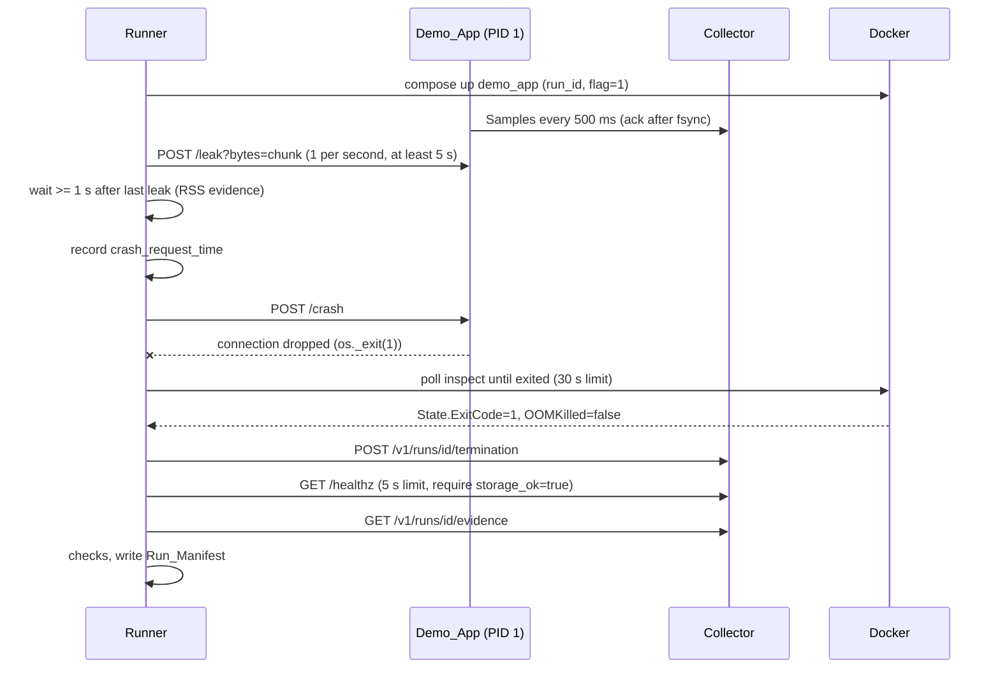
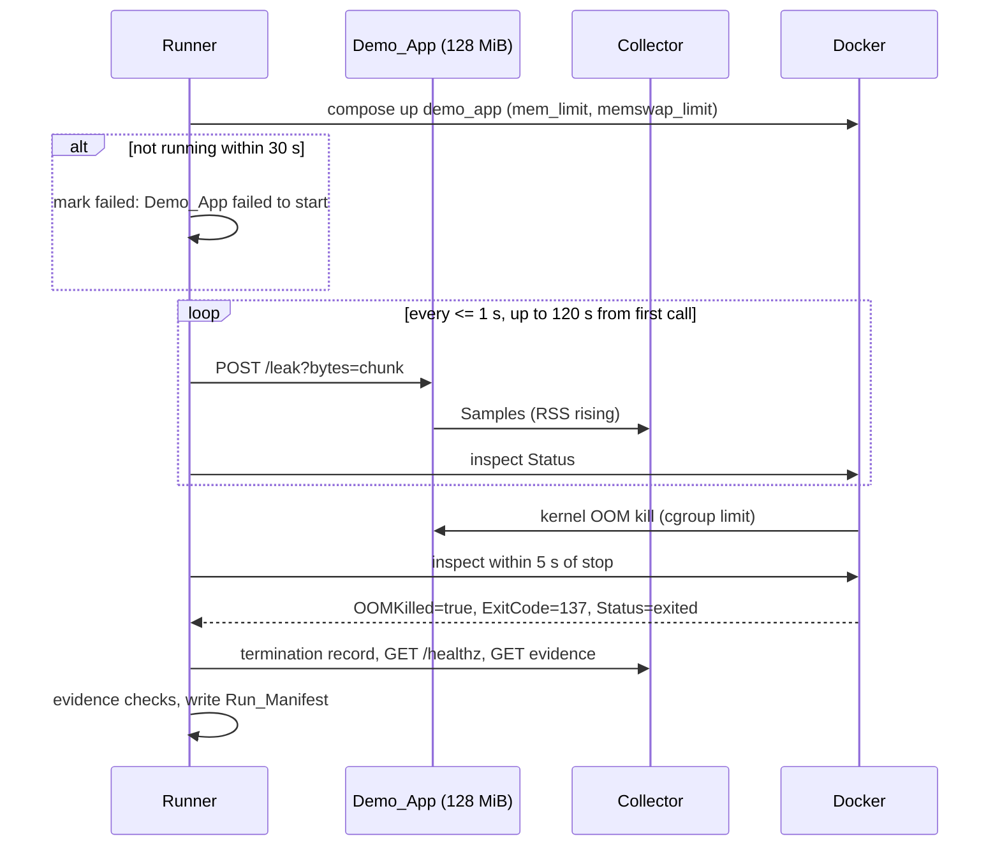

# Design Document: Coroner M0 (Crash Evidence Survival)

## Overview

Coroner M0 proves one claim: diagnostic telemetry pushed out of a Python process survives the death of that process, whether the death is a controlled fatal exit, a SIGKILL, or a genuine Docker OOM kill. M0 does no analysis or diagnosis. It collects evidence, stores it durably, and states plainly what it does not know.

The system has five parts:

- **Demo_App**: FastAPI app with a reproducible memory leak and three intentionally harmful endpoints, gated by `CORONER_ENABLE_DESTRUCTIVE_ENDPOINTS`.
- **Probe**: a stdlib-only module (under 300 non-blank lines) embedded in the Demo_App. It samples RSS, request count, and event-loop delay, and pushes each Sample to the Collector over HTTP. It never retries, never buffers, and never relies on shutdown hooks.
- **Collector**: an independent FastAPI service in its own container. It validates Samples, detects gaps, and appends records to per-run JSONL files, acknowledging only after the record is persisted to the configured Durability_Level.
- **Evidence** library (`coroner.evidence`): writer, reader, repair, and gap reconciliation. It is pure and Docker-free so it can be unit and property tested.
- **Experiment_Runner**: a host-side CLI that drives Docker Compose, runs Experiments A, B, and C, reads `docker inspect` evidence, writes Run_Manifests, and prints summaries.

### Key design decisions (summary)

The full register, including ambiguity resolutions, is in "Design Decisions and Ambiguity Resolutions" near the end. The headline decisions:

1. **Push, not pull, and never wait.** The Probe hands each Sample to a single sender thread. If the sender is busy or delivery fails, the Sample is discarded and counted. The event loop never waits on the network.
2. **Acknowledge only after persist.** The Collector's ingest path is `validate -> classify -> build records -> append+flush(+fsync) -> update in-memory state -> acknowledge`. In-memory state changes only after the write is durable.
3. **Append-only, never truncate.** Repair of an incomplete last line appends a newline and a Repair_Record. M0 never truncates, so original bytes always remain in the file as well as in the Repair_Record. The isolated fragment stays in the file as a Malformed_Line for audit. The Evidence_Reader reports and quarantines it (file, line number, byte length), never treats it as an evidence record, and never counts it as a Sample.
4. **Gaps are data, counted by set union over sequence discontinuities only.** `Missing_Sample_Count` is computed by the Evidence_Reader as the size of the union of the missing ranges of sequence discontinuity Gap_Records and nothing else. Probe-reported drops are reported separately as `Unreconciled_Drop_Count` with an uncertainty flag. Silence gaps are intervals, never numbers. Gap_Record `reconciliation` fields are advisory and cross-checked, never trusted for counting.
5. **Docker state is the ground truth for termination.** Exit code, OOMKilled, and status come from `docker inspect`, never from the app or from a signal the runner thinks it sent.
6. **Fatal exit is not an exception.** The Crash_Endpoint calls `os._exit(1)`. The Error_Endpoint raises an ordinary exception and the process survives. They are separate endpoints, separate tests, and separate wording.
7. **HTTP 200 is not proof of healthy storage.** The Collector health body carries `storage_ok`, produced by a real write+fsync probe. The runner and the Compose healthcheck both require `storage_ok=true`.
8. **Experiment verdicts use mandatory checks only.** Experiment C passes or fails on OOMKilled, exit code 137, Collector survival, preserved pre-crash evidence, measurable growth, and recorded inspect evidence. RSS shape metrics are Diagnostic_Metrics. Experiment B separates Sample capture time from Collector receive time.
9. **The runner is host-portable.** It runs on Windows PowerShell with Docker Desktop (Linux containers) and on POSIX shells: argv lists, `env=` merging, `pathlib`, no shell tools.

## Architecture

### Repository and module layout

```text
coroner/
  common/            # tiny shared helpers: time, ids, env parsing (stdlib only)
    timeutil.py        utc_now_ms(), format_utc_ms()
    envparse.py        parse_int_env(), parse_mem_size()
  probe/             # <= 300 non-blank lines in total, stdlib only
    __init__.py        re-exports Probe, ProbeConfig, load_config
    probe.py           config, readers, sampler loop, sender thread, drop counter
  demo_app/
    app.py             create_app(env, *, probe, exit_fn) -> FastAPI
    leak.py            LeakStore (thread-safe retained-bytes holder)
    counting.py        RequestCountMiddleware (pure ASGI)
    main.py            builds app from os.environ, used by uvicorn
  collector/
    app.py             create_app(config) -> FastAPI, HTTP routes
    config.py          CollectorConfig, load_config(env)
    service.py         IngestService (validate, classify, persist, ack)
    storage_probe.py   StorageProbe (real write+fsync probe under a reserved non-run path)
    state.py           RunState, RunRegistry (per-run locks, lazy state load)
    watchdog.py        SilenceWatchdog (thread, injectable clock)
    main.py            startup: config -> lock -> repair scan -> watchdog -> serve
  evidence/
    schema.py          record types, validators, RUN_ID_RE, SCHEMA_VERSION
    writer.py          Durability, serialize_record, EvidenceWriter
    repair.py          inspect_tail, repair_file
    gaps.py            IntervalSet, merge/union, reconcile, derive_drop_range, SequenceTracker
    reader.py          read_evidence, summarize, RunSummary
  runner/
    cli.py             argparse entry: run, summary
    docker_port.py     DockerPort Protocol + DockerCli (subprocess.run argv lists, env=, no shell)
    collector_client.py  tiny stdlib HTTP client for the Collector (health incl. storage_ok)
    manifest.py        RunManifest dataclasses, atomic write, read
    evaluate.py        pure evaluation: Container_State, Experiment B timing, Experiment C verdict, Diagnostic_Metrics
    experiments/       base.py, exp_a.py, exp_b.py, exp_c.py
    summary.py         formatting of the summary command
docker/
  demo_app.Dockerfile
  collector.Dockerfile
compose.yaml
requirements/        # exact pins: demo_app.txt, collector.txt, runner.txt, dev.txt
tests/
  conftest.py          opt-in logic (--run-docker, CORONER_RUN_DOCKER=1), marker registration
  unit/                Docker-free, network-free (autouse guards)
  docker_integration/  marker: docker_integration, separate directory
runs/                # host-side Run_Manifests, raw inspect output, evidence copies (gitignored)
```

### Dependency direction

Imports flow one way. There are no cycles. Nothing imports `runner`, `collector`, or `demo_app` except their own entry points.



- `probe` imports only the standard library. It does not import `common` or `evidence`, which keeps it small and keeps the Demo_App image free of Collector code. The tests assert that Probe output validates against `evidence.schema.validate_sample`, so the two cannot drift silently.
- The Demo_App image contains `coroner/probe` and `coroner/demo_app` only. The Collector image contains `coroner/common`, `coroner/evidence`, and `coroner/collector`.
- Two enforcement tests (Requirement 14.4): a static AST check of the allowed-import table above, and a fresh-interpreter `python -c "import coroner.<pkg>"` per package. The fresh-interpreter test spawns Python, not Docker, and opens no network connection.

### Component diagram



The evidence volume is mounted only into the Collector. The runner reads evidence through the Collector's read-only evidence endpoint (or `docker cp` for manual inspection). No other container mounts the volume.

### Runtime topology and trust boundaries

- The Demo_App and the Collector share the default Compose network. The Probe reaches the Collector at `http://collector:8081`.
- Host ports are published as `127.0.0.1:8080` (Demo_App) and `127.0.0.1:8081` (Collector) only. Nothing is published on `0.0.0.0`.
- Destructive endpoints are routed only when `CORONER_ENABLE_DESTRUCTIVE_ENDPOINTS=1`. They are for local experiments and must not be exposed beyond localhost.

## Components and Interfaces

### Demo_App

Configuration comes from environment variables:

| Variable | Default | Meaning |
|---|---|---|
| `CORONER_RUN_ID` | generated `manual-<8 hex>` | Run_Identifier attached to every Sample |
| `CORONER_COLLECTOR_URL` | `http://collector:8081` | Probe delivery target |
| `CORONER_SAMPLE_INTERVAL_MS` | `500` | Sample_Interval, valid 100 to 60000 |
| `CORONER_ENABLE_DESTRUCTIVE_ENDPOINTS` | unset | Routes destructive endpoints only when exactly `1` |

Endpoints:

| Method and path | Routed when | Behavior | Responses |
|---|---|---|---|
| `GET /health` | always | Returns `{"status":"ok","pid":<int>,"run_id":"...","probe":{"next_seq":<int>,"dropped":<int>}}` | 200 |
| `POST /leak?bytes=N` | flag is `1` | Retains N bytes filled with `0xA5`, N in 1..104,857,600 | 200 `{"retained_bytes_total":T,"requested_bytes":N}`; 422 for missing, non-integer, or out-of-range N (FastAPI validation, total unchanged); 503 `{"error":"allocation_failed","retained_bytes_total":T}` on `MemoryError` |
| `POST /crash` | flag is `1` | Calls `exit_fn(1)`, where `exit_fn` defaults to `os._exit`. Controlled fatal-process-exit: no exception, no handlers, no atexit, no finalizers | No response; the connection drops |
| `GET /error` | flag is `1` | Raises `RuntimeError("ordinary exception for Experiment non-termination test")`. Starlette converts it to HTTP 500 and the process continues | 500 |

Design points:

- **Gating by routing.** `create_app` registers the three destructive routes only if `env.get("CORONER_ENABLE_DESTRUCTIVE_ENDPOINTS") == "1"`. When they are not registered the framework answers 404 for every method. Compose passes `0` by default, which is "not set to 1".
- **Injectable exit.** `create_app(env, *, probe, exit_fn=os._exit)` lets unit tests assert `exit_fn(1)` was called without exiting the test process.
- **PID 1.** The container runs `uvicorn --workers 1` in exec form, so the server is PID 1. `os._exit(1)` therefore ends the container with exit code 1. `docker kill --signal=KILL` ends it with 137.
- **Leak fill.** `LeakStore.retain(n)` allocates `b"\xa5" * n`, which touches every page, so RSS grows by at least 90% of `n` (Requirement 1.7). Retained chunks live in a list guarded by a lock. The cumulative total is updated only after allocation succeeds. The handler is a sync `def`, so the 100 MiB fill runs in the threadpool, not on the event loop.
- **Request counting.** `RequestCountMiddleware` is pure ASGI. It calls `probe.count_request()` on every HTTP request, including health checks and 404s. Request_Count is therefore "all requests received since process start".
- **Lifecycle.** Probe `start()` is called from the FastAPI lifespan startup. `stop()` is called on shutdown for tidiness only. No evidence depends on it.

### Probe API (`coroner.probe`)

```python
@dataclass(frozen=True)
class ProbeConfig:
    run_id: str
    collector_url: str
    interval_ms: int            # validated 100..60000, default 500
    send_timeout_s: float = 0.200
    start_deadline_s: float = 0.100

def load_config(env: Mapping[str, str], warn: Callable[[str], None]) -> ProbeConfig:
    """Invalid CORONER_SAMPLE_INTERVAL_MS -> 500 and exactly one warn() call."""

class Transport(Protocol):
    def send(self, body: bytes, timeout_s: float) -> bool:
        """True only for an HTTP 200 acknowledgement within the deadline."""

class Probe:
    def __init__(self, config: ProbeConfig, *, transport: Transport | None = None,
                 rss_reader: Callable[[], int] = read_rss_bytes,
                 pid_reader: Callable[[], int] = os.getpid,
                 container_id_reader: Callable[[], tuple[str, str]] = read_container_id,
                 monotonic: Callable[[], float] = time.monotonic,
                 wall_clock: Callable[[], datetime] = utc_now) -> None: ...
    def start(self, loop: asyncio.AbstractEventLoop | None = None) -> None: ...
    async def stop(self) -> None: ...
    def count_request(self) -> None: ...
    def build_sample(self, loop_delay_ms: float | None, loop_delay_reason: str | None = None) -> dict: ...
    @property
    def state(self) -> dict: ...    # {"next_seq": int, "dropped": int}, used by /health
```

Behavior:

- **Real readers only.**
  - `read_rss_bytes()` parses `/proc/self/statm` (resident pages) times the page size. It is a current-RSS reading, not a high-water mark. `resource.getrusage` is deliberately not used because it reports peak RSS.
  - Where `/proc` is unavailable (for example, on a Windows developer machine) the reader raises, and the Probe records `rss_bytes: null` with a reason.
  - No reader has a synthetic fallback and none returns a previous value (Requirements 2.9, 7.1, 7.3, 7.6).
- **Container identifier.**
  - The Probe searches `/proc/self/mountinfo` for a 64-hex ID in a `/containers/<id>/` path (the `hostname`, `hosts`, and `resolv.conf` bind mounts), then `/proc/self/cgroup`.
  - If that fails it uses `HOSTNAME` (the 12-hex short ID), and failing that `null` with a reason.
  - The Sample records `container_id_source` (`mountinfo`, `cgroup`, `hostname`, or `none`) so a short ID is never mistaken for a full one.
  - Under cgroup v2 with a private cgroup namespace `/proc/self/cgroup` shows `0::/`, so `mountinfo` is the primary source.
- **Sampler loop with absolute deadlines.**
  - The tick k is scheduled at `t0 + k*interval`, not "sleep(interval) after the last tick", so there is no cumulative drift (Requirement 2.1).
  - Event_Loop_Delay is `max(0, loop.time() - scheduled_deadline)` in milliseconds for that tick (Requirement 7.2). If the loop is so late that the next deadline has already passed, the schedule skips forward. It never bursts, and the sequence number still increments by exactly 1 per produced Sample.

```text
pseudocode: sampler loop
deadline = loop.time() + interval
while running:
    await sleep_until(deadline)
    lateness_ms = max(0, (loop.time() - deadline) * 1000)
    sample = build_sample(lateness_ms)          # reads RSS, pid, container id, counters
    offer(sample)                               # never blocks
    deadline += interval
    if deadline <= loop.time(): deadline = loop.time() + interval   # skip, no burst
```

- **Delivery without blocking (Requirements 3.1 to 3.7).**
  - One daemon sender thread owns a one-slot handoff. `offer(sample)` takes the lock, checks whether the sender is idle, stores the encoded body, sets an event, and returns. This is well under 10 ms.
  - If the sender is still busy with the previous attempt, the new Sample is discarded and the dropped counter is incremented. There is no queue and no retry.
  - The sender wakes immediately, so delivery starts within 100 ms of Sample creation.
  - Each attempt has a hard deadline of 200 ms. Connect, send, and read each get `timeout = remaining_budget`, and the budget is rechecked between phases.
  - Only HTTP 200 counts as an acknowledgement. Any other result (connection error, timeout, 4xx, 5xx) discards the Sample and increments the counter.
- **Dropped counter.**
  - Every Sample carries `dropped`, the counter value at creation.
  - The counter saturates at 4,294,967,295.
  - On acknowledgement the sender subtracts the value that Sample carried, floored at 0, instead of assigning 0. When no new drop happened during the in-flight attempt, this equals a reset to 0 (Requirement 3.4). When a drop did happen concurrently, that drop is not erased.
  - Drops are sequence numbers consumed by the Probe, so the Collector can derive the dropped range from `seq` and `dropped` (see gap handling).
- **No shutdown dependence.** The Probe registers no signal handler, no atexit hook, and no `finally`-based flush (Requirement 3.2).
- **Interval warning.** An invalid interval value logs exactly one warning at startup (Requirement 2.11).
- **Size budget.** The line budget is enforced by a test that sums non-blank lines over `coroner/probe/**/*.py` against 300.

| Part | Estimated non-blank lines |
|---|---|
| config and interval parsing | 40 |
| RSS, pid, container-id readers | 50 |
| sample building and null-reason handling | 40 |
| sampler loop and scheduling | 45 |
| sender thread, transport, deadline | 70 |
| drop counter and `__init__` glue | 30 |
| **Total** | **about 275** |

### Collector HTTP API

All bodies are JSON. The Collector runs one uvicorn worker. Handlers are sync functions, so per-run locks block a pool thread, not the event loop.

| Method and path | Purpose | Success | Failures |
|---|---|---|---|
| `GET /healthz` | Liveness plus storage readiness, always served | 200 `{"status":"ok","durability":"crash","server_time":"<UTC ms>","uptime_s":N,"storage_ok":true}`; when the storage probe fails, still 200 with `"storage_ok":false` and `"storage_error":"<short reason>"` | none by design (see below) |
| `POST /v1/samples` | Ingest one Sample | 200 `{"status":"stored"\|"duplicate"\|"reset","run_id":"...","seq":N,"durability":"crash","recv_time":"..."}` | 422 validation failure; 413 body over `CORONER_MAX_BODY_BYTES` (default 65536); 503 `{"error":"storage_failure"}` |
| `POST /v1/runs/{run_id}/termination` | Runner records an observed termination | 200 `{"status":"recorded"}` | 422 invalid run_id or body; 503 storage failure |
| `GET /v1/runs/{run_id}/evidence` | Read-only snapshot of a run file (`application/x-ndjson`) | 200 bytes of the file | 404 no such run; 422 invalid run_id |

Notes:

- `GET /healthz` returns 200 whenever the process is serving, even if storage is failing, and reports `storage_ok: false` in that case (Requirements 4.8, 4.18). **HTTP 200 alone is not proof of healthy persistence.** Consumers (the Compose healthcheck and the runner) must read the body and require `storage_ok == true` (Requirements 4.17, 8.7, 8.14). A missing `storage_ok` field is treated as not healthy.
- `storage_ok` comes from `StorageProbe`, never from a cached constant or from "the process started":
  - The probe runs against a reserved path `/data/evidence/.coroner_probe/probe.tmp` (a dot-directory, so it cannot collide with a run file, is not matched by the `*.jsonl` repair scan, and is never read by the Evidence_Reader).
  - Steps: write a unique token record, `flush`, `os.fsync(file)`, `fsync(directory)` when the directory is created, read the token back, compare, then truncate or replace the probe file. Any exception or mismatch makes the result `false`. It uses the same `fsync` and `fsync_dir` callables as the `EvidenceWriter`, so a test double can fail any step.
  - The probe runs on each `/healthz` request, with a result cache of at most 1 s to bound I/O. A failed `append` in the ingest path invalidates the cache so the next health response re-probes. The probe takes no run lock and never touches a run file, so it cannot alter stored records (Requirement 4.4).
  - The probe also runs once at startup before the HTTP server reports ready, and the result is logged.
  - The probe checks writability and persistence at the configured level, but it proves nothing about host-crash durability beyond the documented fsync caveat.
- `server_time` lets the runner estimate host-to-container clock offset (see Experiment flows).
- A 422 body is `{"error":"validation_failed","reason_code":"...","field":"...","reason":"..."}`.
- An acknowledgement (200) is sent only after the record is persisted. The `durability` value in the acknowledgement is taken from the `EvidenceWriter` that actually performed the writes, so the Collector cannot claim `crash` without having called fsync (Requirement 4.15).
- Duplicate and reset Samples are persisted as `sequence_anomaly` records and acknowledged with 200 and the matching `status`, so the Probe still treats them as delivered.

### Collector persistence

#### Files and layout

- The volume `coroner_evidence` is mounted at `/data/evidence` in the Collector only.
- Each run has exactly one file, `/data/evidence/<run_id>.jsonl`.
- `_rejections.jsonl` is a reserved file for rejections that cannot be attributed to a valid Run_Identifier (unparseable JSON, or a missing, empty, or invalid `run_id`). Run IDs cannot start with `_`, so there is no collision.
- Run ID format is `^[A-Za-z0-9][A-Za-z0-9._-]{0,63}$` (1 to 64 characters). This is stricter than "non-empty string of 1 to 64 characters" so the ID is safe as a file name. See the decision register.

#### Durability levels

| Level | `CORONER_DURABILITY` | Steps before acknowledgement |
|---|---|---|
| Process_Durable | `process` | write and flush to the operating system |
| Crash_Durable (default) | `crash` or unset or empty | write, flush, `os.fsync(file)`; on file creation also `fsync(directory)` |

- `parse_durability(raw)` maps unset or empty to `crash`, accepts exactly `process` and `crash`, and raises `ConfigError("invalid CORONER_DURABILITY='x' (expected 'process' or 'crash')")` otherwise. The Collector exits non-zero at startup on that error (Requirement 4.12).
- `EvidenceWriter` takes injectable `fsync` and `fsync_dir` callables so tests use a recording double, with no host crash needed (Requirement 13.14).
- On win32, `fsync_dir` is a documented no-op because directories cannot be opened for fsync. The Collector always runs in a Linux container, so this only affects local unit runs.

#### Append path and acknowledge-after-persist ordering

```text
pseudocode: IngestService.ingest(raw_body)
recv = utc_now_ms()
if len(raw_body) > max_body:                  -> reject(413)
obj = parse_json(raw_body)                    -> on failure reject(422, "invalid_json") to _rejections.jsonl
issues = validate_sample(obj)                 -> on failure reject(422, field, reason)
run_id = obj["run_id"]
with registry.lock(run_id):                   # per-run serialization
    st = registry.open_run(run_id)            # lazy: ensure file, repair tail, load state, write run_metadata
    events = SequenceTracker.classify(st.seq_state, obj["seq"], obj["dropped"])
    records = build_records(obj, recv, events, st.next_gap_id)   # sample or anomaly, gaps, drop gap
    try:
        writer.append(run_id, records)        # ONE buffered write of all lines, flush, fsync (crash)
    except OSError:
        st.mark_dirty()                       # next append runs tail repair first
        -> 503 storage_failure                # no acknowledgement; process keeps running
    st.apply(events, recv, obj)               # in-memory state changes only after durable write
return 200 ack
```

Rules that follow from this ordering:

- **No acknowledgement before persistence.** A crash between `append` and the HTTP response loses only the acknowledgement. The Probe treats the Sample as undelivered, which can make the Collector's stored data a superset of what the Probe believes was delivered (see "ack-lost" in limitations). Stored records are never lost after an acknowledgement.
- **One write per ingest.** A Sample and any Gap_Records it triggers are serialized into a single buffer and written with one `write` plus one flush plus one fsync. A discontinuity gap and a drop gap triggered by the same Sample are therefore both marked reconciled before either reaches disk, and both are durable together.
- **Dirty files are repaired before reuse.** If a write fails partway, the file may end in a partial line. `mark_dirty` forces the repair path (below) before the next append, so a partial line is never followed by a record on the same line.
- **Ack latency.** The 500 ms target at 1 Sample per second is checked in an integration test. The Collector also logs `ingest_ms` per request for diagnosis.

#### Per-run locking and single instance

- `RunRegistry` holds a dict of `RunState` guarded by a registry lock. Each `RunState` owns a `threading.Lock`. Ingest, termination, evidence snapshot, and the watchdog all take the run's lock before touching its file or state.
- On POSIX the Collector takes an exclusive `fcntl.flock` on `/data/evidence/.collector.lock` at startup. A second Collector on the same volume fails fast. This protects the "one writer per file" assumption.

#### Run state

`RunState` is rebuilt lazily by scanning the run file on first use after a Collector start. It holds:

- `highest_seq`
- `seen: IntervalSet` (received Sample sequence numbers, stored as merged intervals)
- `last_sample_recv_time`, `last_sample_monotonic`, `interval_ms`
- `next_gap_number`
- `silence_open: bool`, `terminated: bool`
- `dirty: bool`

#### Startup repair of an incomplete last line

On startup, before the HTTP server accepts traffic, the Collector runs `repair_file` for every `*.jsonl` file in the evidence directory. `open_run` runs it again for any file first touched later or marked dirty, and it is idempotent.

```text
pseudocode: repair_file(path)
tail = inspect_tail(path)                      # scans backward in 64 KiB chunks for the last b"\n"
if empty file: return None
if file ends with b"\n":
    last_line = bytes between the previous newline and the final newline
    if json_ok(last_line): return None         # clean
    fragment, action = last_line, "none_needed_already_terminated"
else:
    fragment = bytes after last newline
    action = "appended_newline"
line_no = count_newlines(file before fragment) + 1
record = RepairRecord(run_id=stem(path), file=name(path), line_no, fragment_len=len(fragment),
                      fragment_b64=b64(fragment[:1 MiB]), fragment_truncated=len(fragment) > 1 MiB,
                      reason="incomplete_last_line" | "missing_trailing_newline" | "invalid_json_last_line",
                      action=action)
data = (b"\n" if action == "appended_newline" else b"") + serialize_record(record)
writer.append_bytes_durably(path, data)        # write, flush, fsync at the configured level
# only now may new appends be accepted for this file
```

- The isolating newline and the Repair_Record are written together in one durable append (Requirement 5.5 to 5.7).
- Original bytes are never altered. They remain in the file and, up to 1 MiB, in the Repair_Record (Requirement 5.8). For the fragment beyond 1 MiB the file itself is the recovery source. Since request bodies are capped at 64 KiB, this limit is not reachable through normal ingest.
- **Truncation is not implemented in M0.** Requirement 5.6 describes an optional alternative. Because M0 never truncates, 5.6 holds vacuously. If truncation is added later, the invariant is: Repair_Record durable first, then truncate.
- **Append-only repair keeps malformed bytes in the file for audit.** The isolated fragment is not removed. It becomes a Malformed_Line sitting between valid records. The Evidence_Reader never repairs. It reports the line (file, line number, byte length), quarantines it away from the valid records, never counts it in any Sample count, and continues (Requirement 5.10, decision D12, D19). The `repair` record is not itself a Sample and is never counted as one.

#### Silence-timeout watchdog

- `SilenceWatchdog` is a daemon thread with a tick of `CORONER_WATCHDOG_TICK_MS` (default 50 ms, always less than the 100 ms minimum Sample_Interval). It only considers runs that received at least one Sample during this Collector process lifetime. Old runs on the volume are not re-flagged on every restart.
- For each watched run it computes `now - last_sample_monotonic`. If that exceeds `3 * interval_ms` (the interval comes from the last Sample's `interval_ms` field), the run is not terminated, and no silence gap is open, it takes the run lock, rechecks the same conditions, and appends one `silence_timeout` Gap_Record. `silence_open` is set only after the write is durable, so a failed write is retried on the next tick.
- Detection lag is at most one tick (50 ms), so detection happens within one Sample_Interval after the threshold (Requirement 6.2).
- The next accepted Sample clears `silence_open`. A later silence is a new period and gets its own record, giving exactly one Gap_Record per continuous silence period.
- A recorded `termination` sets `terminated`, which stops further silence detection.
- The clock and the tick are injectable, so tests drive the watchdog deterministically without sleeping.

#### Gap and sequence handling

`SequenceTracker.classify(state, seq, dropped)` is a pure function in `evidence/gaps.py`. For a validated Sample:

| Condition | Result |
|---|---|
| no previous Sample and `seq == 0` | `new`, no gap |
| no previous Sample and `seq > 0` | `new` plus sequence discontinuity gap `[0, seq-1]` (the Probe starts at 0, so earlier Samples are missing) |
| `seq == highest + 1` | `new`, no gap |
| `seq > highest + 1` | `new` plus sequence discontinuity gap `[highest+1, seq-1]`, `missing_count = seq - highest - 1` |
| `seq` in `seen` | `duplicate`; stored as a `sequence_anomaly`, earlier Sample untouched |
| `seq < highest` and not in `seen` | `reset`; stored as a `sequence_anomaly`, earlier Samples untouched |

Anomalies do not move the baseline (`highest_seq` is unchanged). M0 supports one process incarnation per Run_Identifier, so a restarted process needs a new run ID (see limitations).

Probe-reported drops (`dropped > 0` on a `new` Sample):

1. `derive_drop_range(seq, dropped, seen)` computes the candidate `[seq - dropped, seq - 1]`.
2. If the candidate starts below 0, or intersects `seen` (those numbers were actually received, which happens when an acknowledgement was lost), the range is `null`, `range_status` is `unknown`, and `range_note` explains why (for example `"range overlaps received samples"`). `dropped_count` is always kept.
3. Otherwise the range is recorded with `range_status: "known"`. A range that is derived from `seq` and `dropped` but could be wrong for any other reason is recorded as `"uncertain"` (reserved for future Probe changes; M0's derivation yields only `known` or `unknown`).

Reconciliation marking is computed in the same ingest, before the write, by comparing the new gap ranges (`reconcile(new_range, others)`):

| Relationship of the two ranges | `reconciliation` | `reconciles_with` |
|---|---|---|
| identical range | `reconciled` | the other `gap_id` |
| partial overlap | `partial_overlap` | the other `gap_id` |
| disjoint, or no range | `none` | empty |
| silence timeout | `not_applicable` | empty |

**Counting rules (single source of truth, Requirements 6.11 to 6.13).** Both numbers are computed by the Evidence_Reader from the ranges, never from stored `reconciliation` or count fields:

- `Missing_Sample_Count` = size of the union of `[first_missing_seq, last_missing_seq]` over **sequence discontinuity Gap_Records only**. Each missing sequence number is counted at most once, even if discontinuity ranges overlap. Probe-reported drops and silence gaps contribute nothing, so a sequence number can never be counted twice (once as a discontinuity and once as a drop).
- `Unreconciled_Drop_Count` = for each Probe-reported drop Gap_Record: if its range is unknown or uncertain, add its `dropped_count`; if its range is known, add the number of sequence numbers in that range that are **not** in the discontinuity union (zero when fully covered, which is the fully reconciled case). Any drop that contributes a nonzero amount sets `unreconciled_drop_uncertain = true`, and so does any drop with an unknown or uncertain range even when it contributes via `dropped_count`. A silence gap contributes to neither number.
- A silence timeout is reported as an interval (`last_sample_time` to `detected_time`) with `sample_count: "unknown"`.

```python
def missing_sample_count(gaps):                    # Requirements 6.11, 6.13
    ranges = [(g["first_missing_seq"], g["last_missing_seq"]) for g in gaps
              if g["gap_type"] == "sequence_discontinuity"]      # nothing else
    return union_size(merge_ranges(ranges))        # each number counted once

def unreconciled_drops(gaps):                      # Requirement 6.12
    covered = merge_ranges((g["first_missing_seq"], g["last_missing_seq"]) for g in gaps
                           if g["gap_type"] == "sequence_discontinuity")
    out = []
    for g in gaps:
        if g["gap_type"] != "probe_reported_drop":
            continue
        if g["range_status"] != "known":                       # unknown or uncertain
            out.append({"gap_id": g["gap_id"], "count": g["dropped_count"], "uncertain": True,
                        "reason": g.get("range_note", "range unknown")})
        else:
            rng = (g["first_missing_seq"], g["last_missing_seq"])
            left = size(rng) - overlap_size(rng, covered)      # numbers not explained by a discontinuity
            if left > 0:
                out.append({"gap_id": g["gap_id"], "count": left, "uncertain": True,
                            "reason": "range not covered by a sequence discontinuity"})
    return out                                     # Unreconciled_Drop_Count = sum(count)
```

The two sets never feed each other: `Missing_Sample_Count` ignores drop records entirely, and `Unreconciled_Drop_Count` only counts numbers outside the discontinuity union. The overlap case (identical or partly overlapping ranges) therefore never counts a number twice. The reader also recomputes overlap from the ranges and emits a warning if a stored `reconciliation` field disagrees. The ranges are the ground truth.

### Evidence modules (Python signatures)

```python
# coroner/evidence/schema.py
SCHEMA_VERSION = 1
RUN_ID_RE: re.Pattern[str]
RECORD_TYPES = ("run_metadata", "sample", "gap", "sequence_anomaly",
                "rejection", "repair", "termination")
@dataclass(frozen=True)
class ValidationIssue:
    field: str
    reason_code: str            # e.g. "missing", "wrong_type", "out_of_range", "invalid_run_id"
    reason: str
def validate_run_id(value: object) -> ValidationIssue | None: ...
def validate_sample(obj: object) -> list[ValidationIssue]: ...
def validate_record(obj: object) -> list[ValidationIssue]: ...

# coroner/evidence/writer.py
class Durability(str, Enum): PROCESS = "process"; CRASH = "crash"
class ConfigError(ValueError): ...
def parse_durability(raw: str | None) -> Durability: ...
def serialize_record(record: Mapping[str, Any]) -> bytes:
    """json.dumps(ensure_ascii=True, allow_nan=False, separators=(',',':')) + b'\\n'."""
class EvidenceWriter:
    def __init__(self, directory: Path, durability: Durability, *,
                 fsync: Callable[[int], None] = os.fsync,
                 fsync_dir: Callable[[Path], None] = fsync_directory) -> None: ...
    @property
    def durability(self) -> Durability: ...
    def path_for(self, run_id: str) -> Path: ...
    def append(self, run_id: str, records: Sequence[Mapping[str, Any]]) -> AppendResult: ...
    def append_bytes_durably(self, path: Path, data: bytes) -> None: ...
    def close(self) -> None: ...
    # Not thread-safe by itself. Callers hold the per-run lock.

# coroner/evidence/repair.py
@dataclass(frozen=True)
class TailInspection:
    ends_with_newline: bool
    last_line: bytes
    last_line_valid_json: bool
    last_line_no: int
def inspect_tail(path: Path) -> TailInspection: ...
def repair_file(path: Path, writer: EvidenceWriter, now: Callable[[], str]) -> Mapping[str, Any] | None: ...

# coroner/evidence/gaps.py
SeqRange = tuple[int, int]                       # inclusive
class IntervalSet:
    def add(self, lo: int, hi: int | None = None) -> None: ...
    def __contains__(self, n: int) -> bool: ...
    def intersects(self, lo: int, hi: int) -> bool: ...
def merge_ranges(ranges: Iterable[SeqRange]) -> list[SeqRange]: ...
def union_size(ranges: Iterable[SeqRange]) -> int: ...
def reconcile(new: SeqRange | None, others: Sequence[tuple[str, SeqRange | None]]) -> tuple[str, list[str]]: ...
def derive_drop_range(seq: int, dropped: int, seen: IntervalSet) -> SeqRange | None: ...
def classify(state: SeqState, seq: int, dropped: int) -> SeqEvents: ...
def missing_sample_count(gap_records: Iterable[Mapping[str, Any]]) -> int: ...
def unreconciled_drops(gap_records: Iterable[Mapping[str, Any]]) -> list[Mapping[str, Any]]: ...

# coroner/evidence/reader.py
@dataclass(frozen=True)
class ReadError:
    file: str; line_no: int
    byte_length: int           # length of the offending line in bytes, excluding the newline
    kind: str                  # "invalid_utf8" | "invalid_json" | "not_an_object" | "incomplete_last_line"
                               # | "invalid_record" | "isolated_by_repair"
    detail: str
    has_repair_record: bool
@dataclass
class ReadResult:
    path: str
    records: list[Mapping[str, Any]]          # valid records only, original order, each parsed from one line
    line_numbers: list[int]                   # parallel to records
    errors: list[ReadError]                   # Malformed_Lines: reported, quarantined, never evidence records
def read_evidence(source: Path | bytes, *, name: str | None = None) -> ReadResult: ...
@dataclass
class RunSummary:
    run_id: str | None
    sample_count: int                         # valid `sample` records only; Malformed_Lines never counted
    missing_sample_count: int                 # union of sequence discontinuity ranges only
    unreconciled_drop_count: int              # Probe-reported drops not explained by a discontinuity
    unreconciled_drop_uncertain: bool         # true when any unreconciled drop has an unknown or uncertain range
    gap_count: int
    gap_counts_by_type: dict[str, int]
    silence_intervals: list[dict]             # {last_sample_time, detected_time, sample_count: "unknown"}
    unreconciled_drops: list[dict]            # {gap_id, count, uncertain, reason}
    malformed_line_count: int
    duplicate_count: int
    reset_count: int
    rejection_count: int
    last_sample_time: str                     # ISO time or "none received"
    termination: dict | None
    termination_cause: str                    # "unknown" when no termination record
    unobserved_interval_note: str | None
    durability_levels: list[str]
    read_errors: list[ReadError]
    warnings: list[str]
def summarize(result: ReadResult) -> RunSummary: ...
```

Reader behavior:

- Evidence files are split on the byte `\n` (files are always opened in binary mode, so Windows newline translation cannot alter them), decoded as strict UTF-8, and parsed with `json.loads`. A bad line is reported as a `ReadError` with file, line number, and byte length, quarantined into `errors` (never into `records`), and parsing continues, including for lines isolated by a repair and lines that have a Repair_Record (`has_repair_record` links them by line number).
- **Isolated-by-repair lines.** A line whose number matches the `line_no` of a `repair` record with `action: "appended_newline"` is always quarantined as `isolated_by_repair`, even if its bytes happen to parse as JSON, because it was never acknowledged (an acknowledged record always ends in a newline, so a line that needed an isolating newline was not acknowledged). Its bytes remain in the file and in the `repair` record (decision D19).
- A final line without a newline (an unrepaired file) is reported as `incomplete_last_line`. The reader does not modify files.
- `sample_count`, `last_sample_time`, and all gap counts are computed from valid records only. A Malformed_Line contributes to `malformed_line_count` and nothing else.
- `summarize` states `termination_cause = "unknown"` when there is no `termination` record, and sets `unobserved_interval_note` whenever the run has a termination record or an open silence gap.

### Experiment_Runner CLI

`python -m coroner.runner <command>`:

| Command | Arguments | Behavior | Exit code |
|---|---|---|---|
| `run a\|b\|c` | `--runs-dir runs`, `--mem-limit 128m`, `--leak-chunk-bytes N`, `--repeat K` | Runs the experiment, writes `runs/<run_id>/manifest.json`, prints a result line. With `--repeat K` it runs K times and compares exit code and OOMKilled across runs | 0 passed; 1 experiment failed or aborted; 2 usage or environment error (for example, Docker unavailable) |
| `summary RUN_ID` | `--runs-dir runs`, `--fetch` | Reads the manifest and the evidence copy through the Evidence_Reader and prints sample count, gap count, last sample time, Container_State | 0 ok; 2 on missing manifest or evidence, or unparseable evidence, with an error message. Never modifies stored data |

Runner internals:

```python
class DockerPort(Protocol):
    def compose_up(self, service: str, *, env: Mapping[str, str], no_deps: bool, recreate: bool) -> None: ...
    def container_id(self, service: str) -> str: ...                     # 64-hex
    def inspect(self, container_id: str) -> InspectResult: ...           # raw bytes + parsed JSON + inspect_time
    def kill(self, container_id: str, signal: str) -> None: ...          # used by Experiment B only
    def available(self) -> bool: ...

class DockerCli(DockerPort):
    """Every call is subprocess.run(argv_list, env={**os.environ, **overrides}, capture_output=True,
    timeout=..., check=False). Never shell=True, never POSIX inline VAR=value, never a string command."""
    def __init__(self, *, run: Callable[..., CompletedProcess] = subprocess.run,
                 base_env: Mapping[str, str] | None = None,       # defaults to os.environ at call time
                 docker_exe: str | None = None) -> None: ...      # resolved with shutil.which("docker")

def build_child_env(base: Mapping[str, str], overrides: Mapping[str, str]) -> dict[str, str]: ...  # pure

# --- pure evaluation (coroner/runner/evaluate.py) ---
def evaluate_container_state(experiment: str, state: ContainerState) -> Evaluation: ...
def classify_b_samples(samples: Sequence[SampleView], sigkill_sent: datetime, finished_at: datetime | None,
                       tolerance_ms: int = 250, clock_offset_ms: int = 0) -> BTiming: ...
def diagnostic_metrics(samples: Sequence[SampleView], limit_bytes: int) -> DiagnosticMetrics: ...
def evaluate_experiment_c(state: ContainerState | None, health: HealthResult | None,
                          samples: Sequence[SampleView], stop_time: datetime | None,
                          inspect_record: InspectRecord | None, limit_bytes: int) -> Evaluation: ...
def parse_mem_size(text: str) -> int: ...
```

The runner depends on `DockerPort`, so unit tests use a fake port and never touch the Docker CLI. The unit test for `DockerCli` injects a fake `run` (the `subprocess.run` replacement) and asserts argv, `env`, and `shell` (see Testing Strategy). Experiment C's code does not call `kill`, and a fake-port test asserts it is never invoked there (Requirement 11.9).

Host portability rules for the runner (Requirement 16):

- All paths are `pathlib.Path`. Paths stored in manifests are written with `as_posix()` so a manifest has the same content on Windows and POSIX apart from the host's base directory.
- No `shell=True`, no `bash`, `sleep`, `grep`, `cat`, `wc`, or `fcntl` in the runner. Waiting uses `time.sleep`, polling uses `time.monotonic`, and parsing uses Python.
- Compose variables (`CORONER_RUN_ID`, `CORONER_ENABLE_DESTRUCTIVE_ENDPOINTS`, `CORONER_DEMO_MEM_LIMIT`, and so on) are passed through `env=build_child_env(os.environ, overrides)`. The merged copy keeps `PATH`, `SystemRoot`, `USERPROFILE`, and the Docker Desktop variables that Windows needs. The runner never mutates `os.environ`.
- Evidence copies and manifests are written in binary mode (`wb`) with explicit `\n` so Windows does not translate line endings.
- The docker CLI is called as `[docker_exe, "compose", "-p", "coroner", ...]` and `[docker_exe, "inspect", id]`. `docker_exe` comes from `shutil.which("docker")`, which also finds `docker.exe`.
- Atomic manifest writes use write-temp, `os.fsync`, `os.replace`, which works on Windows when the target is not open elsewhere.

### Docker isolation

#### Compose services (`compose.yaml`, sketch)

```yaml
name: coroner
services:
  collector:
    build: { context: ., dockerfile: docker/collector.Dockerfile }
    image: coroner-collector:m0
    environment:
      CORONER_DURABILITY: ${CORONER_DURABILITY:-crash}
    ports: ["127.0.0.1:${CORONER_COLLECTOR_PORT:-8081}:8081"]
    volumes: ["coroner_evidence:/data/evidence"]
    restart: on-failure:5
    user: "10001:10001"
    cap_drop: [ALL]
    security_opt: ["no-new-privileges:true"]
    healthcheck:
      # healthy only when HTTP 200 AND the JSON body has storage_ok == true (200 alone is not enough)
      test: ["CMD", "python", "-c", "import json,sys,urllib.request as u; r=u.urlopen('http://127.0.0.1:8081/healthz',timeout=2); b=json.load(r); sys.exit(0 if r.status==200 and b.get('storage_ok') is True else 1)"]
      interval: 2s
      timeout: 3s
      retries: 25
      start_period: 5s
  demo_app:
    build: { context: ., dockerfile: docker/demo_app.Dockerfile }
    image: coroner-demo-app:m0
    depends_on:
      collector: { condition: service_healthy }
    environment:
      CORONER_RUN_ID: ${CORONER_RUN_ID:-}
      CORONER_COLLECTOR_URL: http://collector:8081
      CORONER_SAMPLE_INTERVAL_MS: ${CORONER_SAMPLE_INTERVAL_MS:-500}
      CORONER_ENABLE_DESTRUCTIVE_ENDPOINTS: ${CORONER_ENABLE_DESTRUCTIVE_ENDPOINTS:-0}
    ports: ["127.0.0.1:${CORONER_DEMO_PORT:-8080}:8080"]
    mem_limit: ${CORONER_DEMO_MEM_LIMIT:-128m}
    memswap_limit: ${CORONER_DEMO_MEM_LIMIT:-128m}     # no swap, so the kernel OOM-kills instead of swapping
    restart: "no"
    privileged: false
    user: "10001:10001"
    read_only: true
    tmpfs: ["/tmp:size=8m"]
    cap_drop: [ALL]
    security_opt: ["no-new-privileges:true"]
    healthcheck: { test: ["CMD", "python", "-c", "...GET http://127.0.0.1:8080/health..."], interval: 2s, timeout: 3s, retries: 10 }
volumes:
  coroner_evidence: {}
```

Dockerfile base images are pinned to explicit tags, for example `python:3.12.8-slim-bookworm`. The exact tag is confirmed when the Dockerfiles are written, and neither `latest` nor an untagged reference is allowed (Requirement 8.9). A unit test parses `compose.yaml` and the Dockerfiles for this.

How each Docker requirement is met:

| Requirement | Mechanism |
|---|---|
| 8.2 one command, no required env vars | `docker compose up -d --build`. Every variable has a default. A blank `CORONER_RUN_ID` makes the Probe generate `manual-<hex>`. |
| 8.3, 8.4 memory limit | `mem_limit` and `memswap_limit` from `CORONER_DEMO_MEM_LIMIT`, default `128m`. The `:-` form also defaults an empty value. An invalid size makes Docker reject creation of `demo_app` with an error naming the value. The runner starts the Demo_App with `up -d --no-deps --force-recreate demo_app`, so the Collector and the volume are not touched. The runner also pre-validates the string with `parse_mem_size` and reports the invalid value before invoking Docker. |
| 8.5 restart policy | `demo_app` has `restart: "no"`. The stopped container keeps its filesystem, exit code, and logs until the next `--force-recreate`. The runner saves inspect output before any recreation. |
| 8.6 | The Collector uses `on-failure:5`, which restarts after a non-zero exit. |
| 8.7, 8.8, 8.14 start order and storage readiness | `depends_on: condition: service_healthy`, where the Collector healthcheck requires HTTP 200 **and** `storage_ok == true`. When the Collector never becomes healthy, Compose does not start `demo_app` and reports the dependency as unhealthy. Since `--no-deps` bypasses `depends_on`, the runner itself polls the Collector `/healthz` for up to 60 s before any experiment and requires HTTP 200 and `storage_ok is True`. On timeout it aborts with "Collector is unhealthy". If it sees 200 with `storage_ok=false` or no `storage_ok` field, it aborts immediately with a non-zero exit code and "Collector storage is not healthy", and does not start the Demo_App. |
| 8.10 | Destructive flag defaults to `0`. Only the runner (or a user running the documented command) sets `CORONER_ENABLE_DESTRUCTIVE_ENDPOINTS=1`. |
| 8.11, 8.12 | Published ports are `127.0.0.1:...` only. Inter-container traffic uses the Compose network. There is no other published interface. |
| 8.13 | Non-privileged, non-root user, read-only root filesystem with a small tmpfs, all capabilities dropped, no host bind mounts, and no volumes mounted into `demo_app`. |

#### How container IDs are obtained

- **Runner:** after `compose up`, `docker compose -p coroner ps -a -q demo_app` returns the container ID. The runner then calls `docker inspect <id>` and records `.Id`, which must be 64 hex characters. A value that is not 64 hex characters fails the run. The runner never constructs an ID from a name or a short prefix.
- **Probe:** reads the ID from `/proc/self/mountinfo` or `/proc/self/cgroup` as described above. For Requirement 11.16 the integration test compares the Run_Manifest ID with the Sample `container_id`: exact match when the Sample ID is 64 hex, prefix match when `container_id_source` is `hostname`. A Sample with a null ID skips the assertion, which is the "where the Probe reports" condition.

### Experiment flows

Common runner preamble for every experiment:

1. Check `docker.available()`. If not, exit code 2 with "Docker is unavailable".
2. Generate `run_id = "<exp>-<UTC yyyymmddThhmmssZ>-<8 hex>"`, for example `a-20250101T120000Z-9f3a1c2e`. Confirm `runs/<run_id>` does not exist and the Collector has no such evidence file (404). This guarantees uniqueness across all Run_Manifests and evidence files.
3. Poll Collector `/healthz` for up to 60 s until the response is HTTP 200 **and** `storage_ok is True`. Outcomes: timeout means failure `collector_unhealthy`. HTTP 200 with `storage_ok` false or absent means immediate abort with failure `collector_storage_unhealthy`, message "Collector storage is not healthy", and a non-zero exit code (Requirements 8.14, 11.1). In both cases the Demo_App is not started. Record `durability` and `server_time`. Estimate the clock offset between the host and the Collector from the host time at request start, the host time at response, and `server_time` (midpoint method). Store it as `clock_offset_ms`.
4. Start the Demo_App with `argv = [docker_exe, "compose", "-p", "coroner", "up", "-d", "--no-deps", "--force-recreate", "demo_app"]` and `env = {**os.environ, "CORONER_RUN_ID": id, "CORONER_ENABLE_DESTRUCTIVE_ENDPOINTS": "1", "CORONER_DEMO_MEM_LIMIT": limit}` (the last only when a limit is configured). The call is `subprocess.run(argv, env=env, ...)` with no shell and no inline `VAR=value` (Requirement 16.2). Get the container ID. Wait for `GET /health` 200.
5. Wait for at least one Sample to appear for the run (polling the evidence endpoint, 30 s limit) so there is a pre-leak RSS baseline.

The manifest is created at step 2 and rewritten atomically (write temp file, fsync, `os.replace`) after each phase. If any step fails, the manifest records the failure and everything observed so far (Requirement 12.7), and the Evidence_Store records written before the failure are kept.

#### Experiment A: controlled fatal-process-exit via `os._exit(1)`

This is not an exception test. `os._exit(1)` skips exception handlers, shutdown handlers, atexit hooks, and finalizers. Expected: exit code 1, OOMKilled false.



- Step failures: Demo_App not healthy in 30 s means abort with a recorded reason and non-zero exit (9.2). A leak request that fails or exceeds 5 s means abort without calling `/crash` (9.4).
- The runner treats the dropped connection on `/crash` as the expected outcome, not an error.
- Container did not exit within 30 s of `crash_request_time` means a recorded timeout failure (9.7).
- Pass conditions: exit code 1 and OOMKilled false (exit code not 1 means failed with the observed code in the manifest and on screen). Also: Collector survival (HTTP 200 within 5 s **and** `storage_ok=true`), and at least one Sample whose Capture_Time (`ts`, offset-corrected) is earlier than `crash_request_time`.
- Wording rule (Requirement 9.12): the manifest `termination_description` is "controlled fatal process exit via os._exit(1)". The words "exception" and "unhandled exception" are never used for it. A test asserts this on the experiment descriptions and the summary output.

#### Separate ordinary HTTP 500 non-termination test (not an experiment)

Covers Requirements 15 and 13.15 and is intentionally not part of Experiment A.

1. Start the Demo_App with the flag set. Record `pid` and `probe.next_seq` from `/health`.
2. `GET /error` returns 500.
3. `GET /health` returns 200 within 1 s with the same `pid`.
4. Samples continue with the same `pid` and strictly increasing `seq`, increasing by exactly 1 per Sample.
5. Docker variant: `docker inspect` still shows `Status=running`.

It is implemented twice: a Docker-free in-process test (`TestClient`, fake transport capturing Samples), and a `docker_integration` test that adds the container-state assertion.

#### Experiment B: SIGKILL

Expected: exit code 137, OOMKilled false.

1. Common preamble. Drive `/leak` at 1 request per second for at least 5 s.
2. Record `sigkill_sent_time` (UTC, millisecond precision, immediately before the call). Run `docker kill --signal=KILL <full id>`.
3. Poll `docker inspect` every 200 ms for up to 10 s until `State.Status == "exited"`. If it does not stop, mark failed with a timeout message (10.5). Otherwise record exit code, OOMKilled, status, `State.FinishedAt` (the container stop time), and inspect data.
4. Failed if exit code is not 137 (10.6). OOMKilled must be false (10.9).
5. Post the termination record, check Collector survival within 5 s (HTTP 200 **and** `storage_ok=true`, 10.7), fetch evidence, and classify Sample timing (below).
6. Requirement 10.10: the evidence contains only Collector-authored record types plus Probe Samples, with both `ts` (Capture_Time) and `recv_time` (Receive_Time) in every stored Sample. No application shutdown handler can run after SIGKILL, and the Probe registers none, so there is no record of any kind written by one. The runner records this as a check (`no_shutdown_handler_records`).

**Sample timing: capture time versus receive time.** The kill sends at `sigkill_sent_time`. A Sample captured before that instant can legitimately be received after it, because its HTTP request was in flight (Experiment_B's in-flight case). The design therefore does **not** require every Sample to have been received before the SIGKILL. Each stored Sample record keeps both `sample.ts` (Capture_Time, from the Probe clock) and `recv_time` (Receive_Time, from the Collector clock), unchanged.

`classify_b_samples` assigns each `sample` record to exactly one category, comparing the offset-corrected Capture_Time (`ts - clock_offset_ms`) with `sigkill_sent_time`, and `tolerance_ms = 250` (the documented clock-difference tolerance, never more than 250 ms):

| Category | Condition | Effect |
|---|---|---|
| `pre_kill` | capture < kill | counts toward the pass condition |
| `pre_kill_late_received` | capture < kill and `recv_time` > kill | accepted as valid evidence, counted and reported in the manifest and summary (subset of `pre_kill`) |
| `within_tolerance` | kill <= capture <= kill + 250 ms | not a pass-condition Sample, not a failure. Counted and reported as residual clock difference |
| `post_kill_beyond_tolerance` | capture > kill + 250 ms | **fails** Experiment B; each such Sample is listed as an anomaly |
| `after_container_stop` (independent flag) | capture > `State.FinishedAt` | reported as an anomaly in the manifest and summary; because the runner and Docker share one clock it should never occur (Requirement 10.13). It is reported, and it fails the run only when it also falls in `post_kill_beyond_tolerance` |

```text
pseudocode: evaluate_experiment_b(state, health, samples, kill_sent, finished_at, offset, tol=250ms)
t = classify_b_samples(samples, kill_sent, finished_at, tol, offset)
checks = [
  exit_code == 137,                         # 10.6
  oom_killed is False,                      # 10.9
  stopped_within_10s,                       # 10.5
  health.http_status == 200 and health.storage_ok is True,    # 10.7
  t.pre_kill_count >= 1,                    # 10.8: at least one Sample with capture earlier than kill
  len(t.post_kill_beyond_tolerance) == 0,   # 10.12
  no_shutdown_handler_records,              # 10.10
]
report (not pass/fail): t.pre_kill_late_received_count, t.within_tolerance_count,
                        t.after_container_stop (anomalies), tolerance_ms, clock_offset_ms
outcome = passed iff all(checks)
```

A late-received pre-kill Sample is never an error, and the number of late-received Samples can be zero.

#### Experiment C: genuine Docker OOM kill

Expected: exit code 137, OOMKilled true. The runner never sends a signal, never calls `/crash`, and never fakes an exit code.



- **Start failure:** container not running within 30 s means failed with "Demo_App failed to start", and the leak calls never start (11.2).
- **Drive loop:** `POST /leak?bytes=chunk` with a default chunk of 4 MiB (`--leak-chunk-bytes`). Each iteration issues the leak call, checks container status, and sleeps so the period is at most 1 s. The loop ends when the container is no longer `running` or when 120 s have elapsed since the first leak call (11.3). A smaller chunk keeps RSS growth gradual, which makes pre-kill Samples with rising RSS more likely. It does not guarantee a Sample near the limit, which is why that shape is only a Diagnostic_Metric.
- **120 s timeout:** the runner stops calling `/leak`, marks the run failed with "timeout elapsed", records the observed Container_State, and leaves the container as is. It does not signal, stop, or kill it, and records `container_left_running: true` (11.7).
- **After stop:** inspect within 5 s (poll every 250 ms). If inspect fails or returns no state, mark failed with "Container_State could not be read" (11.8). If `OOMKilled` is not true, mark failed, report the observed state, and keep the manifest (11.6).
- **Recorded values (11.13, 11.14):** `State.OOMKilled`, `State.ExitCode`, `State.Status`, the full 64-character `Id`, and `HostConfig.Memory` in bytes. The full raw `docker inspect` output is saved to `runs/<run_id>/docker_inspect.json`, and `inspect_time` is recorded in UTC with millisecond precision.
- **Memory evidence (11.11, 11.12, 11.18):** the runner records `memory_limit_bytes` (from `parse_mem_size`, matching `HostConfig.Memory`) and `highest_rss_bytes` (the maximum non-null RSS in the evidence).
- **Mandatory versus diagnostic (11.17 to 11.20).** The verdict depends only on the mandatory conditions below. The RSS-shape values that earlier drafts treated as pass conditions (last 5 Samples non-decreasing, peak at least 80% of the limit) are now Diagnostic_Metrics: they are computed, recorded, printed, and never read by the verdict function. Rationale: a genuine OOM kill can arrive between two Samples, so the Samples may not show a tidy plateau near the limit even though Docker proves the kill. Requiring that shape would fail real OOM kills for sampling reasons.

```text
pseudocode: evaluate_experiment_c(state, health, samples, stop_time, inspect_record, limit_bytes)
# --- mandatory conditions (Requirement 11.17) ---
rss = [s.rss_bytes for s in samples_in_capture_order if s.rss_bytes is not None]
first_rss = rss[0] if rss else None              # first Sample in capture order with a readable RSS
peak_rss  = max(rss) if rss else None            # the peak Sample
checks = [
  Check("oom_killed_true",        state is not None and state.oom_killed is True),                 # 11.5, 11.6
  Check("exit_code_137",          state is not None and state.exit_code == 137),                   # 11.5
  Check("collector_survival",     health is not None and health.http_status == 200
                                  and health.storage_ok is True),                                  # 11.10
  Check("preserved_precrash_evidence",
        count(s for s in samples if s.recv_time < stop_time) >= 1),                                # 11.11
  Check("measurable_memory_growth", peak_rss is not None and peak_rss > first_rss),               # 11.18, weak check
  Check("docker_inspect_recorded", inspect_record is not None and inspect_record.has_all(
        "State.OOMKilled", "State.ExitCode", "State.Status", "Id(64 hex)", "HostConfig.Memory",
        "raw_inspect_path", "inspect_time")),                                                      # 11.13, 11.14
]
outcome = "passed" if all(c.passed for c in checks) else "failed"      # nothing else is consulted

# --- Diagnostic_Metrics (Requirement 11.19): recorded, never used above ---
tail = samples_in_capture_order[-5:]                                    # or all, when fewer than 5
rss_monotonic_tail = None if any(s.rss_bytes is None for s in tail) or not tail      # None = inconclusive
                     else all(a.rss_bytes <= b.rss_bytes for a, b in pairwise(tail))
peak_rss_ratio_of_limit = peak_rss / limit_bytes if peak_rss is not None else None
sample_count = len(samples)

# --- Sampling_Limitations (Requirement 11.20): always recorded and printed ---
statements = [
  f"Sample_Interval is {interval_ms} ms while the leak adds about {leak_rate_human} per second, "
  f"so up to {bytes_per_interval_human} of growth can occur between two Samples.",
  "The final seconds before the out-of-memory kill may be unobserved: the last Sample can predate the kill.",
  "The peak RSS in the Samples may understate the container memory limit that triggered the kill.",
]
```

  The manifest also carries `sampling_limitations` (interval, approximate leak rate, the three statements). A weak growth failure (`peak_rss <= first_rss`, or no readable RSS) is the only evidence-shape check that can fail Experiment C. It guards against a run in which the Probe never observed any memory increase, which would make the evidence useless.
- **Integration assertions (11.15, 11.16, 13.5):** the integration test independently runs `docker inspect` and asserts equality with the manifest values, `HostConfig.Memory == configured limit`, `OOMKilled is True`, `ExitCode == 137`, and the container ID relation to Sample `container_id`. It also asserts Collector survival with `storage_ok=true`, at least 1 pre-crash Sample, measurable growth, and that `diagnostics` and `sampling_limitations` are present in the manifest. It does not assert any value of the Diagnostic_Metrics other than their presence and type.

#### Evidence growth check (Requirement 7.4)

For Experiments A and B the runner waits at least `max(1 s, 1.5 * interval)` after the last leak response, so a Sample exists after the leak completes. It then computes `growth = rss(first Sample at least 1 s after last leak completes) - rss(last Sample before the first leak request)` and checks `growth >= 0.5 * cumulative_bytes_retained`. This is recorded as a named check in the manifest. Experiment C uses the weaker Requirement 11.18 growth check (peak RSS above the first Sample RSS) instead, because the container dies during the drive.

#### Consistency across repeated runs (Requirement 12.4)

`run X --repeat 3` executes three independent runs, each with its own run ID, Evidence_Store file, and Run_Manifest, and then compares `exit_code` and `oom_killed` across the manifests. It prints a mismatch and exits 1 if they differ.

#### Summary command

`summary RUN_ID` prints, for example:

```text
Run:            c-20250101T121500Z-4be07a11  (Experiment C)
Outcome:        passed
Container:      status=exited exit_code=137 oom_killed=true (inspected 2025-01-01T12:17:03.221Z)
Samples:        141
Gaps:           0 total (missing samples, from sequence discontinuities only: 0)
Unreconciled:   0 probe-reported drops (uncertain: no)
Malformed:      0 lines quarantined (never counted as samples)
Last sample:    2025-01-01T12:17:01.874Z
Termination:    observed by runner; the interval between the last sample and the actual termination is unobserved
Durability:     crash (fsync before acknowledgement; storage caveats apply)
Diagnostics:    rss_monotonic_tail=true peak_rss_ratio_of_limit=0.93 sample_count=141 (informational, not pass/fail)
Limitations:    interval 500 ms vs leak ~4 MiB/s; final seconds before the OOM kill may be unobserved; peak RSS may understate the limit
```

For Experiment B the summary also prints the Sample timing classification (pre-kill, late-received, within tolerance, anomalies). The Diagnostics and Limitations lines appear only for Experiment C.

## Data Models

All records are single-line UTF-8 JSON objects. Every record has a common envelope.

| Field | Type | Meaning |
|---|---|---|
| `record_type` | string | one of `run_metadata`, `sample`, `gap`, `sequence_anomaly`, `rejection`, `repair`, `termination` |
| `schema_version` | integer | currently `1` |
| `run_id` | string or null | Run_Identifier (null only in `_rejections.jsonl`) |
| `recv_time` | string | Collector UTC time of the triggering event (receipt, detection, or repair), ISO 8601, millisecond precision |

Every stored line is terminated by exactly one `\n`, contains no raw newlines (serialization uses `ensure_ascii=True`, so U+2028 and similar are escaped), and is the same schema for all three experiments.

### Sample (as sent by the Probe)

```json
{"run_id":"a-20250101T120000Z-9f3a1c2e","seq":12,"ts":"2025-01-01T12:00:06.512Z","rss_bytes":71303168,"request_count":9,"loop_delay_ms":0.84,"pid":1,"container_id":"3f1c0e0a9d7b4c1e8a6f5d2b9c4e7a1033b8d5f6e2a4c7b9d1e3f5a7c9b1d3e5","container_id_source":"mountinfo","interval_ms":500,"dropped":0}
```

| Field | Type | Rules |
|---|---|---|
| `run_id` | string | matches `RUN_ID_RE` (1 to 64 characters) |
| `seq` | integer | at least 0, not a boolean; starts at 0 per process, +1 per produced Sample |
| `ts` | string | `YYYY-MM-DDTHH:mm:ss.sssZ` |
| `rss_bytes` | integer or null | at least 0 |
| `request_count` | integer or null | at least 0 |
| `loop_delay_ms` | number or null | at least 0, finite |
| `pid` | integer | process identifier |
| `container_id` | string or null | 64-hex or 12-hex ID |
| `container_id_source` | string | `mountinfo`, `cgroup`, `hostname`, or `none` |
| `interval_ms` | integer | 100 to 60000, used by the watchdog (decision D4) |
| `dropped` | integer | 0 to 4,294,967,295 |
| `null_reasons` | object, optional | present when any nullable field is null: `{"rss_bytes":"cannot read /proc/self/statm: ..."}`, each reason 1 to 200 characters |

A nullable field that is null must have a matching reason (Requirements 2.9, 7.6, 7.7). Unknown extra fields are rejected so that "stored exactly as received" is unambiguous (decision D5).

Example with a null measurement:

```json
{"run_id":"manual-1a2b3c4d","seq":3,"ts":"2025-01-01T12:00:01.501Z","rss_bytes":null,"request_count":2,"loop_delay_ms":0.31,"pid":1,"container_id":null,"container_id_source":"none","interval_ms":500,"dropped":0,"null_reasons":{"rss_bytes":"cannot read /proc/self/statm: FileNotFoundError","container_id":"no container id found in mountinfo, cgroup, or HOSTNAME"}}
```

### Stored Sample record

The Sample is nested unchanged, and only the envelope is added. Both times are always kept: `sample.ts` is the Capture_Time (Probe clock, when the Sample was taken) and `recv_time` is the Receive_Time (Collector clock, when it was received). Experiment B relies on the two being distinct.

```json
{"record_type":"sample","schema_version":1,"run_id":"a-20250101T120000Z-9f3a1c2e","recv_time":"2025-01-01T12:00:06.530Z","sample":{"run_id":"a-20250101T120000Z-9f3a1c2e","seq":12,"ts":"2025-01-01T12:00:06.512Z","rss_bytes":71303168,"request_count":9,"loop_delay_ms":0.84,"pid":1,"container_id":"3f1c0e0a9d7b4c1e8a6f5d2b9c4e7a1033b8d5f6e2a4c7b9d1e3f5a7c9b1d3e5","container_id_source":"mountinfo","interval_ms":500,"dropped":0}}
```

### Run metadata record

The first record of a file when it is created, and again each time the Collector reopens an existing run file after a restart.

```json
{"record_type":"run_metadata","schema_version":1,"run_id":"a-20250101T120000Z-9f3a1c2e","recv_time":"2025-01-01T12:00:06.021Z","event":"created","durability":"crash","fsync_before_ack":true,"evidence_file":"a-20250101T120000Z-9f3a1c2e.jsonl","collector_version":"0.1.0"}
```

`event` is `created` or `resumed`. `durability` and `fsync_before_ack` come from the writer's real configuration, so `crash` appears only when fsync is performed.

### Gap_Record

Common fields: `gap_id` (`gap-0001`, unique within the file), `gap_type`, `start_time`, `end_time`, `reconciliation`, `reconciles_with`.

Type-specific fields:

| `gap_type` | Fields | Counted in |
|---|---|---|
| `sequence_discontinuity` | `first_missing_seq`, `last_missing_seq`, `missing_count`, `detected_at_seq` | `Missing_Sample_Count` (union of ranges) |
| `probe_reported_drop` | `dropped_count` (Probe's count, distinct from any missing count), `range_status` (`known`, `uncertain`, or `unknown`), `first_missing_seq` and `last_missing_seq` (non-null only when `range_status` is `known`), `range_note` (when not `known`), `detected_at_seq`. It has no `missing_count` field | `Unreconciled_Drop_Count` only for the part not covered by a discontinuity |
| `silence_timeout` | `last_sample_time`, `detected_time`, `threshold_ms`, `interval_ms`, `sample_count: "unknown"` | neither |

`reconciliation` is `reconciled`, `partial_overlap`, `none`, or `not_applicable`, with `reconciles_with` listing the overlapping `gap_id` values. Both fields are advisory and cross-checked by the reader.

Sequence discontinuity, with a Probe-reported drop for the same numbers (both marked reconciled; the drop adds nothing to either count):

```json
{"record_type":"gap","schema_version":1,"run_id":"a-20250101T120000Z-9f3a1c2e","recv_time":"2025-01-01T12:00:08.031Z","gap_id":"gap-0001","gap_type":"sequence_discontinuity","start_time":"2025-01-01T12:00:06.530Z","end_time":"2025-01-01T12:00:08.031Z","first_missing_seq":13,"last_missing_seq":15,"missing_count":3,"reconciliation":"reconciled","reconciles_with":["gap-0002"],"detected_at_seq":16}
{"record_type":"gap","schema_version":1,"run_id":"a-20250101T120000Z-9f3a1c2e","recv_time":"2025-01-01T12:00:08.031Z","gap_id":"gap-0002","gap_type":"probe_reported_drop","start_time":"2025-01-01T12:00:06.530Z","end_time":"2025-01-01T12:00:08.031Z","dropped_count":3,"range_status":"known","first_missing_seq":13,"last_missing_seq":15,"reconciliation":"reconciled","reconciles_with":["gap-0001"],"detected_at_seq":16}
```

Here `Missing_Sample_Count` is 3 (from gap-0001 only) and `Unreconciled_Drop_Count` is 0, so numbers 13 to 15 are reported once.

Probe-reported drop with an unknown range (stays unreconciled, uncertainty flag set by the reader):

```json
{"record_type":"gap","schema_version":1,"run_id":"r1","recv_time":"2025-01-01T12:00:09.031Z","gap_id":"gap-0003","gap_type":"probe_reported_drop","start_time":"2025-01-01T12:00:08.531Z","end_time":"2025-01-01T12:00:09.031Z","dropped_count":1,"range_status":"unknown","first_missing_seq":null,"last_missing_seq":null,"range_note":"range overlaps received samples","reconciliation":"none","reconciles_with":[],"detected_at_seq":20}
```

Here `Missing_Sample_Count` is unchanged and `Unreconciled_Drop_Count` rises by 1 with `uncertain: true`.

Silence timeout (unknown sample count, never counted):

```json
{"record_type":"gap","schema_version":1,"run_id":"a-20250101T120000Z-9f3a1c2e","recv_time":"2025-01-01T12:00:12.081Z","gap_id":"gap-0004","gap_type":"silence_timeout","start_time":"2025-01-01T12:00:10.530Z","end_time":"2025-01-01T12:00:12.081Z","last_sample_time":"2025-01-01T12:00:10.530Z","detected_time":"2025-01-01T12:00:12.081Z","threshold_ms":1500,"interval_ms":500,"sample_count":"unknown","reconciliation":"not_applicable","reconciles_with":[]}
```

`gap_type` is exactly one of `sequence_discontinuity`, `silence_timeout`, `probe_reported_drop`.

### Duplicate or reset record (`sequence_anomaly`)

```json
{"record_type":"sequence_anomaly","schema_version":1,"run_id":"r1","recv_time":"2025-01-01T12:00:10.001Z","anomaly":"duplicate","seq":7,"previous_seq":9,"sample":{"run_id":"r1","seq":7,"ts":"2025-01-01T12:00:03.500Z","rss_bytes":50000000,"request_count":1,"loop_delay_ms":0.2,"pid":1,"container_id":null,"container_id_source":"none","interval_ms":500,"dropped":0,"null_reasons":{"container_id":"not found"}}}
```

`anomaly` is `duplicate` or `reset`. `previous_seq` is the highest accepted sequence number. The nested `sample` is the offending payload as received. It is not a `sample` record, so it is not counted as a received Sample, and the original stored Sample is untouched.

### Rejection record

Written to the run file when the Run_Identifier is valid, otherwise to `_rejections.jsonl`.

```json
{"record_type":"rejection","schema_version":1,"run_id":null,"recv_time":"2025-01-01T12:00:11.250Z","http_status":422,"reason_code":"invalid_run_id","field":"run_id","reason":"run_id longer than 64 characters","body_len":214,"body_preview_b64":"eyJydW5faWQiOi..."}
```

`reason_code` values include `invalid_json`, `invalid_run_id`, `missing_field`, `wrong_type`, `out_of_range`, `null_without_reason`, `unknown_field`, and `body_too_large`. `body_preview_b64` holds at most the first 1,024 bytes.

### Repair_Record

```json
{"record_type":"repair","schema_version":1,"run_id":"a-20250101T120000Z-9f3a1c2e","recv_time":"2025-01-01T12:05:00.004Z","file":"a-20250101T120000Z-9f3a1c2e.jsonl","line_no":143,"fragment_len":57,"fragment_b64":"eyJyZWNvcmRfdHlwZSI6InNhbXBsZSIsInNjaGVtYV92ZXJzaW9uIjox","fragment_truncated":false,"reason":"incomplete_last_line","action":"appended_newline"}
```

Written together with the isolating newline in one durable append. The fragment itself stays in the file as a Malformed_Line at `line_no` (audit copy) and in `fragment_b64` (recovery copy). The Evidence_Reader quarantines the line and excludes it from every Sample count. `reason` is `incomplete_last_line`, `missing_trailing_newline`, or `invalid_json_last_line`. `action` is `appended_newline` or `none_needed_already_terminated`.

### Termination record

Written by the Collector at the Runner's request. The Collector itself never knows why a process died.

```json
{"record_type":"termination","schema_version":1,"run_id":"c-20250101T121500Z-4be07a11","recv_time":"2025-01-01T12:17:03.300Z","source":"experiment_runner","observed_time":"2025-01-01T12:17:03.221Z","container_state":{"status":"exited","exit_code":137,"oom_killed":true},"cause_label":"docker_oom_kill","note":"Observed after the fact via docker inspect. The interval between the last Sample and the actual termination is unobserved."}
```

`cause_label` is one of `controlled_fatal_process_exit`, `sigkill_sent_by_runner`, `docker_oom_kill`, or `unknown`. It is derived by the runner from the experiment and the observed Container_State, never from the experiment name alone: a mismatch yields `unknown` and a failed run.

### Run_Manifest (`runs/<run_id>/manifest.json`)

```json
{
  "schema_version": 1,
  "experiment": "C",
  "run_id": "c-20250101T121500Z-4be07a11",
  "outcome": "passed",
  "failure": null,
  "start_time": "2025-01-01T12:15:00.114Z",
  "end_time": "2025-01-01T12:17:04.002Z",
  "durability_level": "crash",
  "termination_description": "genuine Docker OOM kill (kernel cgroup memory limit)",
  "expected": {"exit_code": 137, "oom_killed": true},
  "container_state": {
    "status": "exited",
    "exit_code": 137,
    "oom_killed": true,
    "container_id": "3f1c0e0a9d7b4c1e8a6f5d2b9c4e7a1033b8d5f6e2a4c7b9d1e3f5a7c9b1d3e5",
    "host_config_memory_bytes": 134217728,
    "inspect_time": "2025-01-01T12:17:03.221Z",
    "raw_inspect_path": "runs/c-20250101T121500Z-4be07a11/docker_inspect.json",
    "raw_inspect_excerpt": {
      "Id": "3f1c0e0a9d7b4c1e8a6f5d2b9c4e7a1033b8d5f6e2a4c7b9d1e3f5a7c9b1d3e5",
      "State": {"Status": "exited", "OOMKilled": true, "ExitCode": 137, "FinishedAt": "2025-01-01T12:17:02.911Z"},
      "HostConfig": {"Memory": 134217728, "MemorySwap": 134217728}
    }
  },
  "evidence": {
    "container_path": "/data/evidence/c-20250101T121500Z-4be07a11.jsonl",
    "host_copy_path": "runs/c-20250101T121500Z-4be07a11/evidence.jsonl",
    "record_count": 143
  },
  "memory": {"configured_limit_bytes": 134217728, "highest_rss_bytes": 119255040, "first_rss_bytes": 31457280},
  "leak": {"chunk_bytes": 4194304, "requests": 28, "first_call_time": "2025-01-01T12:15:05.003Z"},
  "times": {"crash_request_time": null, "sigkill_sent_time": null},
  "clock_offset_ms": 3,
  "collector_health": {"http_status": 200, "storage_ok": true, "ok": true, "checked_time": "2025-01-01T12:17:03.800Z", "latency_ms": 12},
  "checks": [
    {"name": "oom_killed_true", "passed": true},
    {"name": "exit_code_137", "passed": true},
    {"name": "collector_survival", "passed": true, "detail": "http 200 and storage_ok=true"},
    {"name": "preserved_precrash_evidence", "passed": true, "detail": "139 samples received before stop"},
    {"name": "measurable_memory_growth", "passed": true, "detail": "peak 119255040 > first 31457280"},
    {"name": "docker_inspect_recorded", "passed": true},
    {"name": "durability_matches_run_metadata", "passed": true}
  ],
  "diagnostics": {
    "note": "informational only; never used for pass or fail",
    "rss_monotonic_tail": true,
    "peak_rss_ratio_of_limit": 0.8885,
    "sample_count": 141
  },
  "sampling_limitations": {
    "sample_interval_ms": 500,
    "approx_leak_rate_bytes_per_s": 4194304,
    "statements": [
      "Sample_Interval is 500 ms while the leak adds about 4 MiB per second, so up to about 2 MiB can grow between two Samples.",
      "The final seconds before the out-of-memory kill may be unobserved: the last Sample can predate the kill.",
      "The peak RSS in the Samples may understate the container memory limit that triggered the kill."
    ]
  },
  "evidence_summary": {"sample_count": 141, "missing_sample_count": 0, "unreconciled_drop_count": 0,
                       "unreconciled_drop_uncertain": false, "malformed_line_count": 0},
  "limitations": ["The interval between the last received Sample and the actual termination is unobserved."]
}
```

Experiment B manifests carry, instead of `memory`, `diagnostics`, and `sampling_limitations`, a timing block:

```json
"times": {"crash_request_time": null, "sigkill_sent_time": "2025-01-01T12:00:09.250Z"},
"sample_timing": {
  "tolerance_ms": 250, "clock_offset_ms": 3, "container_finished_at": "2025-01-01T12:00:09.311Z",
  "pre_kill_count": 17, "pre_kill_late_received_count": 1, "within_tolerance_count": 0,
  "post_kill_beyond_tolerance": [], "after_container_stop": []
},
"checks": [{"name": "exit_code_137", "passed": true}, {"name": "oom_killed_false", "passed": true},
           {"name": "collector_survival", "passed": true}, {"name": "at_least_one_sample_captured_before_kill", "passed": true},
           {"name": "no_sample_captured_after_kill_beyond_tolerance", "passed": true},
           {"name": "no_shutdown_handler_records", "passed": true}]
```

Field notes:

- `outcome` is `passed`, `failed`, or `aborted`. `failure` is `{"code": "...", "message": "..."}`, for example `unexpected_exit_code`, `timeout`, `oomkilled_false`, `docker_inspect_failed`, `demo_app_failed_to_start`, `collector_unhealthy`, `collector_storage_unhealthy`, `no_memory_growth_observed`, `sample_captured_after_kill`, `no_precrash_evidence`.
- For experiments that never read a Container_State (aborted early), `container_state` is `null` and the failure is recorded (Requirement 12.7).
- The `expected` values are A `{1, false}`, B `{137, false}`, C `{137, true}`.
- `durability_level` is read from the Collector `/healthz` and cross-checked against the `run_metadata` record in the fetched evidence. A mismatch fails the `durability_matches_run_metadata` check (Requirement 4.16).
- For Experiments A and B, `memory`, `diagnostics`, and `sampling_limitations` are null. `highest_rss_bytes` is still computed when available. Experiment B adds `sample_timing`. `sampling_limitations` and `diagnostics` are always present (never omitted) for Experiment C, even when the run failed after the container stopped.
- Collector survival is recorded as `collector_health.http_status` plus `collector_health.storage_ok`. `ok` is true only when `http_status == 200` and `storage_ok is True`.
- `evidence_summary` is produced by the Evidence_Reader. Its counts never include Malformed_Lines.
- `HostConfig.Memory` in the manifest is the value from `docker inspect`, and the runner checks it equals `parse_mem_size(configured)`.

## Design Decisions and Ambiguity Resolutions

| ID | Ambiguity or decision | Resolution and reason |
|---|---|---|
| D1 | Run_Identifier is "a non-empty string of 1 to 64 characters" but is also a file name | Restrict to `^[A-Za-z0-9][A-Za-z0-9._-]{0,63}$`. This prevents path traversal and the reserved `_rejections.jsonl` collision. Other strings get a 422 with `invalid_run_id`. Lowercase IDs are generated by the runner to avoid case-insensitive filesystem collisions. |
| D2 | Where a rejection is stored when no valid Run_Identifier exists | `_rejections.jsonl`. Rejections with a valid run ID go to that run's file. A rejected Sample can therefore create a run file containing only `run_metadata` and a `rejection`. |
| D3 | Who records a "termination cause" (Requirement 6.6, 6.7) | The Runner posts a `termination` record through the Collector (the only writer). The Collector never infers a cause. Absence of the record means "unknown". |
| D4 | The Collector needs Sample_Interval for the silence threshold, but the Sample field list omits it | The Probe adds `interval_ms` to every Sample. A required extra field is consistent with "store exactly as received". |
| D5 | Unknown extra Sample fields | Rejected with `unknown_field`, so stored values are unambiguous. This means the Probe and schema evolve together (versioned by `schema_version`). |
| D6 | First received `seq > 0` | Treated as a sequence discontinuity `[0, seq-1]`, since a Probe starts at 0. |
| D7 | "Duplicate" vs "reset" when a process restarts at 0 within the same run | Follows the literal rule in 6.4 (lower and previously unseen is `reset`, equal to a seen number is `duplicate`). Anomalies do not move the baseline. A restarted process within one Run_Identifier is not supported in M0, and a new Run_Identifier is required. |
| D8 | Probe-reported drop range derivation and counting | Candidate `[seq - dropped, seq - 1]`, used only if it is non-negative and does not intersect already-received numbers. Otherwise the range is null (`range_status: unknown`) and the drop is unreconciled. **Counting (resolves an earlier contradiction between the pseudocode and the properties):** `Missing_Sample_Count` is the union of sequence discontinuity ranges only. Probe-reported drops never enter it. Drops go to `Unreconciled_Drop_Count` (unknown or uncertain range: its `dropped_count`; known range: only the numbers outside the discontinuity union), with an uncertainty flag. No sequence number is counted twice, and silence gaps are never turned into numbers. |
| D9 | Probe "reset counter to 0 after ack" under concurrent drops | Subtract the value the acknowledged Sample carried, floored at 0. Equal to a reset to 0 when no concurrent drop occurred. |
| D10 | "Flush" in Process_Durable | Buffered file `write` then `flush()`, so data is in the OS page cache before acknowledgement. |
| D11 | Runner "read access" to the evidence volume | The runner is a host process. It reads evidence through the Collector's read-only `GET /v1/runs/{id}/evidence` endpoint (and `docker cp` manually). The volume is mounted only into the Collector. |
| D12 | Truncation option in Requirement 5.6 | Not implemented. M0 only appends. Append-only repair deliberately leaves the isolated fragment in the file as a Malformed_Line for audit, and the reader quarantines it (see D19). The ordering invariant is documented for any future truncation. |
| D13 | Destructive endpoints are 404 when unset, yet experiments need them | The runner sets `CORONER_ENABLE_DESTRUCTIVE_ENDPOINTS=1` only for the Demo_App container it starts for an experiment. Compose defaults it to `0`. |
| D14 | Clock skew (Docker Desktop VM vs host) when comparing "before the crash request time" | The runner estimates `clock_offset_ms` from Collector `server_time` and corrects comparisons. It records the offset in the manifest. |
| D15 | `/crash` and `/leak` HTTP methods | POST for both (state-changing). `/error` is GET. |
| D16 | Collector health during storage failure | `/healthz` stays 200 and reports `storage_ok: false`. Because 200 alone proves nothing, every consumer (Compose healthcheck, runner preamble, survival checks) requires `storage_ok is True` in the body, and a missing field counts as unhealthy. |
| D17 | Dependency pinning scope | Direct and transitive dependencies are pinned in `requirements/*.txt` with `==` (generated by pip freeze at implementation). Candidate direct pins: `fastapi==0.115.6`, `uvicorn==0.34.0`, `pytest==8.3.4`, `hypothesis==6.122.3`, `httpx==0.28.1`. These versions are to be confirmed against PyPI when implemented. |
| D18 | Experiment C pass conditions | Mandatory: `State.OOMKilled == true`, exit code 137, Collector survival (HTTP 200 and `storage_ok=true`), at least one Sample received before the container stopped, measurable growth (peak RSS > first readable-RSS Sample), and recorded inspect evidence. Not mandatory: last-5 RSS non-decreasing and peak >= 80% of the limit; these are Diagnostic_Metrics (`rss_monotonic_tail`, `peak_rss_ratio_of_limit`, `sample_count`). Reason: a genuine OOM kill can fall between Samples, so the Samples cannot be required to show a clean plateau. "First Sample" means the first in capture order with a non-null RSS, so a null reading cannot make the comparison meaningless. Sampling_Limitations are always recorded. |
| D19 | Quarantine of repaired lines | Any line that a `repair` record isolated with `action: appended_newline` is quarantined as `isolated_by_repair` even if its bytes parse as JSON, because an acknowledged record always ends in a newline, so a line needing an isolating newline was never acknowledged. Bytes are kept in the file and in the `repair` record. |
| D20 | Experiment B timing | Capture_Time (`ts`) and Receive_Time (`recv_time`) are separate, both stored. Pass needs at least one Sample captured before the kill. Late-received pre-kill Samples are valid and reported. Capture after kill + 250 ms fails. Capture after `State.FinishedAt` is an anomaly report. The tolerance is a named constant `CLOCK_TOLERANCE_MS = 250`, documented in the README, never larger than 250 ms. |
| D21 | `storage_ok` semantics | Produced by a real write+fsync+read-back probe on a reserved dot-path outside run files. Not a constant, not "process is up". |
| D22 | Windows host support | Runner uses `subprocess.run(argv, env={**os.environ, **overrides})`, `pathlib`, binary file modes, `shutil.which("docker")`, and no shell tools. Container-side code remains Linux-only. On Docker Desktop (WSL2) the runner still verifies the OOM kill from `State.OOMKilled`, not from host-side assumptions. |
| D23 | M0 scope control | Must-have items versus deferrable items are ranked in "M0 Scope Priorities and Deferrable Items". No requirement is dropped, only sequenced. |

## Correctness Properties

*A property is a characteristic or behavior that should hold true across all valid executions of a system-essentially, a formal statement about what the system should do. Properties serve as the bridge between human-readable specifications and machine-verifiable correctness guarantees.*

PBT (property-based testing) applies to the pure and in-memory logic of M0: serialization, validation, sequence and gap handling, repair, Probe sample construction and counters, evaluation of container state, and parsing. It does not apply to Docker wiring, Compose configuration, or real OS-level behavior (OOM kill, RSS growth, CPU overhead, fsync hardware guarantees). Those use smoke, example, and integration tests.

Reflection step: criteria that were separate in the prework were merged where one property implies the other. Round-trip and single-line framing are one property. "Reject malformed", "reject invalid Run_Identifier", and "reject invalid measurement" are one property over mutations. The Probe's null-with-reason and no-substitution rules are folded into the Sample well-formedness property. Missing-count union, no double counting between discontinuities and drops, unreconciled-drop accounting, and silence exclusion are one property (Property 12). Experiment C's mandatory-only verdict and its Diagnostic_Metrics are separate properties (22 and 26) because one asserts independence and the other asserts computation. Experiment B timing (27), storage-based readiness (28), and runner environment passing (29) are added for the corrections to Requirements 4, 8, 10, and 16. Property 21 evaluates the Container_State expected pairs only. Experiments B and C add the further mandatory checks through Properties 27 and 22.

### Property 1: Record framing and round trip

*For any* list of 0 to 1,000 JSON-serializable records (including strings with newlines, U+2028, and non-ASCII), serializing each with the Evidence_Writer yields exactly one UTF-8 line terminated by a single `\n` with no other raw newline, and reading the written file with the Evidence_Reader returns the same number of records, in the same order, with every field equal to the original.

**Validates: Requirements 4.6, 5.4, 5.9, 12.2, 12.3, 13.2**

### Property 2: Reader quarantines bad lines and keeps going

*For any* evidence file made of valid record lines with arbitrary invalid lines (invalid UTF-8, invalid JSON, non-object JSON, an incomplete last line, or a line isolated by a Repair_Record) interspersed, the Evidence_Reader returns all valid records in their original order, reports exactly one error per invalid line carrying the correct file name, line number, and byte length, never returns an invalid line among the records, computes `sample_count` as the number of valid `sample` records (so appending or interspersing any number of Malformed_Lines leaves every Sample count unchanged), and does not modify the file.

**Validates: Requirements 5.10, 13.13**

### Property 3: Valid Samples are stored exactly as received

*For any* valid Sample, ingesting it appends one `sample` record whose nested `sample` object is equal to the received object, whose `run_id` equals the Sample's `run_id`, and whose `recv_time` is a UTC ISO 8601 string with millisecond precision, and no other Sample field is added or changed.

**Validates: Requirements 4.2, 4.7, 7.5**

### Property 4: Invalid input is rejected and never stored as a Sample

*For any* Sample produced by taking a valid Sample and applying one mutation (unparseable body, missing required field, wrong field type, Run_Identifier missing, empty, longer than 64 characters, or not matching the permitted pattern, RSS or Event_Loop_Delay missing, non-numeric, or null without a reason string), the Collector returns HTTP 422, appends a `rejection` record with a UTC `recv_time` and a reason code naming the failed validation, appends no `sample` record, and leaves all previously stored records unchanged.

**Validates: Requirements 4.5, 4.9, 7.7**

### Property 5: Run files are isolated by Run_Identifier

*For any* set of valid Run_Identifiers and any interleaving of records for them, every record for a run is appended only to that run's file, distinct Run_Identifiers map to distinct files, and no file contains a record whose `run_id` differs from the file's Run_Identifier.

**Validates: Requirements 4.7, 5.2, 12.1**

### Property 6: Durability configuration parsing

*For any* string value of `CORONER_DURABILITY`, the result is Crash_Durable when the value is unset or empty, Process_Durable when it is exactly `process`, Crash_Durable when it is exactly `crash`, and a configuration error that names the offending value in every other case.

**Validates: Requirements 4.10, 4.11, 4.12, 13.14**

### Property 7: Persistence precedes acknowledgement at the claimed level

*For any* sequence of ingested Samples and either Durability_Level, an acknowledgement is returned only after the record bytes were written and flushed, and under Crash_Durable only after `fsync` on the file (and on the directory when the file was created) was called after that write, as observed by a recording test double. Under Process_Durable `fsync` is never called. The `durability` value in acknowledgements and in `run_metadata` equals `crash` if and only if the fsync steps were performed. When the write raises an error, no acknowledgement is produced and the in-memory run state is unchanged.

**Validates: Requirements 4.3, 4.8, 4.13, 4.14, 4.15, 4.16, 5.7, 13.14**

### Property 8: Repair never loses or alters bytes

*For any* evidence file content whose tail is an incomplete line (arbitrary bytes after the last newline, including a valid JSON object missing its newline, truncated JSON, and invalid UTF-8) or an invalid last line, after repair: the original file bytes are an unmodified prefix of the repaired file, the `repair` record's `fragment_b64` decodes to the original fragment (within the 1 MiB cap), its `fragment_len`, `file`, `line_no`, and `run_id` are correct, the repair was persisted (fsync under Crash_Durable) before any later append is accepted, and the next appended record begins on a fresh line.

**Validates: Requirements 5.5, 5.6, 5.7, 5.8, 13.13**

### Property 9: Repair is idempotent and keeps the file readable

*For any* evidence file, repairing it twice yields the same file as repairing it once, repairing a clean file changes nothing, the isolated fragment bytes remain in the repaired file (the file is never truncated), and reading a repaired file reports the isolated fragment as exactly one Malformed_Line (file, line number, byte length), excludes it from the Sample count, and returns every complete record.

**Validates: Requirements 5.5, 5.10, 13.13**

### Property 10: Sequence anomalies are classified exactly and separately

*For any* sequence of arriving sequence numbers for one Run_Identifier, each Sample is classified as exactly one of `new`, `duplicate` (its sequence number equals that of a previously received Sample), or `reset` (lower than the highest accepted number and not previously received). Each `new` Sample whose number exceeds the previous highest plus 1 yields exactly one sequence discontinuity gap whose first and last missing numbers are `previous + 1` and `received - 1` and whose count equals `received - previous - 1`. Duplicates and resets never change previously stored Samples and never change the highest accepted number.

**Validates: Requirements 6.1, 6.4, 13.3**

### Property 11: Probe-reported drop ranges and reconciliation fields agree with the ranges

*For any* Sample sequence number, dropped counter, and set of already received numbers, the derived drop range is `[seq - dropped, seq - 1]` with `range_status` `known` when that range is non-negative and disjoint from received numbers, and null with `range_status` `unknown` otherwise, and the drop record always carries `dropped_count` and never carries a `missing_count`. For any set of gap records created by one ingest, a record's `reconciliation` is `reconciled` when another gap in the set has an identical range, `partial_overlap` when ranges overlap but are not identical, `none` otherwise, and `not_applicable` for silence timeouts, and `reconciles_with` lists exactly the overlapping gap identifiers.

**Validates: Requirements 6.3, 6.8, 6.9, 6.10, 6.11**

### Property 12: Gap accounting counts each number once, from discontinuities only

*For any* collection of gap records (sequence discontinuity, Probe-reported drop with known, uncertain, or unknown range, silence timeout), in any order and with any record duplicated, the reported Missing_Sample_Count equals the size of the set union of the integer ranges of the sequence discontinuity records only, computed independently by brute-force set union. Fully and partially overlapping discontinuity ranges count each number once, Probe-reported drops and silence timeouts contribute zero to the Missing_Sample_Count, and a known-range drop that lies entirely inside the discontinuity union adds zero to the Unreconciled_Drop_Count. The Unreconciled_Drop_Count equals, summed over Probe-reported drops, the `dropped_count` of each drop with an unknown or uncertain range plus the number of numbers in each known range that are outside the discontinuity union, and the uncertainty flag is set whenever any such drop exists. In all cases, the numbers the Missing_Sample_Count covers and the numbers the Unreconciled_Drop_Count covers from known ranges are disjoint (no sequence number is counted twice).

**Validates: Requirements 6.11, 6.12, 6.13, 13.12**

### Property 13: Run summary is consistent with the records

*For any* set of records for a run, the summary's sample count equals the number of valid `sample` records (Malformed_Lines excluded), its last sample time equals the latest stored Sample `recv_time` (or the text `none received` when there are none), it reports the Missing_Sample_Count and the Unreconciled_Drop_Count with its uncertainty flag, the termination cause is `unknown` when no `termination` record exists, and the unobserved-interval statement is present whenever the run has a `termination` record or an open silence gap.

**Validates: Requirements 6.5, 6.6, 6.7, 12.5**

### Property 14: Silence watchdog emits one gap per silence period

*For any* schedule of Sample arrivals, watchdog ticks, and an optional termination under an injected clock, the watchdog appends exactly one `silence_timeout` gap per continuous silence period longer than 3 times the Sample_Interval, detects each within one Sample_Interval after the threshold elapses, appends none after a termination is recorded, appends none while Samples keep arriving, and never changes Missing_Sample_Count.

**Validates: Requirements 6.2, 6.13**

### Property 15: Probe Samples are well formed and never fabricated

*For any* outcome of the RSS, request counter, Event_Loop_Delay, process ID, and container ID readers (each a valid value or a failure), `build_sample` produces a Sample that passes `validate_sample`, with a UTC millisecond `ts`, `seq` increasing by exactly 1 per Sample starting at 0, non-negative integer RSS and counts where present, and for each failed reader a null field with a 1 to 200 character reason in `null_reasons`, with all other fields populated and no default, estimate, or previous value substituted.

**Validates: Requirements 2.2, 2.3, 2.4, 2.5, 2.6, 2.7, 2.9, 7.6**

### Property 16: Sampling schedule does not drift

*For any* sequence of Sample_Interval values in 100 to 60000 ms and loop lateness values, the computed sampler deadlines advance by exactly one interval from the previous deadline (no cumulative drift), skip forward rather than burst when the loop is late, and the Event_Loop_Delay recorded for a tick equals `max(0, actual - scheduled)` in milliseconds.

**Validates: Requirements 2.1, 7.2**

### Property 17: Sample interval configuration

*For any* string value of `CORONER_SAMPLE_INTERVAL_MS`, the Probe uses the integer value when the string is an integer between 100 and 60000 inclusive, and otherwise uses 500 and emits exactly one warning.

**Validates: Requirements 2.8, 2.11**

### Property 18: Dropped counter accounting

*For any* sequence of delivery outcomes (acknowledged, error, timeout, or sender busy), the dropped counter equals the number of Samples discarded since the last acknowledged Sample that carried the counter, the next Sample sent carries the current counter value, the counter is reduced only after the Collector acknowledges the Sample that carried it, no Sample is retried, and the counter never exceeds 4,294,967,295.

**Validates: Requirements 3.3, 3.4, 3.5, 3.7**

### Property 19: Leak endpoint accumulates exactly or changes nothing

*For any* byte-count input (missing, non-integer, below 1, above 104,857,600, or an integer in range) and any prior total, the Demo_App with the destructive flag set retains exactly N additional bytes and returns the new total when N is in range, and otherwise returns HTTP 422 (or the allocation-failure error when allocation raises `MemoryError`) with the retained total unchanged and no additional bytes retained. The retained bytes are non-zero.

**Validates: Requirements 1.2, 1.3, 1.4, 1.7, 1.8**

### Property 20: Destructive endpoints are routed only when the flag is exactly 1

*For any* value of `CORONER_ENABLE_DESTRUCTIVE_ENDPOINTS` (including unset, empty, `0`, `true`, and ` 1`), the Crash_Endpoint, Leak_Endpoint, and Error_Endpoint are routed if and only if the value is exactly `1`; otherwise each returns HTTP 404 and `exit_fn` is never called.

**Validates: Requirements 1.10, 1.11, 13.16, 15.6**

### Property 21: Container state evaluation

*For any* experiment in {A, B, C} and any observed combination of exit code, OOMKilled flag, and status, the runner marks the experiment passed if and only if the observed values equal the expected pair (A: 1 and false, B: 137 and false, C: 137 and true) and the container status is `exited`, and otherwise marks it failed with a message that includes the observed values.

**Validates: Requirements 9.6, 9.10, 9.11, 10.4, 10.6, 10.9, 11.5, 11.6**

### Property 22: Experiment C verdict depends only on mandatory conditions

*For any* Container_State, health result, Sample series, stop time, inspect record, and memory limit, `evaluate_experiment_c` returns passed if and only if all of these hold: `OOMKilled` is true, the exit code is 137, the health result has HTTP 200 and `storage_ok` true, at least one Sample was received before the stop time, the peak RSS is greater than the first readable RSS, and the inspect record has all required fields. Changing only the Diagnostic_Metrics inputs while keeping the mandatory conditions fixed (for example, making the last 5 RSS values decreasing, or making the peak 1% of the limit) never changes the outcome. A health result with HTTP 200 and `storage_ok` false or absent always fails. A Sample series with no positive RSS increase (including all-null RSS) always fails.

**Validates: Requirements 11.5, 11.6, 11.10, 11.11, 11.13, 11.14, 11.17, 11.18**

### Property 26: Diagnostic metrics and sampling limitations are recorded

*For any* Sample series and any positive memory limit, `diagnostic_metrics` returns `rss_monotonic_tail` equal to true exactly when the RSS values of the last min(5, n) Samples in capture-time order are all non-null and non-decreasing (null when any is null or n is 0), `peak_rss_ratio_of_limit` equal to the maximum RSS divided by the limit (null when no RSS is readable), and `sample_count` equal to the number of Samples, and the manifest builder always includes these three values together with the three Sampling_Limitations statements.

**Validates: Requirements 11.12, 11.19, 11.20**

### Property 23: Memory size parsing

*For any* non-negative integer and unit in {`b`, `k`, `m`, `g`}, `parse_mem_size` returns the integer times the corresponding power of 1024 bytes, and for any string that is not a valid size it raises an error naming the value.

**Validates: Requirements 8.3, 8.4, 11.12, 11.15**

### Property 24: Run identifiers are unique and valid

*For any* set of existing Run_Identifiers and any experiment, the generated Run_Identifier is not in the set and matches the permitted pattern.

**Validates: Requirements 9.1, 10.1, 11.1, 12.1**

### Property 25: Run_Manifest and inspect excerpt fidelity

*For any* Run_Manifest, writing it and reading it back yields an equal manifest, and for any `docker inspect` JSON the extracted excerpt contains `State.OOMKilled`, `State.ExitCode`, `State.Status`, the full 64-character `Id`, and `HostConfig.Memory` equal to the source values, with the raw output saved unchanged.

**Validates: Requirements 11.13, 11.14, 12.2, 12.7**

### Property 27: Experiment B Sample timing classification

*For any* set of Samples with arbitrary Capture_Times and Receive_Times, any SIGKILL send time, any container stop time, any clock offset, and any tolerance up to 250 ms, `classify_b_samples` assigns every Sample to exactly one of `pre_kill`, `within_tolerance`, or `post_kill_beyond_tolerance` by Capture_Time alone (Receive_Time never changes the category), counts a Sample with Capture_Time before the kill and Receive_Time after it as `pre_kill_late_received` and as valid evidence, flags every Sample captured after the container stop time as an anomaly, and `evaluate_experiment_b` passes the timing checks if and only if at least one Sample is `pre_kill` and none is `post_kill_beyond_tolerance`. Experiment B never fails merely because a Sample was received after the kill.

**Validates: Requirements 10.8, 10.10, 10.11, 10.12, 10.13**

### Property 28: Health readiness requires a successful storage probe

*For any* combination of outcomes of the probe steps (write, flush, fsync, directory fsync, read-back, compare), the Collector `/healthz` body reports `storage_ok` true if and only if every step succeeded, always keeps HTTP 200, and never modifies any run file. For any health response (any status code, any `storage_ok` value including absent or non-boolean), the runner's readiness check accepts it if and only if the status is 200 and `storage_ok` is exactly `true`, and rejects every other response with the "Collector storage is not healthy" outcome when the status is 200.

**Validates: Requirements 4.4, 4.17, 4.18, 8.7, 8.8, 8.14, 9.8, 10.7, 11.10**

### Property 29: Runner child process environment and argv

*For any* base environment mapping and any set of Compose variable overrides, the environment passed to the child process equals the base mapping merged with the overrides (overrides win, every base variable otherwise preserved, the base mapping not mutated), the command is a list of strings whose first element is the Docker executable, `shell` is not true, and no argument has the form `NAME=value` that depends on shell parsing for the override to take effect.

**Validates: Requirements 16.1, 16.2**

## Error Handling

| Situation | Behavior | Evidence left behind |
|---|---|---|
| Collector unreachable or non-200 from Probe's view | Probe discards the Sample, increments the dropped counter, continues. No retry, no buffering | later `dropped > 0` Sample produces a `probe_reported_drop` gap |
| Delivery exceeds 200 ms | Probe abandons the attempt. Same handling as above | same |
| Sender thread still busy | New Sample is discarded and counted | same |
| Probe cannot read a measurement | Field is null with a 1 to 200 character reason. Sample still produced | `null_reasons` in the Sample |
| Invalid `CORONER_SAMPLE_INTERVAL_MS` | Default 500 and one warning | warning log line |
| Malformed or invalid Sample | 422 and a `rejection` record. Never stored as a Sample | `rejection` record |
| Body over 64 KiB | 413 and a `rejection` record with `body_too_large` | `rejection` record |
| Write, flush, or fsync failure | No acknowledgement, 503 `storage_failure`, run marked dirty, process and `/healthz` keep running. Dirty run is repaired before its next append | none for the failed Sample; later `repair` record if a partial line was left |
| Failure to write a `rejection` record | Response is still 422, with `rejection_recorded: false` in the body. The failure is logged | log line |
| Incomplete last line at start or before append | Isolating newline plus `repair` record, persisted before new appends | `repair` record |
| Invalid `CORONER_DURABILITY` | Collector exits non-zero with a message naming the value. Compose restarts it up to 5 times, and it stays unhealthy | container logs |
| Second Collector on the same volume | Lock acquisition fails and the process exits non-zero | container logs |
| Silence detected | One `silence_timeout` gap per silence period | `gap` record |
| Acknowledged Sample, response lost | Probe counts the Sample as dropped although it is stored. Next drop range overlaps received numbers, so it is recorded with `range_status: unknown` and reported as an unreconciled drop with an uncertainty flag, never added to the Missing_Sample_Count | `gap` record with `range_note` |
| Experiment: Docker unavailable | Runner exits 2 with "Docker is unavailable", writes no manifest (no run ID assigned yet) | none |
| Collector storage probe fails (write, fsync, read-back, or compare) | `/healthz` stays 200 with `storage_ok: false` and `storage_error`; the Collector keeps running. Compose healthcheck marks it unhealthy | log line |
| Health body missing `storage_ok`, or non-boolean | Treated as not healthy by the runner and the healthcheck | none |
| Experiment: Collector not healthy in 60 s (no 200 with `storage_ok=true`) | Failure `collector_unhealthy`, Demo_App not started, manifest written | manifest |
| Experiment: `/healthz` returns 200 with `storage_ok=false` or no field before start | Immediate abort, failure `collector_storage_unhealthy`, message "Collector storage is not healthy", non-zero exit, Demo_App not started (Requirement 8.14) | manifest |
| Experiment B: Sample captured after kill + 250 ms | Failure `sample_captured_after_kill`, Samples listed as anomalies | manifest `sample_timing` |
| Experiment B: Sample captured after container stop | Reported as an anomaly in manifest and summary (fails the run only when it is also beyond tolerance) | manifest `sample_timing` |
| Experiment B: pre-kill Sample received after the kill | Not an error. Accepted, counted as `pre_kill_late_received`, reported | manifest `sample_timing` |
| Experiment C: peak RSS not above first readable RSS, or no readable RSS | Failure `no_memory_growth_observed`, manifest keeps the Container_State | manifest |
| Experiment C: no Sample received before the stop | Failure `no_precrash_evidence` | manifest |
| Experiment C: Diagnostic_Metrics look poor (non-monotonic tail, low peak ratio) | Not an error. Recorded, printed, outcome unchanged | manifest `diagnostics` |
| Docker Compose call fails because of the child environment (for example, a missing `SystemRoot` on Windows) | Prevented by merging `os.environ`; if Docker still exits non-zero the runner reports the argv (without secrets) and stderr, and exits 2 | none |
| Malformed_Line in an evidence file at read time | Reported (file, line number, byte length), quarantined, excluded from all counts, reading continues | none (file unchanged) |
| Experiment: Demo_App not healthy or running in 30 s | Failure `demo_app_failed_to_start`, abort, manifest written, non-zero exit | manifest, partial evidence |
| Experiment: leak request fails or times out (5 s) in A or B | Abort without crash or kill, manifest written | manifest |
| Experiment: container does not stop (A within 30 s, B within 10 s) | Failure `timeout`, manifest records last observed state | manifest |
| Experiment: wrong exit code or OOMKilled flag | Failure `unexpected_exit_code` or `oomkilled_mismatch`, observed state in manifest and on screen | manifest, raw inspect |
| Experiment C: 120 s elapse with container running | Stop leaking, failure `timeout`, container left running and noted | manifest |
| Experiment C: inspect fails or returns no state | Failure `docker_inspect_failed` | manifest |
| Experiment: evidence fetch fails after the container stopped | Failure `evidence_unavailable`. Manifest keeps the container state | manifest |
| Experiment: Collector survival check fails at end (no response in 5 s, non-200, or `storage_ok` not true) | Experiment marked failed for A, B, and C (Requirements 9.8, 10.7, 11.10) | manifest |
| Any failure after the Run_Identifier is assigned | Manifest is still written atomically. Evidence already stored is kept | manifest |
| `summary` for unknown or unparseable run | Error message naming the cause, exit 2, no writes | none |

## Testing Strategy

### Layout, markers, and opt-in

```text
tests/
  conftest.py            --run-docker option, CORONER_RUN_DOCKER=1 env, marker registration
  unit/                  default suite: Docker-free and network-free
    conftest.py          autouse guards (below)
  docker_integration/    marker: docker_integration, separate directory
```

- `pytest.ini` sets `testpaths = tests` and registers the `docker_integration` marker.
- In `pytest_collection_modifyitems`: if the user did not opt in, every item marked `docker_integration` is deselected and reported, so no integration test runs (Requirement 13.10). If the user opted in with `--run-docker` or `CORONER_RUN_DOCKER=1` and `docker info` fails, each integration item gets a skip with the message "Docker is unavailable", and unit tests still run (13.6, 13.11). With opt-in and Docker available, failing integration tests fail the pytest exit status without changing unit results (13.9). pytest's standard summary reports pass, fail, and skip counts (13.7).
- Documented commands: `pytest` (unit only), `pytest --run-docker` or `CORONER_RUN_DOCKER=1 pytest` (unit plus integration).

### Network-free and Docker-free guarantees (Requirement 13.8)

The `tests/unit/conftest.py` autouse fixture:

- patches `socket.getaddrinfo` and `socket.socket.connect` to raise, so any outbound connection fails the test. The one exception is connects made inside `socket.socketpair`, which the fixture wraps, because the Windows asyncio event loop builds its internal self-pipe from a loopback socket pair. FastAPI `TestClient` and `asyncio` need that. No unit test opens a real network connection.
- patches `subprocess.Popen` to fail if the argument list starts with `docker` or `docker-compose`. The fresh-interpreter import test spawns `sys.executable` only.
- All time, `fsync`, container-ID, RSS, and transport dependencies are injected, so unit tests use fakes and never real hardware or sockets.

### Unit and example tests (Docker-free)

| Area | Tests |
|---|---|
| Probe | sampling and field formats, null-with-reason, Event_Loop_Delay computation with a fake loop clock, sender deadline and busy handling with a fake transport, no `atexit` or `signal` use (static scan), size at most 300 non-blank lines, no `random` imports in `probe` and `demo_app` (static scan) |
| Demo_App | health, Leak_Endpoint ranges, Crash_Endpoint calls the injected `exit_fn(1)`, Error_Endpoint 500 with the process still serving, gating when the flag is unset (each of the three returns 404 and `exit_fn` is never called) |
| Ordinary 500 (Requirement 13.15, in-process) | after `GET /error` returns 500, `/health` returns 200 with the same `pid`, and the fake-transport Samples keep the same `pid` with `seq` increasing by 1 |
| Collector | ingest ordering with a recording writer double, 422 and 503 paths, run metadata, anomalies, gap emission, watchdog with a fake clock. **Health:** `/healthz` returns `storage_ok: true` with a working fake filesystem, and `storage_ok: false` with HTTP 200 when the injected `fsync`, write, or read-back fails (each step in turn); the probe writes only under `.coroner_probe/` and leaves run files byte-identical; a failed ingest invalidates the probe cache |
| Evidence | writer, reader, repair, gaps, summary (see properties). **Gap accounting examples:** (a) overlap case: discontinuity `[13,15]` plus drop `[13,15]` gives Missing=3, Unreconciled=0; (b) partial overlap: discontinuity `[13,15]` plus drop `[14,17]` gives Missing=3, Unreconciled=2 (numbers 16, 17), flag set; (c) unknown-range case: drop with `range_status: unknown`, `dropped_count=4` gives Missing unchanged, Unreconciled=4, flag set; (d) silence timeout adds nothing to either count and appears as an interval with unknown sample count; (e) duplicated discontinuity record counts once. **Malformed lines:** a repaired file with an isolated fragment reports file, line number, and byte length, `sample_count` unchanged by the fragment, and the `repair` record is not counted as a Sample; a fragment that happens to be valid JSON is still quarantined (D19); the file is never truncated by repair |
| Experiment B timing | Docker-free unit tests of `classify_b_samples` and `evaluate_experiment_b`: pre-kill capture received after the kill is accepted, counted, and reported; no Sample before the kill fails; capture at kill + 250 ms is within tolerance; capture at kill + 251 ms fails and is listed; a Sample captured after `FinishedAt` is reported as an anomaly; Receive_Time alone never changes the category |
| Experiment C evaluation | Docker-free unit tests of `evaluate_experiment_c` and `diagnostic_metrics`: all six mandatory conditions pass with a fake state; each mandatory condition failing alone (OOMKilled false, exit 138, health 200 with `storage_ok` false, no pre-crash Sample, flat RSS, incomplete inspect record) fails the run; a non-monotonic tail and a peak ratio of 0.01 still pass; the Run_Manifest contains `diagnostics` and `sampling_limitations` on pass and on fail |
| Runner env passing | `DockerCli` is built with a fake `run` callable (a `subprocess.run` replacement, so no process starts and the Docker guard is untouched). Asserts: argv is a `list[str]` starting with the Docker executable; `shell` is absent or false; `env` equals `{**base_env, **overrides}` with `CORONER_RUN_ID`, `CORONER_ENABLE_DESTRUCTIVE_ENDPOINTS`, and `CORONER_DEMO_MEM_LIMIT` present; the base env mapping is not mutated; no argument matches `^[A-Z_]+=` as an inline assignment; paths in manifests are `PurePosixPath`-style strings. A static scan asserts `coroner/runner` does not contain `shell=True`, `bash`, `os.system`, or `fcntl`. |
| Runner readiness | the fake Collector client returns 200 with `storage_ok` true (proceeds), 200 with `storage_ok` false (abort with "Collector storage is not healthy", non-zero exit, Demo_App never started), 200 with the field absent (same), 503 or timeout (60 s limit path with a fake clock), and the same cases at the end of each experiment fail the survival check |
| Durability | default is crash, invalid value rejected, flush and fsync before acknowledgement via the `fsync` double (13.14) |
| Runner | scripted experiment flows against a fake `DockerPort` and fake Collector client: every failure path in the Error Handling table, Experiment C never calls `kill`, manifest written on every failure, summary exit codes, wording rule for Experiment A |
| Structure | AST import-graph check, fresh-interpreter import per package, `compose.yaml` parse (pinned tags, loopback ports, restart policies, no host bind mounts, `depends_on` health, default flag value, Collector healthcheck command checks both the HTTP status and `storage_ok`), exact `==` pins in `requirements/*.txt`, documentation phrase check |

### Property-based tests

- Library: **Hypothesis** (not hand-rolled). Settings: `max_examples=100` minimum per property, and `deadline=None` for properties that touch temporary files.
- Each property in "Correctness Properties" is implemented as a single Hypothesis test.
- Tag format in a comment above each test: `# Feature: coroner-m0, Property N: <title>`.
- Strategies:
  - JSON records: recursive dictionaries of text (including `\n`, U+2028, and non-ASCII), integers, finite floats, booleans, null.
  - Tails: arbitrary `bytes`.
  - Gap sets: lists of gap records of all three types over a small domain (0 to 60): discontinuities `(first, last)`, drops with `range_status` `known`, `uncertain`, or `unknown` and a `dropped_count`, and silence intervals, so a brute-force `set` union and set difference are cheap to compute independently. Includes identical, nested, partially overlapping, and disjoint discontinuity and drop ranges.
  - Experiment B Samples: lists of `(capture_ms, receive_ms)` offsets around a kill time, including boundaries at kill, kill + 250 ms, and kill + 251 ms.
  - Experiment C Samples: lists of `(ts, rss or None)`, a limit, and mutated mandatory-condition flags.
  - Health responses: arbitrary status codes and JSON bodies with `storage_ok` drawn from `true`, `false`, `null`, strings, and absent.
  - Environment mappings: dictionaries of text keys and values (including keys that look like Compose variables) for Property 29.
  - Arrival orders: lists of integers over a small domain to produce duplicates, resets, and gaps.
  - Delivery outcomes: lists drawn from `ack`, `error`, `timeout`, `busy`.
  - Environment values: arbitrary text, with the boundary values 99, 100, 60000, 60001 and `process`, `crash`, `Crash`, ` process`.
- File-based properties use `tmp_path`-style temporary directories and an `fsync` double. They never need a host crash.

### Docker integration tests (opt-in, `tests/docker_integration/`)

Marked `docker_integration`, one test per experiment plus supporting checks:

| Test | Asserts |
|---|---|
| `test_experiment_a_fatal_exit` | exit code 1, OOMKilled false, at least 1 Sample before `crash_request_time`, Collector healthy within 5 s with `storage_ok=true`, manifest fields (Requirements 9, 13.4) |
| `test_experiment_b_sigkill` | exit code 137, OOMKilled false, at least one Sample with Capture_Time before `sigkill_sent_time`, no Sample captured after kill + 250 ms, late-received pre-kill Samples (if any) counted in the manifest, Collector healthy with `storage_ok=true` (Requirement 10, 13.4). It does **not** assert that every Sample was received before the kill |
| `test_experiment_c_oom` | OOMKilled true, exit code 137 from an independent `docker inspect`. Manifest `State.OOMKilled`, `State.ExitCode`, `State.Status`, container ID, and `HostConfig.Memory` equal inspect values and the configured limit. Container ID matches Sample `container_id` where reported. Collector survival with `storage_ok=true`, at least 1 pre-crash Sample, peak RSS above first RSS. `diagnostics` (`rss_monotonic_tail`, `peak_rss_ratio_of_limit`, `sample_count`) and `sampling_limitations` are present in the manifest. Diagnostic values are not asserted (Requirement 11, 13.5) |
| `test_ordinary_500_does_not_terminate` | non-destructive: container still `running`, health 200, same `pid`, `seq` still increasing (13.15, 15) |
| `test_collector_restart_keeps_evidence` | restart Collector and verify acknowledged records unchanged (5.3) |
| `test_probe_overhead_and_ack_latency` | CPU overhead at most 5% at idle over 60 s against a probe-disabled baseline run, and acknowledgement within 500 ms at 1 Sample per second (2.10, 4.3) |
| `test_repeat_consistency` | three consecutive runs of the same experiment produce identical exit code and OOMKilled (12.4) |

Experiment C is time-bounded (120 s) and consumes real memory limited by the container cgroup. Limit the host impact by running it only with the default 128 MiB limit.

### Limitations and uncertainty reporting

M0 states what it does not know. These statements appear in the documentation, in the summary output, and in manifests:

1. **The unobserved interval.** The time between the last received Sample and the actual termination is unobserved. A Sample captured just before death may never have been sent. M0 reports that the interval exists, not what happened in it.
2. **Cause of termination is unknown unless a termination record exists.** Even with a record, it reflects what the runner observed from Docker, not an inference from telemetry.
3. **Silence gaps have an unknown sample count.** They never add to Missing_Sample_Count.
4. **Sampling resolution.** A leak or spike between two Samples is invisible. RSS is only measured every Sample_Interval (default 500 ms).
5. **fsync guarantees are only as strong as the stack beneath.** Crash_Durable means the Collector called flush and `os.fsync` (and directory fsync on creation) before acknowledging. Whether the data survives a host or OS crash depends on the Docker volume driver, the host filesystem, the Docker Desktop VM layer (when used), and the storage hardware, including drive write caches. M0 never tests a host crash and makes no claim beyond "fsync was performed". Process_Durable survives a Collector or Demo_App crash but not necessarily an OS crash.
6. **Ack-lost duplication.** If a Collector persists a Sample but the acknowledgement is lost, the Probe counts it as dropped. Stored evidence is then a superset of what the Probe believes was delivered, and the resulting drop is reported as unreconciled.
7. **One process incarnation per Run_Identifier.** A process restarted inside a run is flagged as duplicates or resets, not as a new incarnation.
8. **Clock skew.** On Docker Desktop the VM clock can differ from the host. The runner estimates the offset but the correction is approximate.
9. **Container ID discovery.** Probe container-ID parsing depends on `/proc` layout and may fall back to the 12-character `HOSTNAME`. The `container_id_source` field says which.
10. **Pre-start data is not covered.** Nothing before the Probe starts, and nothing between sample ticks, is captured.
11. **Experiment C sampling limitations (always recorded in the manifest and summary).** The Sample_Interval compared with the leak speed bounds how much growth can happen unseen between Samples. The final seconds before the OOM kill may be unobserved. The peak RSS may understate the limit. Diagnostic_Metrics are informational and never decide pass or fail.
12. **Experiment B capture versus receive time.** A Sample captured before the kill may arrive after it. The Collector clock and Probe clock are separate, so classification uses an estimated offset and a documented 250 ms tolerance.
13. **Unreconciled drops.** A Probe-reported drop whose range cannot be established is reported with an uncertainty flag, not as a number of known missing Samples.
14. **Malformed lines remain in evidence files.** Append-only repair keeps the fragment for audit. Standard text tools will show it. Only the Evidence_Reader quarantines it.
15. **`storage_ok` is a point-in-time probe.** It shows the volume was writable and persistent at probe time (cached up to 1 s). It does not prove that later writes succeed or that data survives a host crash.

## Windows Setup and Verification

The Experiment_Runner and the pytest suite run on Windows PowerShell. The Demo_App, Probe, and Collector run only in Linux containers, so Docker Desktop must use **Linux containers with the WSL2 backend** (Requirement 16.4, 16.5). No container-side code supports Windows. On Windows the Probe cannot read `/proc` when run natively, which is only relevant to unit tests, and those use injected readers.

Prerequisites: Docker Desktop (Linux containers, WSL2 backend), Docker Compose v2 (`docker compose`), Python 3.11 or newer (the documented minimum, confirmed when the code is written), and Git.

Verification commands (PowerShell, from the repository root):

```powershell
# 1. Tooling
docker version
docker compose version
python --version

# 2. Virtual environment and dependencies
python -m venv .venv
.\.venv\Scripts\Activate.ps1
# if script execution is blocked: Set-ExecutionPolicy -Scope Process -ExecutionPolicy Bypass
python -m pip install -r requirements/dev.txt

# 3. Default suite: Docker-free and network-free unit tests only
python -m pytest

# 4. Opt-in Docker integration tests (either form)
python -m pytest --run-docker
$env:CORONER_RUN_DOCKER = "1"; python -m pytest
Remove-Item Env:CORONER_RUN_DOCKER        # clear it afterwards

# 5. Run one experiment through the runner
python -m coroner.runner run a
python -m coroner.runner run b
python -m coroner.runner run c

# 6. Confirm the Demo_App memory limit is enforced (after a run; the container is stopped, not removed)
$id = docker compose -p coroner ps -a -q demo_app
docker inspect $id --format '{{.HostConfig.Memory}} {{.HostConfig.MemorySwap}} {{.State.OOMKilled}} {{.State.ExitCode}}'
# expected for the default limit: 134217728 134217728 and, after Experiment C, true 137
```

Checks to read from step 6:

- `HostConfig.Memory` must equal the configured limit in bytes (134217728 for `128m`). A value of `0` means no limit is enforced and Experiment C would not be a genuine OOM kill.
- `HostConfig.MemorySwap` equal to `Memory` means no extra swap, so the kernel kills instead of swapping.
- To use another limit: `$env:CORONER_DEMO_MEM_LIMIT = "192m"; python -m coroner.runner run c`, then check `HostConfig.Memory` again. Clear it with `Remove-Item Env:CORONER_DEMO_MEM_LIMIT`.

Caveats for Docker Desktop with WSL2:

- Containers run inside the WSL2 VM, so the memory limit is a cgroup limit applied inside that VM. The VM's own memory ceiling (`%UserProfile%\.wslconfig`, `memory=`) must be larger than the container limit, or the VM, not the container cgroup, may run out of memory first. Keep the default 128 MiB limit well below the WSL2 ceiling.
- Docker Desktop's reporting of `OOMKilled` can differ across versions and cgroup configurations. M0 never infers an OOM kill from RSS or timing. It verifies the kill only through `State.OOMKilled` and `State.ExitCode == 137` from `docker inspect`, and the run fails if `OOMKilled` is not true.
- The VM clock can differ slightly from the Windows host clock. The runner estimates `clock_offset_ms` from the Collector's `server_time` and records it. Experiment B uses it with the 250 ms tolerance.
- Evidence files live on a Docker volume inside the VM. They are read through the Collector evidence endpoint, not through a Windows path. Copies written by the runner use binary mode so Windows does not translate line endings.
- fsync guarantees are limited by the Docker Desktop VM layer and the Windows storage stack (see Limitations, item 5).

## M0 Scope Priorities and Deferrable Items

M0 proves one thing: evidence survives process death. This ranking keeps the task plan small. No requirement is removed. Items marked deferrable stay in the requirements and can be scheduled last, or after the three experiments pass.

**Must-have (the proof; schedule first).**

1. Evidence library: `schema`, `writer`, `reader`, `repair`, `gaps` (round trip, repair, union counting, Malformed_Line quarantine). Properties 1, 2, 8, 9, 10, 11, 12.
2. Collector: ingest, Durability_Level handling (default Crash_Durable), acknowledge-after-persist, per-run files, `storage_ok` health probe. Properties 3, 4, 5, 6, 7, 28.
3. Probe and Demo_App: real RSS and loop-delay samples, non-blocking delivery, drop counter, leak, crash, and error endpoints with gating. Properties 15, 18, 19, 20.
4. Compose environment with the Collector healthcheck requiring `storage_ok`, memory limit, restart policies, loopback ports.
5. Experiment_Runner with Experiments A, B, and C, Run_Manifests, `docker inspect` evidence capture, and the Windows-safe `DockerCli` (env merging). Properties 21, 22, 24, 25, 27, 29.
6. The tests that validate the three experiments: Docker-free evaluation tests (Experiments B and C, readiness, env passing) and the three opt-in integration tests, including genuine OOM verification through `State.OOMKilled`.

**Should-have (small, schedule next).** Silence watchdog (Property 14), run summary and the `summary` command (Property 13), the ordinary HTTP 500 non-termination test (Requirement 15), the structure tests (import graph, pins, Compose parse), README with the Windows section.

**Deferrable (schedule last, or only if the plan has room).**

- The Collector `GET /v1/runs/{id}/evidence` endpoint polish: a minimal read-only route is enough. Pagination, range requests, and content-type refinements are deferred. If needed, `docker cp` already gives access.
- CLI summary niceties: colors, alignment, `--fetch` convenience, the `--repeat K` comparison printout. The manifest is the source of truth.
- Hypothesis breadth: start with the minimum 100 examples and the core strategies. Extra strategies (arbitrary Unicode edge sets, exhaustive tail mutations, Property 16 schedule drift fuzzing, Property 17 boundary fuzzing) can follow.
- CPU-overhead measurement (Requirement 2.10, `test_probe_overhead_and_ack_latency`): a 60 s baseline comparison is slow and environment-sensitive. Schedule after the experiments pass.
- Ack-latency benchmark (Requirement 4.3): the code already logs `ingest_ms`. The timed integration assertion is deferrable.
- Extended repeat-consistency run (`test_repeat_consistency`, Requirement 12.4): three consecutive runs are slow, so run it last.
- Collector restart persistence integration test (`test_collector_restart_keeps_evidence`): the unit-level persistence properties cover the logic first.

If the task plan grows, cut from the bottom of the deferrable list first. Never cut the genuine OOM verification, the `storage_ok` readiness gating, or the Experiment B capture-versus-receive classification.

## Requirements Traceability

| Req | Satisfied by |
|---|---|
| 1 Demo_App and leak | Demo_App section (endpoints, `LeakStore`, gating, PID 1), Properties 19 and 20, `demo_app` Dockerfile |
| 2 Probe sampling | Probe API and behavior, Sample data model, Properties 15, 16, 17 |
| 3 Probe delivery | Sender thread, one-slot handoff, 200 ms deadline, dropped counter, Property 18 |
| 4 Independent Collector | Collector HTTP API (including `storage_ok` and `StorageProbe`, 4.17, 4.18), ingest ordering, validation, durability levels, run metadata, Properties 3, 4, 5, 6, 7, 28 |
| 5 Persistent evidence | Volume layout, `EvidenceWriter`, append-only repair that keeps the Malformed_Line for audit, `EvidenceReader` quarantine (5.10), D12, D19, Properties 1, 2, 8, 9 |
| 6 Gaps and uncertainty | Gap and sequence handling, counting rules (D8), Gap_Record model (type-specific fields, `range_status`), watchdog, reader summary (`missing_sample_count`, `unreconciled_drop_count` with uncertainty flag), Properties 10 to 14 |
| 7 Real measurements only | Real readers (`/proc/self/statm`), loop-delay definition, stored-as-received rule, validation, static scan for synthetic data, evidence growth check, Properties 3, 4, 15, 16 |
| 8 Compose environment | Compose sketch (healthcheck requires `storage_ok`) and mapping table (8.7, 8.8, 8.14), runner health gating, Properties 23, 28 |
| 9 Experiment A | Experiment A flow, Container_State evaluation, `storage_ok` survival check (9.8), wording rule, Properties 21, 24, 28 |
| 10 Experiment B | Experiment B flow, capture versus receive time classification (10.8, 10.10 to 10.13), D20, Properties 21, 24, 27, 28 |
| 11 Experiment C | Experiment C flow, mandatory versus diagnostic evaluation pseudocode (11.17 to 11.20), `docker inspect` capture, manifest model (`diagnostics`, `sampling_limitations`), D18, Properties 21, 22, 23, 24, 25, 26, 28 |
| 12 Repeatability | Per-run IDs, files, manifests, same schema, repeat comparison, summary command, Properties 1, 13, 24, 25 |
| 13 Automated tests | Testing Strategy: layout, opt-in, guards, unit (including Experiment B timing, Experiment C evaluation, runner env passing, readiness, gap accounting, Malformed_Line), property, integration tests |
| 14 Reproduction and modularity | Module layout, dependency direction, import tests, pinned requirements, Probe size test, documentation (README sections for prerequisites, commands, expected exit codes and OOMKilled, limitations including Experiment C Sampling_Limitations and the Experiment B tolerance, `storage_ok` semantics (14.11, 14.12), durability caveat, opt-in testing, destructive endpoints) |
| 15 Ordinary HTTP 500 | `GET /error`, 500 non-termination flow, in-process and Docker tests, Property 20 |
| 16 Windows compatibility | Runner host portability rules (argv lists, `env=` merging, `pathlib`, binary file modes, no shell tools), "Windows Setup and Verification" section, D22, Property 29 |
