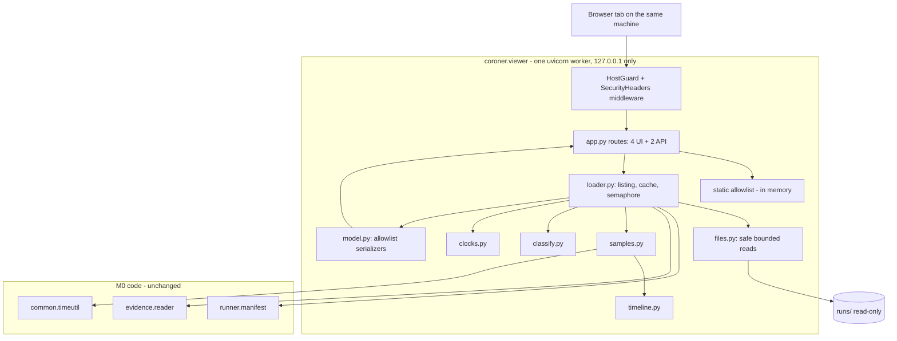
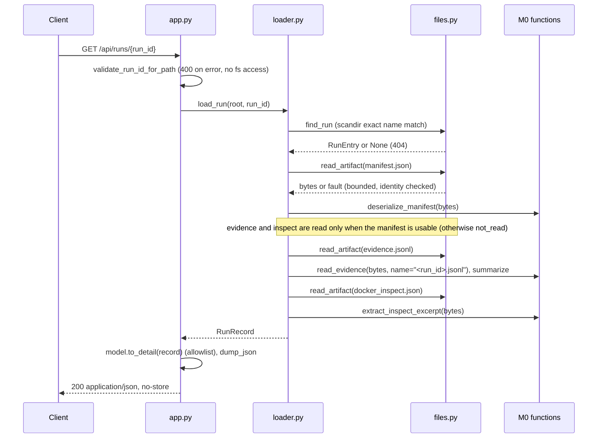

# Design Document: Coroner M1 (Forensic Viewer)

## Overview

Coroner M1 adds the **Viewer**: a read-only, localhost-only web workstation over the saved M0 run artifacts (`runs/<run_id>/manifest.json`, `evidence.jsonl`, `docker_inspect.json`). It answers one question for a dead container: what do we know, what evidence survived, and what remains uncertain. It shows the three M0 crash scenarios side by side to make one point: the same exit code does not always mean the same failure (Experiment_B and Experiment_C both exit 137; only OOMKilled differs).

The Viewer is a new package `coroner.viewer` (FastAPI, vanilla JavaScript, no build step, no npm, no database, no Docker). It changes no M0 code, schema, image, or artifact.

### Key design decisions (summary)

The full register is in "Design Decisions". The headline decisions:

1. **Bytes in, never paths.** Every artifact is read through one function (`files.read_artifact`) that returns at most 16 MiB plus 1 byte. The bytes go to the M0 functions `deserialize_manifest`, `read_evidence(bytes, name=...)`, `summarize`, `extract_inspect_excerpt`. The path-based M0 functions (`read_manifest(Path)`, `read_evidence(Path)`, `build_summary`) are never called.
2. **Containment by construction, then verification.** Run directories are found by listing the resolved Runs_Directory with `os.scandir` and matching the exact entry name. The Viewer never builds a path from a request string. Links and reparse points are rejected before and after opening, and the opened handle must have the identity of the checked entry.
3. **Server computes, browser draws.** The Python side parses, classifies, formats timestamps, derives the Experiment_B correction and the ordering suppression rule, selects chart points, computes the chart axis domain and tick labels, and serialises through explicit allowlists. The JavaScript side builds DOM nodes with `textContent` and draws SVG. The browser never parses or rounds a timestamp.
4. **Observed facts and interpretation stay apart.** The API carries observed values and, in a separate `runner_text` block, the M0 strings recorded by the Runner. The Viewer never creates a cause, a confidence, or a missing Sample.
5. **Null stays null.** An absent, null, wrong-typed, or out-of-range value becomes JSON `null`. It never becomes `0`, `false`, or `""`.
6. **One cheap cache with a stated limit.** `/api/runs` needs a Sample count and a discrepancy flag per run. The Viewer re-checks the `stat` signature of each artifact on every request and re-parses only when a signature changed. A rewrite that keeps the size, modification time, and file identity (deliberate metadata forgery) is not detected, and the documents say so.
7. **Loopback only, hostile-page safe.** Literal `127.0.0.1` bind, exact Host header check (DNS rebinding defence) in the pure function `host_allowed(host, port)` (which also accepts the two hostnames without a port when the port is 80), `GET` only, no CORS, strict CSP, `no-store`.

### What the real runs show (read-only inspection of `runs/`)

These shapes drove the design:

- `runs/` holds about 300 entries but only 9 run directories with a `manifest.json` (A: 5, B: 2, C: 2). The rest are loose files and scratch directories, several of which also match `RUN_ID_RE` (for example `t31`, `m07-71`). Discovery must skip them silently, and "valid name" alone is not "is a run".
- Manifests store absolute Windows paths (`raw_inspect_path`, `docker_inspect_path`, `evidence.host_copy_path`). These must never reach a response.
- `clock_offset_uncertainty_ms` is a float (`12.5375`); `clock_offset_ms` is an int (`9`, `14`).
- Docker `State.FinishedAt` has nine fractional digits (`2026-11-20T21:13:21.760545826Z`); the manifest `container_finished_at` is the same instant truncated to milliseconds (`...21.760Z`).
- Experiment B manifest: `times.sigkill_sent_time` set, `times.crash_request_time` null, `sample_timing` object. Experiment A: `times.crash_request_time` set, `sample_timing` null. Experiment C: `sampling_limitations.statements[]` set.
- Experiment B evidence: 17 valid records (15 Samples plus `run_metadata` and `termination`), and manifest `evidence.record_count` is 17, which is `len(ReadResult.records)`.

## Architecture

### Repository and module layout

```text
coroner/viewer/
  __init__.py       VIEWER_VERSION only; imports nothing heavy
  __main__.py       `if __name__ == "__main__": raise SystemExit(main())` (import-safe)
  cli.py            parse_args, validate_host/port, build_server_config, main
  app.py            create_app(runs_dir, port, ...) -> FastAPI; routes; static allowlist
  hostcheck.py      host_allowed (pure), HostGuard (pure ASGI), SecurityHeaders (pure ASGI), MethodGuard helper
  files.py          safe bounded file access: RunsRoot, list_run_entries, find_run, read_artifact
  timefmt.py        display_utc_ms, display_docker, epoch_ms_*, Docker_Time_Parser (local parse_docker_time)
  samples.py        Sample extraction from ReadResult, first/peak/last, last persisted, latest capture
  timeline.py       select_points (deterministic cap), gap detection, segment styles, axis domain and ticks, build_chart
  clocks.py         time axis mode, offset resolution (conflicts), corrected capture, ordering rule, derived intervals
  classify.py       experiment type, verdict, Docker state source + discrepancies
  model.py          internal dataclasses, API serializers (explicit allowlists), capped(), dump_json
  loader.py         artifact bytes -> RunRecord / ListFacts, listing in Run_Order, not_read, cache, load semaphore
  compare.py        /compare query validation (a, b, c; 400 for unknown, repeated, or empty parameters)
  static/
    index.html      one shell for all three pages
    app.js          router and page bootstrap
    api.js          fetch with error states
    dom.js          el(), text(), clear() helpers (createElement + textContent only)
    copy.js         every user-visible string (single place)
    overview.js  incident.js  evidence-panel.js  chart.js
    compare.js      compare page rendering
    compare-logic.js  pure comparison predicates (no DOM, no import; also run by the Node vector test)
    style.css       tokens, layout, components
```

Everything outside `coroner/viewer/` is unchanged by the implementation, except the tasks-phase test updates listed under "Import boundaries".

### Dependencies and requirements files

Verified against `requirements/*.txt` (all exact pins):

| Need | Pin | Present in |
|---|---|---|
| `fastapi` | `fastapi==0.115.6` | `collector.txt`, `demo_app.txt`, `dev.txt` |
| `starlette` | `starlette==0.41.3` | same |
| `uvicorn` | `uvicorn==0.34.0` | same |
| `anyio`, `pydantic` (FastAPI internals) | `anyio==4.16.0`, `pydantic==2.14.3` | same |
| Tests: `TestClient`, `httpx`, `hypothesis`, `pytest` | `httpx==0.28.1`, `hypothesis==6.122.3`, `pytest==8.3.4` | `dev.txt` |

**No new pin is needed and no requirements file is added.** The structure test requires the exact file set `EXPECTED_FILES` and exact pins, so adding `requirements/viewer.txt` would also force test changes. The Viewer runs from the host dev environment (`dev.txt`), is not copied into any Docker image, and the Dockerfiles stay unchanged (they `COPY` only `common`, `evidence`, `collector`, `probe`, `demo_app`). Verified in the project venv: FastAPI 0.115.6, Starlette 0.41.3, uvicorn 0.34.0, httpx 0.28.1. `uvicorn.Config` accepts every option used here (`server_header`, `proxy_headers`, `ws`, `lifespan`, `h11_max_incomplete_event_size`, `limit_concurrency`).

### Import boundaries

Verified by importing in a fresh interpreter:

- `import coroner.runner.manifest, coroner.evidence.reader` loads only `coroner`, `coroner.common.{envparse,timeutil}`, `coroner.evidence.{gaps,reader,schema,writer}`, `coroner.runner`, `coroner.runner.manifest`. It does not load `subprocess`, `urllib.request`, `http.client`, or `socket`. All package `__init__.py` files except `probe` are empty.
- `import coroner.runner.experiments.base` loads `subprocess`, `urllib.request`, `coroner.runner.docker_port`, and `coroner.runner.collector_client`.

Therefore `parse_docker_time` (defined in `coroner/runner/experiments/base.py`) **cannot be imported by the Viewer** without breaking the "no `docker_port`, no subprocess" boundary. The approved decision (Q1) is a local Docker_Time_Parser (`timefmt.parse_docker_time`) pinned to the M0 function by a parity test that imports `base.parse_docker_time` **in the test only**. The M0 function is neither moved nor edited, and the Viewer never imports `coroner.runner.experiments.base`. See "Docker time parsing".

**Exact reused set.** Requirement 12 criterion 10 lists the M0 functions and constants that feed the Source Field Map. The Viewer imports exactly these, plus the M0 types and exceptions that the listed functions return or raise (types carry no behaviour of their own):

| Kind | Names | Module | Used in |
|---|---|---|---|
| Functions | `deserialize_manifest`, `extract_inspect_excerpt`, `validate_run_id_for_path` | `coroner.runner.manifest` | `loader.py`, `files.py`, `classify.py`, `app.py` |
| Functions | `read_evidence`, `summarize` | `coroner.evidence.reader` | `loader.py`, `samples.py` |
| Functions | `parse_utc_ms`, `format_utc_ms` (public; the private `_fmt` is never used) | `coroner.common.timeutil` | `timefmt.py`, `clocks.py`, `samples.py`, `timeline.py` |
| Constants | `UNOBSERVED_NOTE` | `coroner.evidence.reader` | `model.py` (returned unchanged as `evidence_summary.unobserved_interval_note`) |
| Constants | `RUN_ID_RE` | `coroner.evidence.schema` | reached only through `validate_run_id_for_path`; tests reference it |
| Types and exceptions | `ReadResult`, `RunSummary` | `coroner.evidence.reader` | `loader.py`, `samples.py` (annotations) |
| Types and exceptions | `RunManifest`, `InspectExcerpt`, `ManifestError`, `InspectError`, `RunIdError` | `coroner.runner.manifest` | `loader.py`, `classify.py`, `app.py` (annotations and `except` clauses) |

Not imported: `CLOCK_TOLERANCE_MS` and `classify_b_samples` (`coroner.runner.evaluate`), `NONE_RECEIVED`, `UNKNOWN_CAUSE`, `MANIFEST_FILE_NAME`, `parse_docker_time`, `_fmt`. The Viewer returns `sample_timing.tolerance_ms` exactly as recorded and validates it against its own constant `VIEWER_CLOCK_TOLERANCE_MAX_MS = 250` in `clocks.py`, documented as mirroring the M0 `CLOCK_TOLERANCE_MS`; a Valid_Tolerance is a JSON `int` (a `bool` is excluded) from 0 to 250 inclusive. The M0 constant is not imported by any Viewer module; a parity test (`test_tolerance_parity.py`) imports `coroner.runner.evaluate.CLOCK_TOLERANCE_MS` in test code only and asserts equality with the Viewer constant, so the copy cannot drift silently. M0 is not changed. The Viewer shows `last_sample_time` and `termination_cause` text unchanged and never parses it, so it needs no sentinel constant.

Allowed imports for `coroner.viewer`:

| Import | Allowed in | Used for |
|---|---|---|
| stdlib (`os`, `stat`, `json`, `re`, `math`, `bisect`, `collections`, `dataclasses`, `enum`, `threading`, `logging`, `argparse`, `datetime`, `time`, `pathlib`, `typing`) | all modules | |
| `fastapi`, `starlette` | `app.py`, `hostcheck.py` | HTTP layer |
| `uvicorn` | `cli.py` only | server |
| the exact reused set above | the modules named there | M0 reuse |

Forbidden: `coroner.collector`, `coroner.probe`, `coroner.demo_app`, every other `coroner.runner` module (`docker_port`, `cli`, `collector_client`, `summary`, `evaluate`, `experiments*`), and the stdlib modules `subprocess`, `socket`, `urllib`, `http.client`, `shutil`, `ctypes`, `multiprocessing`. (`socket` is used by uvicorn, not by Viewer source.)

**Reconciliation with `tests/unit/test_structure.py`** (read; not edited now). The file has package-level rules (`PACKAGES`, `IMPORTABLE`, `ALLOWED_COMPONENTS`, `STDLIB_ONLY`, `third_party_for`) and the whole-tree fresh-interpreter import test. Required updates, for the tasks phase:

1. `PACKAGES += ("viewer",)` and `IMPORTABLE += ("coroner.viewer",)`.
2. `ALLOWED_COMPONENTS["viewer"] = frozenset({"evidence", "common", "runner"})`. This rule is package-level, so it would also allow `coroner.runner.docker_port`; the finer rule is a new test (below).
3. `third_party_for("viewer")` must return the pins of `requirements/collector.txt` (no `viewer.txt` exists). `viewer` must not be in `STDLIB_ONLY`.
4. Add detection cases to `test_checker_detects_prohibited_imports` for `viewer` (for example `import coroner.collector`, `from coroner.probe import x`, `import docker`, `import yaml`, `from coroner.runner.experiments.base import parse_docker_time`) and acceptance cases to `test_checker_accepts_allowed_imports` (`import fastapi`, `from coroner.evidence import reader`).
5. A new file `tests/unit/viewer/test_import_boundary.py` enforces the module-level rule in the tables above (from `runner` only `runner.manifest`; no `runner.experiments.base`; `uvicorn` only in `cli.py`; none of the forbidden stdlib modules) using the same AST helper `imported_modules`. The parity test file is the only Viewer test that imports `coroner.runner.experiments.base`.
6. `test_every_module_imports_in_one_fresh_interpreter` will import `coroner.viewer.__main__`; `__main__.py` is guarded by `if __name__ == "__main__":` so the import has no side effects. `coroner.viewer.cli` must not parse `sys.argv` at import time.
7. Existing assertion `int(proc.stdout.strip()) >= len(IMPORTABLE) - 1` remains true.

No test may assert that `subprocess` is absent from `sys.modules` after importing the Viewer: `asyncio` and `anyio` import it. The boundary is enforced on Viewer source by AST, not on the process.

### Component diagram



### Request flow for one artifact



### Runtime topology and trust boundaries

- The Viewer is a host process. It opens one listening socket on `127.0.0.1:<port>`. It opens no other socket, starts no subprocess, and does not talk to Docker, the Collector, or the Demo_App.
- The Runs_Directory is the trust boundary. Everything under it is **untrusted data** (a manifest or evidence file could be hostile or corrupt): sizes are bounded, names are matched, types are checked, strings are returned as data only.
- The browser is a second boundary. Hostile web pages in other tabs are blocked by the Host check (rebinding), the absence of CORS headers, and `GET`-only routes. The UI inserts artifact text only with `textContent`.
- Protected Docker volumes are never referenced by the Viewer. It has no Docker dependency to reference them with.

## Components and Interfaces

### M0 functions used (signatures verified in the source)

| Function or constant | Module | Signature or value | Verified behaviour that the design relies on |
|---|---|---|---|
| `deserialize_manifest` | `coroner/runner/manifest.py` | `(data: bytes) -> RunManifest` | Raises `ManifestError` (a `ValueError`) for bad UTF-8, bad JSON, or invalid shape. It catches `UnicodeDecodeError` and `ValueError` only, so `RecursionError` from deeply nested JSON escapes; the Viewer catches it. NaN/Infinity are accepted by `json.loads` here, so `extra` values can be non-finite. |
| `validate_run_id_for_path` | same | `(run_id: object) -> str` | `RUN_ID_RE.fullmatch`; raises `RunIdError` (not `ManifestError`). Trailing newline is rejected because `fullmatch` is used. |
| `extract_inspect_excerpt` | same | `(raw: bytes \| str) -> InspectExcerpt` | `json.loads(raw)`; raises `InspectError` (a `ValueError`) with `__cause__` set to the JSON error for invalid JSON, and without a JSON cause for shape problems. Requires a 64-character `Id`. Does not return `FinishedAt`. `RecursionError` escapes. |
| `InspectExcerpt` | same | frozen dataclass `(id, status, oom_killed, exit_code, memory)` | `exit_code` is an int and not a bool, `oom_killed` is a bool. |
| `RunManifest` | same | dataclass: `experiment, run_id, outcome, start_time, end_time, durability_level, termination_description, expected, failure, container_state, evidence, extra, schema_version` | `extra` holds every non-core top-level key (`times`, `checks`, `sample_timing`, `clock_offset_ms`, `clock_offset_uncertainty_ms`, `container_finished_at`, `termination`, `collector_health`, `diagnostics`, `sampling_limitations`, `limitations`). `container_state: ContainerState \| None` has `status, exit_code, oom_killed, container_id, host_config_memory_bytes, inspect_time, raw_inspect_path, raw_inspect_excerpt`. `evidence: EvidenceRef \| None` has `record_count`. Core field types are validated; `extra` is untyped. |
| `read_evidence` | `coroner/evidence/reader.py` | `(source: Path \| bytes, *, name: str \| None = None) -> ReadResult` | Accepts `bytes`, `bytearray`, `memoryview`. With `name="<run_id>.jsonl"` the file-context rule applies (a record whose `run_id` differs is `invalid_record`), the same call `build_summary` makes. Never raises on content. |
| `ReadResult` | same | `path: str`, `records: list[Mapping]`, `line_numbers: list[int]` (parallel), `errors: list[ReadError]` | **File order is preserved**: `records` is appended inside a single in-order loop over lines, and `line_numbers` is parallel. Verified by reading the loop. |
| `ReadError` | same | `file, line_no, byte_length, kind, detail, has_repair_record` | `detail` may quote record values (up to 80 chars), so the Viewer returns `kind`, `line_no`, `byte_length` only. |
| `summarize` | same | `(result: ReadResult) -> RunSummary` | `sample_count`, `missing_sample_count`, `unreconciled_drop_count`, `unreconciled_drop_uncertain`, `unreconciled_drops` (dicts `gap_id, count, uncertain, reason`), `malformed_line_count`, `silence_intervals`, `last_sample_time` (the last `sample` record's `recv_time` in file order, or `"none received"`), `termination_cause` (`"unknown"` when none), `unobserved_interval_note`, `durability_levels`, `read_errors`, `warnings`. May raise `GapRecordError` only for hand-built results; the Viewer still catches `Exception`. |
| `UNOBSERVED_NOTE` | same | string constant | Returned unchanged as `evidence_summary.unobserved_interval_note` when the evidence is `ok`; the UI shows the text unchanged (Requirement 7 criterion 3). |
| `RUN_ID_RE` | `coroner/evidence/schema.py` | `^[A-Za-z0-9][A-Za-z0-9._-]{0,63}$` | Always `fullmatch`; the Viewer reaches it only through `validate_run_id_for_path`. |
| Sample record shape | `coroner/evidence/schema.py` | `{"record_type":"sample","schema_version":1,"run_id","recv_time","sample":{"run_id","seq","ts","rss_bytes","request_count","loop_delay_ms","pid","container_id","container_id_source","interval_ms","dropped"}}` | `ts` is validated by `parse_utc_ms` (exactly three fractional digits and `Z`). `rss_bytes` is a non-negative int (never a bool) or `null`. `seq` is a non-negative int. So an invalid `ts` or negative RSS cannot appear in `records`; such a line is a Malformed_Line. |
| Gap record shapes | same | `sequence_discontinuity`: `first_missing_seq, last_missing_seq, missing_count, detected_at_seq`. `probe_reported_drop`: `range_status` in `known/uncertain/unknown`, first/last are ints only when `known`. `silence_timeout`: `last_sample_time, detected_time, threshold_ms, sample_count: "unknown"`. | Viewer reads only these documented fields; it does not import the private `_gap_range`. Counts always come from `summarize`. |
| `format_utc_ms` | `coroner/common/timeutil.py` | `(value: datetime) -> str` | Public. UTC, three fractional digits, **truncates** sub-millisecond digits (never rounds). Raises `ValueError` for a naive datetime. |
| `parse_utc_ms` | same | `(text: str) -> datetime` | Public. Strict `YYYY-MM-DDTHH:mm:ss.sssZ`; raises `ValueError`/`TypeError`. |
| `parse_docker_time` | `coroner/runner/experiments/base.py` | `(text: object) -> datetime \| None` | Regex `([0-9]{4})-([0-9]{2})-([0-9]{2})T([0-9]{2}):([0-9]{2}):([0-9]{2})(?:\.([0-9]{1,9}))?Z` with `fullmatch`; returns `None` for a non-`str`, no match, `year <= 1` (the zero value), or a `datetime` `ValueError`; keeps six fractional digits (`((frac or "") + "000000")[:6]`). **Not imported by the Viewer**; the parity test imports it (Q1). |
| `_fmt` | `base.py` | private helper | **Never used.** The Viewer calls the public `format_utc_ms` (Q2). |
| `classify_b_samples`, `CLOCK_TOLERANCE_MS` | `coroner/runner/evaluate.py` | | **Not imported.** The Viewer reuses only the sign convention `corrected = ts - clock_offset_ms`, which Requirement 15 criterion 5 states itself, and keeps its own constant `VIEWER_CLOCK_TOLERANCE_MAX_MS = 250` that mirrors `CLOCK_TOLERANCE_MS`; the parity test imports the M0 constant in test code only (Requirement 11 criterion 44). M0 validates `tolerance_ms` as an `int` in 0..250 (`evaluate.py`), which the Viewer's validity rule matches. |
| `build_summary` | `coroner/runner/summary.py` | `(runs_dir, run_id) -> Summary` | Calls `read_manifest(Path)` and `read_evidence(Path)`, both of which read whole files (`Path.read_bytes()`, `handle.read()`), so it has no size bound and follows links. The Viewer must not call it. Reusable pieces: the pattern `read_evidence(..., name=f"{run_id}.jsonl")`, and the rule `manifest.evidence.record_count != len(result.records)` for the record-count warning. Both are re-expressed in `loader.py`, not imported. |

### CLI (`cli.py`, `__main__.py`)

```python
DEFAULT_RUNS_DIR = "runs"; DEFAULT_HOST = "127.0.0.1"; DEFAULT_PORT = 8765

class ViewerConfigError(Exception): ...   # message is safe to print

@dataclass(frozen=True)
class ViewerArgs:
    runs_dir: str
    host: str
    port: int

def parse_args(argv: Sequence[str] | None = None) -> ViewerArgs: ...
def validate_host(host: str) -> str: ...        # only the exact string "127.0.0.1"
def validate_port(text: str) -> int: ...        # ASCII digits only, 1..65535
def build_server_config(app: FastAPI, args: ViewerArgs) -> uvicorn.Config: ...
def main(argv: Sequence[str] | None = None) -> int: ...
```

- `--runs-dir` (default `runs`), `--host` (default `127.0.0.1`), `--port` (default `8765`). `--port` is read as a string and validated by `validate_port` (so `"8765\n"`, `"+80"`, `"0x50"`, `"８０８０"` are rejected). Port 80 is a valid value (the Host rule for port 80 is in "Host guard"). `argparse` usage errors exit 2.
- A host other than the exact string `127.0.0.1` (including `localhost`, `::1`, `0.0.0.0`, and `127.0.0.2`) prints `error: the Viewer binds only to 127.0.0.1 (got '<host>')` to stderr and exits 2. The echoed value is cut to 64 characters and printed with `repr` so control characters are escaped.
- `main` returns 2 for every configuration error: invalid port (message names the value), runs directory missing or not a directory (message names the path as given on the command line; this is the operator's own input echoed to their terminal), host rejected.
- The server is `uvicorn.Server(uvicorn.Config(app, host="127.0.0.1", port=port, workers=1, reload=False, log_level="warning", access_log=False, lifespan="off", server_header=False, proxy_headers=False, ws="none", h11_max_incomplete_event_size=16384, timeout_keep_alive=5, limit_concurrency=64)).run()`. The host literal is a constant in `build_server_config`, not the parsed argument, so `localhost` is never resolved for binding, for every valid port including 80.
- `main` prints one start line to stdout: `Coroner Viewer: http://127.0.0.1:<port>/  (runs: <label>, read-only)`, where `<label>` is the Runs_Directory_Label defined under "Launch and Safety".
- **Testing the bind without a socket.** `cli.py` reaches uvicorn only through the name `uvicorn.Server` (and `uvicorn.Config`), so a test replaces `coroner.viewer.cli.uvicorn.Server` with a spy class that records the `Config` it receives and whose `run()` does nothing. The test then calls `main([...])` and `build_server_config(...)` and asserts `config.host == "127.0.0.1"` (the exact string, for every valid port including 80), `config.port` equals the validated port, and that the recorded host is never `localhost`, `0.0.0.0` or `::1`. No socket is created, so the unit-test network guards are never involved. The real bind, the HTTP request to `http://127.0.0.1:8765` and the Host-header checks against a running server are manual acceptance checks (see "Manual check with the real `runs/`").

### Application factory (`app.py`)

```python
def create_app(
    runs_dir: str | os.PathLike[str],
    port: int,
    *,
    runs_dir_label: str | None = None,
    io: ArtifactIO = DEFAULT_IO,
    cache: RunCache | None = None,
    clock_ns: Callable[[], int] = time.time_ns,
) -> FastAPI: ...
```

- Resolves the Runs_Directory once (`open_runs_root`), raising `ViewerConfigError` when it is missing or not a directory. `runs_dir_label` defaults to `make_runs_dir_label(runs_dir)`: the value as supplied when it is relative, and only its final path component when it is absolute (`os.path.isabs` is true or `os.path.splitdrive` gives a non-empty drive); this is the Runs_Directory_Label of Requirement 3 criterion 9.
- Builds `FastAPI(docs_url=None, redoc_url=None, openapi_url=None, redirect_slashes=False)`. No `response_model`, no dependency injection of artifact data, no CORS middleware, no `StaticFiles` mount.
- Adds middleware, outermost first: `SecurityHeaders`, `HostGuard(port)`. Both are pure ASGI classes, so they run for 404, 405, and exceptions as well as for handlers. `HostGuard` is inside `SecurityHeaders` so a 421 or 400 still carries `Cache-Control: no-store`.
- Handlers are plain `def` functions (FastAPI runs them in its thread pool), so blocking file reads never block the event loop.
- The detail handler wraps its load in `try/except Exception`, and a catch-all `Exception` handler backs it up for every other route. Both return `500 {"error":{"code":"internal_error","message":"Unexpected error."}}` with a fixed message, no exception text, no host path, and no traceback, and log only the exception class name and the run id (Requirement 9 criterion 10, Q14). The listing builder wraps **each run** in its own `try/except Exception`, so a failure for one run only turns that entry into an UNKNOWN entry with `reason` `internal_error`, and `GET /api/runs` still returns 200 (Requirement 3 criterion 18).

#### HTTP contract

| Method and path | Success | Errors |
|---|---|---|
| `GET /` | 200 `text/html` (`index.html`) | |
| `GET /runs/{run_id:path}` | 200 `text/html` (same shell) | 400 invalid id; 404 valid id, no Run_Directory |
| `GET /compare?a=&b=&c=` | 200 `text/html` (same shell) | 400 (code `invalid_query` or `invalid_run_id`) for an invalid, empty, or repeated `a`/`b`/`c`, or any unknown parameter, with no file access (Q13). A valid id with no run is still 200 (the page shows the slot as unavailable). |
| `GET /static/{asset:path}` | 200 with a fixed content type | 404 for every name not in the allowlist |
| `GET /api/runs` | 200 `application/json` (also when one run fails unexpectedly: that entry has `reason` `internal_error`) | |
| `GET /api/runs/{run_id:path}` | 200 `application/json` | 400 invalid id; 404 no Run_Directory; 500 coded body for an unexpected error |
| any path with a method other than `GET` (including `HEAD`, `OPTIONS`) | | 405 with `Allow: GET` |
| any unregistered path | | 404 |
| bad Host header | | 421 wrong value; 400 missing or repeated |

Design points:

- **`{run_id:path}`.** The run routes use the `path` converter so that `..%2Fx`, `a%2Fb`, `a/b`, and an empty id reach the handler and get HTTP 400 from `validate_run_id_for_path`. With the default converter they would be HTTP 404 (verified with the pinned Starlette: `/api/runs/a%2Fb` decodes to `a/b` and `{run_id:path}` receives it). `redirect_slashes=False` keeps `/api/runs/` from redirecting; it is handled as the empty id (400).
- **405 behaviour.** FastAPI `@app.get` registers `GET` only. The pinned Starlette answers `HEAD`, `OPTIONS`, `POST`, `PUT`, `PATCH`, and `DELETE` on a registered path with 405 and `Allow: GET` (verified with `TestClient`). No `HEAD` route is added. Tests assert the behaviour for every registered route, and a unit test asserts the registered route set. If a future Starlette changes this, `MethodGuard` (a small ASGI check in `hostcheck.py`, enabled by the same test failing) enforces it before routing.
- **Docs endpoints.** `docs_url`, `redoc_url`, `openapi_url` set to `None` makes `/docs`, `/redoc`, `/openapi.json` unregistered, so they return 404.
- **Error bodies.** API errors are `{"error":{"code":"<stable>","message":"<fixed text>"}}`. Codes: `invalid_run_id`, `invalid_query`, `not_found`, `method_not_allowed`, `misdirected_host`, `missing_host`, `internal_error`. UI routes return a fixed one-line message as `text/plain; charset=utf-8` and do not carry the JSON body or the code. The `/compare` route is an explicit exception to "the same body": an invalid `a`, `b` or `c` (invalid, empty, repeated or unknown parameter) returns HTTP 400 with `Content-Type: text/plain; charset=utf-8` and the fixed body `Invalid compare parameter.` followed by one line feed (`Invalid compare parameter.\n`); the codes `invalid_run_id` and `invalid_query` are used inside the Viewer only and do not appear in the body. Messages are fixed strings; they never echo the request value.
- **Static allowlist.** At start-up `app.py` scans the package `static/` directory once with `os.scandir`, keeps only regular files whose names match `^[a-z0-9][a-z0-9._-]*\.(html|js|css)$`, reads each into memory, and records its content type (`text/html; charset=utf-8`, `text/javascript; charset=utf-8`, `text/css; charset=utf-8`). `/static/{asset}` is a dictionary lookup, so `..`, `/`, `\`, `C:`, or an unknown name is a 404 with no file access. Nothing under the Runs_Directory is reachable.
- **Headers.** `SecurityHeaders` adds to every response: `Cache-Control: no-store`, `X-Content-Type-Options: nosniff`, `Referrer-Policy: no-referrer`, `Cross-Origin-Resource-Policy: same-origin`, and for `text/html` responses `Content-Security-Policy: default-src 'none'; script-src 'self'; style-src 'self'; img-src 'self'; font-src 'self'; connect-src 'self'; base-uri 'none'; form-action 'none'; frame-ancestors 'none'` and `X-Frame-Options: DENY`. It removes any `Access-Control-*` header and never adds one. API responses carry `Content-Type: application/json`.
- **No inline styles.** CSP `style-src 'self'` blocks `style=""` attributes and `setAttribute("style", …)`. The UI uses CSS classes, SVG presentation attributes, and CSSOM property assignment (`el.style.width = …`), which CSP allows.

### Host guard (`hostcheck.py`)

The acceptance rule is a **pure function** so every case, including port 80, is testable without binding a socket:

```python
def host_allowed(host_header: str, port: int) -> bool: ...
```

- Allowed values are exactly `127.0.0.1:<port>` and `localhost:<port>`, where `<port>` is the canonical decimal form of `port` (no sign, no leading zero, no whitespace).
- WHEN `port == 80`, the two hostnames **without** a port (`127.0.0.1`, `localhost`) are also allowed, because a browser omits the default HTTP port. `127.0.0.1:80` and `localhost:80` stay allowed.
- Hostnames are exactly `127.0.0.1` and `localhost`, lower case, compared case-sensitively and byte for byte (`LOCALHOST:<port>`, `Localhost`, and `127.0.0.1.evil.test:<port>` are rejected). `[::1]`, `[::1]:<port>`, `localhost:<other port>`, `127.0.0.1` or `localhost` without a port when `port != 80`, a value with a trailing character or space, and the empty string are rejected.
- No parsing is involved: the function compares the header to a set of at most four literal strings, so there is no parser to get wrong.

`HostGuard(app, port)` is the ASGI wrapper. It reads the raw `host` entries from `scope["headers"]`:

1. Zero `Host` headers or more than one: 400 `missing_host`.
2. The single value is decoded as `latin-1` (lossless for bytes) and passed to `host_allowed(value, port)`. `False`: 421 `misdirected_host`.

The guard uses no `X-Forwarded-*` header (`proxy_headers=False`). The accepted `localhost` hostname never affects the bind: the socket is created for the literal `127.0.0.1` only (see "CLI"), so the Viewer does not listen on `::1` or any other address in either case. With `--port 80` the same literal bind applies; whether an unprivileged process may bind port 80 is an operating-system matter, and a bind failure is reported by uvicorn and ends the process with a non-zero status. The earlier "port 80 is unusable from browsers" limitation no longer exists (Q10, resolved).

### Safe file access (`files.py`)

This is the most security-relevant module.

```python
ARTIFACT_LIMIT = 16_777_216          # 16 MiB, a size exactly equal to the limit is allowed
READ_LIMIT = ARTIFACT_LIMIT + 1      # the most bytes ever requested in total
READ_CHUNK = 1_048_576

class ArtifactName(str, Enum):
    MANIFEST = "manifest.json"; EVIDENCE = "evidence.jsonl"; INSPECT = "docker_inspect.json"

class ArtifactFault(str, Enum):      # error taxonomy; values are the stable reason codes
    MISSING = "missing"                    # entry absent
    NOT_REGULAR = "not_regular_file"       # directory, device, FIFO, socket
    UNSAFE_PATH = "unsafe_path"            # symlink, junction, other reparse point, outside Runs_Directory, identity changed
    TOO_LARGE = "too_large"
    UNREADABLE = "unreadable"              # OSError other than absence; message never returned
    INVALID = "invalid"                    # set by loader.py after parsing fails

class ArtifactStatus(str, Enum):     # the six Artifact_Status values (Glossary; Requirement 9 criterion 9)
    OK = "ok"; MISSING = "missing"; UNREADABLE = "unreadable"; INVALID = "invalid"
    TOO_LARGE = "too_large"; NOT_READ = "not_read"      # NOT_READ is assigned by loader.py only; files.py never produces it

# API status of a fault (Requirement 16 criteria 2 and 4: links and non-regular files are `missing`)
STATUS_OF = {MISSING: ArtifactStatus.MISSING, NOT_REGULAR: ArtifactStatus.MISSING, UNSAFE_PATH: ArtifactStatus.MISSING,
             TOO_LARGE: ArtifactStatus.TOO_LARGE, UNREADABLE: ArtifactStatus.UNREADABLE, INVALID: ArtifactStatus.INVALID}

@dataclass(frozen=True)
class RunsRoot:
    real: str            # resolved absolute path; never serialised or logged
    label: str           # display label, see "Launch and safety"

@dataclass(frozen=True)
class RunEntry:
    run_id: str
    present: frozenset[ArtifactName]     # exact-name entries found by scandir (any kind)
    dir_id: tuple[int, int]              # (st_dev, st_ino) of the run directory at listing time

@dataclass(frozen=True)
class ArtifactRead:
    name: ArtifactName
    fault: ArtifactFault | None
    reason: str | None                   # finer stable code, for example "symlink_or_reparse_point"
    data: bytes | None                   # set only when fault is None; len(data) <= ARTIFACT_LIMIT
    signature: tuple[int, int, int, int] | None   # (size, mtime_ns, dev, ino) of the verified entry

class ArtifactIO(Protocol): ...          # scandir, lstat, open, fstat, read, close, realpath (test seam)
DEFAULT_IO: ArtifactIO

def open_runs_root(runs_dir: str | os.PathLike[str]) -> RunsRoot: ...
def list_run_entries(root: RunsRoot, io: ArtifactIO = DEFAULT_IO) -> list[RunEntry]: ...
def find_run(root: RunsRoot, run_id: str, io: ArtifactIO = DEFAULT_IO) -> RunEntry | None: ...
def read_artifact(root: RunsRoot, run: RunEntry, name: ArtifactName,
                  io: ArtifactIO = DEFAULT_IO) -> ArtifactRead: ...
```

#### Containment algorithm

**Start-up (once).**

1. `real = os.path.realpath(runs_dir, strict=True)`. It must be a directory (`os.stat` follows the link the operator chose; a Runs_Directory that is itself a symlink to a directory is allowed because the operator named it). Otherwise `ViewerConfigError`.
2. Keep `real` in `RunsRoot`. Every later path is `join(real, <name from scandir>, <fixed artifact name>)`.

**Listing (`list_run_entries`, per request).**

1. `os.scandir(root.real)`. For each entry:
2. Name check: `validate_run_id_for_path(entry.name)`; on `RunIdError` skip.
3. `st = entry.stat(follow_symlinks=False)` (an `lstat`; on error skip). Skip when `stat.S_ISLNK(st.st_mode)`, or on Windows when `st.st_file_attributes & FILE_ATTRIBUTE_REPARSE_POINT (0x400)` (this covers symlinks, junctions, mount points, and OneDrive placeholders), or when `not stat.S_ISDIR(st.st_mode)`.
4. `os.scandir(join(root.real, name))`; collect entries whose name equals exactly one of the three artifact names (case-sensitive, so a Windows alias such as `MANIFEST.JSON` is not a match). If `manifest.json` is not among them the directory is not a run: skip it silently. A `manifest.json` that is a link or a directory still counts as present, so the run is listed as UNKNOWN with a reason (Requirement 3 criterion 13).
5. Record `(st_dev, st_ino)` of the directory.

**Lookup (`find_run`).** Validate the id first (`validate_run_id_for_path`; the caller returns 400 on `RunIdError`). Then run the same listing logic and return the entry whose name equals the id exactly. The id is **never** joined into a path: only names returned by `scandir` are. This removes four Windows hazards at once: reserved device names (`con`, `nul`, `com1`, which match `RUN_ID_RE`), case-insensitive aliases (`A-2026…` for `a-2026…`), trailing-dot aliases (`x.` for `x`), and short names (8.3 names contain `~`, which `RUN_ID_RE` does not allow). Cost is one `scandir` of the Runs_Directory (about 300 entries in the real repository).

**Read (`read_artifact`).**

1. If the name is not in `run.present`: fault `MISSING`.
2. Re-`lstat` the run directory and compare `(st_dev, st_ino)` with `run.dir_id`; mismatch: `UNSAFE_PATH`, reason `identity_changed`. Re-check it is not a reparse point.
3. `p = join(root.real, run.run_id, name.value)`; `pre = io.lstat(p)`. A link or reparse point: `UNSAFE_PATH`, reason `symlink_or_reparse_point`. Not `S_ISREG`: `NOT_REGULAR`.
4. `real_p = io.realpath(p, strict=True)`. After `os.path.normcase`, its parent must equal `normcase(realpath(run directory))`, and that must lie under `normcase(root.real)` with a separator boundary (not a bare string prefix, so `runs-evil` is not "inside" `runs`). Otherwise `UNSAFE_PATH`, reason `outside_runs_directory`.
5. Early rejection (allowed by Requirement 16 criterion 8): if `pre.st_size > ARTIFACT_LIMIT`: `TOO_LARGE`. This does not replace the bounded read.
6. `fd = io.open(p, O_RDONLY | O_BINARY | O_NOFOLLOW | O_CLOEXEC | O_NOINHERIT | O_NONBLOCK)`, using `getattr(os, flag, 0)` so absent flags are 0. `O_NOFOLLOW` exists on POSIX only; `O_NONBLOCK` stops a file swapped for a FIFO from hanging the open on POSIX.
7. `post = io.fstat(fd)`. Require `S_ISREG(post.st_mode)`, else close and `NOT_REGULAR`.
8. Identity: `(post.st_dev, post.st_ino) == (pre.st_dev, pre.st_ino)` when `pre.st_ino != 0`. Verified on this Windows host that `lstat` and `fstat` agree on both values for a regular file. If the inode is 0 (a filesystem without file ids), compare `(st_size, st_mtime_ns)` instead. Mismatch: close, `UNSAFE_PATH`, reason `identity_changed`. On Windows, where `os.open` follows reparse points, this check is what detects a swap-in between steps 3 and 6: a link entry has its own file id, which differs from its target's.
9. `io.realpath(p, strict=True)` again; it must equal `real_p` (best effort post-open check, Requirement 16 criterion 4).
10. Read from `fd` in chunks: `want = min(READ_CHUNK, READ_LIMIT - total)`; `b = io.read(fd, want)`; stop on empty `b` or when `total == READ_LIMIT`. The loop never requests more than `READ_LIMIT - total`, so the sum over all calls is at most `READ_LIMIT`, whatever `stat` said and however the file grows.
11. `finally: io.close(fd)`.
12. `total > ARTIFACT_LIMIT`: drop all chunks, fault `TOO_LARGE`, reason `too_large`. `total <= ARTIFACT_LIMIT` (including exactly 16,777,216): `data = b"".join(chunks)`.
13. Final `lstat` for the cache signature `(size, mtime_ns, dev, ino)`.
14. Any `FileNotFoundError` in steps 3 to 13: `MISSING` (the file disappeared). Any other `OSError`: `UNREADABLE`, reason `os_error`. The exception message and `filename` are discarded, because on Windows they contain absolute paths (Requirement 16 criterion 9).

Callers receive `ArtifactRead`, never a `Path`. The loader hands `data` to M0 and drops it; nothing keeps a path.

#### TOCTOU and residual risk

- Between steps 3 and 6 an entry can be swapped. The post-open identity and regular-file checks (steps 7 and 8) detect it before any byte is read. POSIX adds `O_NOFOLLOW`, which refuses a final-component link at the kernel level.
- A swap of a parent directory after step 2 is covered by the second `realpath` comparison and by the identity check on the opened file. The second `realpath` is a path-based check, not a handle-based one (`GetFinalPathNameByHandle` through `ctypes` is deliberately not used to keep the boundary simple). The primary guard is the handle identity check.
- Hard links cannot be detected from inside a directory and are not treated as a threat: they point to a file the operator already made reachable.
- A file that grows or shrinks during the read is covered by the read bound. A file that changes content between the first and last byte yields whatever bytes were read; the parse then either succeeds or reports `invalid`. The cache refuses to store such results (see "Performance").
- Threat model: a local, single-user developer machine where the Runs_Directory is user-owned. The checks defend against accidents (a stray junction, a huge log renamed to `evidence.jsonl`) and against a malicious artifact created by a tool, not against an attacker with concurrent write access to the repository.

#### Windows specifics

- **Reparse points.** `st_file_attributes & 0x400` on the `lstat` result rejects symlinks, junctions, mount points, and cloud placeholders. `DirEntry.is_junction` (Python 3.12, which the project requires) is not relied on because the attribute check is broader.
- **Case-insensitive names.** Exact-case entry matching against `scandir` output; `normcase` only for comparing resolved paths.
- **Reserved names and 8.3 names.** Neutralised by never joining the request id into a path (above).
- **Alternate data streams.** `:` is not in `RUN_ID_RE`, and artifact names are fixed.
- **`os.open` flags.** `O_BINARY` prevents newline translation and Ctrl-Z handling; `O_NOINHERIT` keeps the handle out of child processes (none are started).
- **Sharing.** Python opens with shared read/write/delete access, so a Runner writing a manifest concurrently is not blocked; atomic `os.replace` of the manifest means a reader sees either the old or the new file.
- **Long paths.** The root is resolved with `realpath`, which may return a `\\?\` form for very long paths; the containment comparison uses the same function on both sides.

### Classification and verdict (`classify.py`)

```python
def experiment_type(experiment: str | None) -> Literal["A", "B", "C"] | None: ...
def verdict_of(outcome: str | None) -> Literal["PASS", "FAIL", "UNKNOWN"]: ...
def resolve_docker_state(manifest: RunManifest | None, raw: RawInspect | None,
                         raw_fault: str | None) -> DockerView: ...
```

- **Experiment type.** `experiment.upper() in ("A", "B", "C")` on the manifest `experiment` string (the same rule `build_summary` applies). Any other string gives `None` and is shown as text. The Viewer never infers the type from ExitCode, OOMKilled, or the run id.
- **Verdict.** `passed` gives PASS, `failed` gives FAIL, anything else (`aborted`, unusable manifest) gives UNKNOWN. It is a pure function of `outcome`. Discrepancies, missing evidence, or ExitCode never change it.
- **Docker state source and precedence.** Two sources: Manifest_Derived_State (`manifest.container_state`) and Raw_Inspect (`docker_inspect.json` through `extract_inspect_excerpt`). The `source` code and its fixed UI label:

| `source` | Condition | UI label (Requirement 14) |
|---|---|---|
| `inspect_and_manifest_agree` | raw readable, manifest state present, no discrepancy | "Docker inspect (raw file and manifest agree)" |
| `inspect_and_manifest_disagree` | raw readable, manifest state present, at least one discrepancy | "Docker inspect and manifest disagree (see DISCREPANCY)" |
| `manifest_only` | manifest state present, raw unavailable | "manifest-derived (raw inspect unavailable)" plus the reason |
| `raw_only` | manifest `container_state` is null, raw readable | "raw inspect only (manifest has no container_state)" |
| `unavailable` | neither | values shown as "not recorded" |

`raw_unavailable_reason` is one of `missing`, `unreadable`, `invalid_json`, `rejected`, `too_large`, or `null` when raw is readable. `invalid_json` versus `rejected` is decided from `InspectError.__cause__` being a `ValueError` (JSON decoding failed) or not; error text is never parsed. A raw file that is unavailable for any of these reasons makes the whole raw block `null`, including the raw `FinishedAt`.

- **Effective values** (used for list cards, compare slots, and the headline numbers): per field, the manifest value when it is non-null, otherwise the raw value, otherwise `null`. With a discrepancy the card shows the manifest value and the DISCREPANCY marker, and the incident page shows both values side by side (Requirement 14 criterion 7). No field is ever filled with a default.
- **Compared fields and normalisation.**

| Field | Manifest side | Raw side | Equality rule |
|---|---|---|---|
| `container_id` | `container_state.container_id` | `InspectExcerpt.id` | exact string |
| `status` | `container_state.status` | `State.Status` | exact string |
| `exit_code` | `container_state.exit_code` | `State.ExitCode` | int equality (bool is never an int here) |
| `oom_killed` | `container_state.oom_killed` | `State.OOMKilled` | bool equality |
| `memory_limit_bytes` | `container_state.host_config_memory_bytes` | `HostConfig.Memory` | int equality (`0` is a value) |
| `finished_at` | top-level `container_finished_at` (`parse_utc_ms`) | `State.FinishedAt` (Docker parse) | both converted to a UTC datetime, then `format_utc_ms` (truncation to ms), then string equality. A side that is absent, the zero value, or unparseable is "not recorded" for that side. |

Per-field `result` is `equal`, `discrepancy`, `not_compared_manifest_missing`, `not_compared_raw_missing`, `not_recorded_both`, or `unparseable`. A discrepancy exists only when both sides are non-null and different (Requirement 14 criterion 7). A field recorded in exactly one source is `not_compared_…` and never a discrepancy.

- **ExitCode 137.** ExitCode and OOMKilled are two independent facts. The Viewer shows `137 / OOMKilled false` and `137 / OOMKilled true` as recorded and never states a cause. It does not infer OOMKilled from RSS, memory limit, or ExitCode, nor ExitCode from OOMKilled (Property 7).
- **Memory limit.** `0` gives `memory_limit_kind: "none_configured"` (UI: "0 bytes (no memory limit configured)"); a positive int gives `"bytes"`; `null` gives `null` (UI: "not recorded").

### Evidence assembly (`samples.py`, `loader.py`)

```python
@dataclass(frozen=True)
class SampleRow:
    file_pos: int           # index in ReadResult.records (file order)
    seq: int
    ts: str                 # Original_Timestamp (Capture_Time, Container_Clock)
    ts_ms: int | None       # epoch ms from parse_utc_ms; None if unparseable (defensive)
    recv: str               # Original_Timestamp (Receive_Time, Collector_Clock)
    rss: int | None         # None when null or invalid

def extract_samples(result: ReadResult) -> list[SampleRow]: ...        # file order
def is_plottable(row: SampleRow) -> bool: ...                          # rss is int >= 0 and ts_ms is not None
def capture_order(rows: Sequence[SampleRow]) -> list[SampleRow]: ...   # sort key (ts_ms, seq, file_pos)
def last_persisted(rows: Sequence[SampleRow]) -> SampleRow | None: ...   # rows[-1] in file order
def latest_capture(rows: Sequence[SampleRow]) -> SampleRow | None: ...   # max ts_ms, earliest file_pos on ties
def rss_stats(rows: Sequence[SampleRow]) -> RssStats: ...              # first, highest, last
```

- **Last_Persisted_Sample** is the last `sample` record in `ReadResult.records` (file order, verified). It is not `summarize().last_sample_time`, which is a Receive_Time string and is returned separately as `last_receive_time_summary`.
- **Latest_Capture_Sample** is the row with the maximum `ts_ms`; ties go to the earliest in file order.
- **Capture order** sorts by `(ts_ms, seq, file_pos)`. `file_pos` is only a final tie-break so the order is total even for hand-edited files.
- **First, highest, last RSS** (Requirement 12 criterion 8), computed from the Plottable_Samples of the full evidence: *first* is the first in Capture order; *highest* is the maximum `rss`, earliest in Capture order on ties; *last* is the Last_Persisted_Sample when it is plottable, otherwise the last plottable row in file order, with `basis` `"last_persisted"` or `"last_plottable_in_file_order"`.
- **Unplottable.** A valid Sample with `rss` null is counted in `unplottable_samples` and never plotted. Invalid `ts` or negative RSS cannot reach this stage (the reader quarantines them), but the code still guards `ts_ms is None` and counts such a row as unplottable.
- **Counts** `total_samples` is the number of `sample` records in `result.records`. The loader asserts it equals `RunSummary.sample_count`; `summarize` remains the source for every other count.
- **Record-count warning.** `manifest.evidence.record_count != len(result.records)` adds one Viewer warning with code `record_count_mismatch` (Requirement 5 criterion 8 and 11). If `manifest.evidence` is `null` while `evidence.jsonl` is readable, the count is `null`, no mismatch is claimed, and the file is still parsed.
- **Durability.** `evidence_summary.durability_levels` comes from `summarize`; `run.durability_level` comes from the manifest. They are shown separately and no extra warning is added (Requirement 5 criterion 11 limits Viewer-added warnings).
- **Evidence read name.** `read_evidence(data, name=f"{run_id}.jsonl")`, so a record from another run is a Malformed_Line, exactly as in `build_summary`.
- **Malformed lines.** The API returns `malformed_line_count` from `summarize` and at most 20 entries of `{line_no, byte_length, kind}` (`malformed_lines_truncated: true` when more exist). `ReadError.detail` is not returned.
- **Gaps.** Silence intervals (at most 50) and the unreconciled drop list (at most 50 entries of `{count, uncertain, reason}`) come from `summarize`. Chart gap marks come from `timeline.py` (below).

### Timeline (`timeline.py`)

```python
CHART_CAP = 5000

def select_points(plottable: Sequence[SampleRow], cap: int = CHART_CAP) -> list[int]: ...
def gap_index(result: ReadResult) -> GapIndex: ...
def segment_styles(selected: Sequence[SampleRow], order_pos: Mapping[int, int], gap_flags: Sequence[bool]) -> list[SegmentStyle]: ...
def x_axis(xs: Sequence[int], extra_x_ms: int | None) -> XAxis: ...
def nice_ticks(lo_ms: int, hi_ms: int) -> list[int]: ...
def build_chart(rows: Sequence[SampleRow], gaps: GapIndex, mode: AxisMode,
                offset_ms: int | None, cap: int = CHART_CAP, sigkill_x_ms: int | None = None) -> Chart: ...
```

`cap` is a parameter of `build_chart` only so that tests can pass a smaller value (Requirement 11 criterion 38). The HTTP layer always passes `CHART_CAP`.

**Deterministic selection.** Input is the Plottable_Samples in Capture order, `n = len(plottable)`.

```text
pseudocode: select_points(P, cap)
n = len(P)
if n <= cap: return [0 .. n-1]                      # full view
peak = index of the first maximum rss in P           # earliest in Capture order
extra = 0 if peak in (0, n-1) else 1
m = cap - extra                                      # number of evenly spaced indices
uniform = { (j * (n-1)) // (m-1)  for j in 0 .. m-1 }   # integer arithmetic only, includes 0 and n-1
return sorted(uniform ∪ {peak})
```

- Since `n > cap >= m`, consecutive uniform indices differ by `(n-1)/(m-1) > 1`, so they are distinct and `|uniform| = m`. The result has at most `m + extra = cap` entries, always contains the first, the last, and the peak, is strictly increasing (Capture order preserved), and contains only existing Samples. It depends only on `P`, so it is deterministic (Requirement 6 criteria 3 to 5; Property 1).
- Alternative considered: min/max per bucket (keeps spikes). Rejected as default because it picks about twice as many candidates and makes the "contains only evenly selected Samples" statement harder to explain. The peak is kept explicitly, and the UI labels the view "Partial view" with both counts.
- `chart.partial_view` is `plottable_samples > cap` **for that invocation**. `select_points` returns every index exactly when `n <= cap`, so `partial_view` is also `len(selected) < n`.
- **Statistics are computed before selection** from all rows, and neither `cap` nor the selection feeds a statistic (Property 2).

**Gap detection (full parsed evidence).** `gap_index` collects, from `result.records` in file order:

- *Sequence ranges*: `gap` records with `gap_type == "sequence_discontinuity"`, or `probe_reported_drop` with `range_status == "known"`, using their integer `first_missing_seq` and `last_missing_seq`. Merged into sorted disjoint intervals.
- *Silence positions*: the file position of every `gap` record with `gap_type == "silence_timeout"`.
- *Unknown-range drops*: `probe_reported_drop` with `range_status` `uncertain` or `unknown` have no position. They set `unknown_range_drop_present = true` (the UI states below the chart that the position of the drop is unknown and that a line may span it, Requirement 6 criterion 10) and never set `gap_before`.

For two consecutive plotted points `prev` and `cur`, `gap_before` is true when:

1. some sequence interval `[lo, hi]` intersects the open interval `(min(prev.seq, cur.seq), max(prev.seq, cur.seq))` (a `bisect` lookup, O(log g)), or
2. some silence position `g` satisfies `min(prev.file_pos, cur.file_pos) < g < max(prev.file_pos, cur.file_pos)` (a `bisect` lookup over sorted file positions).

The test uses the full evidence, not only the plotted subset, so it holds in Partial_View exactly as in full view (Property 11).

**Segment style (Requirement 6 criteria 9 and 25).** Each point carries `segment_before`, the style of the line segment that joins it to the previous plotted point:

```text
pseudocode: segment_before for point i of the plotted list
S      = all valid Samples with a parseable Capture_Time, in Capture order (plottable or not)   # the "full sequence"
pos(p) = index of p in S
if i == 0:                         "none"     # nothing before it
elif gap_before(i):                "none"     # an Evidence_Gap: no connector at all; the UI draws a labelled gap mark
elif pos(p_i) == pos(p_{i-1}) + 1: "solid"    # adjacent in the full sequence: no omitted observation between them
else:                              "dashed"   # omitted Plottable_Samples (stride) and/or Samples with no RSS lie between them
```

- `omitted_before = pos(p_i) - pos(p_{i-1}) - 1` is the number of valid Samples between the two points that are not plotted. `skipped_before` is the part of that number whose `rss_bytes` is `null`. So a `dashed` segment is exactly one with `omitted_before > 0`, in full view (only `skipped_before` can be positive) and in Partial_View (both can be).
- A gap takes precedence over a dashed style: a pair that has an Evidence_Gap between it has `segment_before: "none"` whatever `omitted_before` is.
- A segment that spans a probe-reported drop of unknown range cannot be detected; it is drawn as `solid` or `dashed` by the rules above, and the text below the chart says that a line may span the drop.
- The UI shows one legend entry, "dashed: omitted observations between these points", whenever at least one point has `segment_before == "dashed"`. A solid segment therefore always means two consecutive Samples of the evidence.

**X axis and ticks (Requirement 6 criteria 11 and 23).** The browser parses no timestamp, so the server also supplies the axis domain and the tick labels. Each tick label is the display string of the exact tick value, never the timestamp of a nearby Sample. The browser shows the clock part of that string (see the tick-label bullet below) and the date separately; it never moves a tick from its `x_ms`.

```text
pseudocode: x_axis(xs, extra_x_ms)
domain_min = min(xs ∪ {extra_x_ms})        # extra_x_ms is the drawn SIGKILL x_ms, when drawn
domain_max = max(xs ∪ {extra_x_ms})
ticks      = nice_ticks(domain_min, domain_max)
x_axis     = { domain_min_ms, domain_max_ms, ticks: [ {x_ms: t, label: format_utc_ms(epoch_ms_to_datetime(t))} for t in ticks ] }

pseudocode: nice_ticks(lo, hi)              # integer epoch milliseconds, UTC
span = hi - lo
if span == 0: return [lo]
STEPS = [1,2,5,10,20,50,100,200,500,                                 # milliseconds
         1000,2000,5000,10000,15000,30000,                           # seconds
         60000,120000,300000,600000,900000,1800000,                  # minutes
         3600000,7200000,10800000,21600000,43200000,                 # hours
         86400000,172800000,345600000,604800000]                     # days; then 7 days doubled repeatedly
step = smallest value in STEPS (extended by doubling the last value) with span / step <= 6
t = ceil(lo / step) * step ; ticks = []
while t <= hi: ticks.append(t); t += step
if ticks is empty: return [lo, hi]                                   # guard; cannot happen for span >= 1
return ticks
```

- All steps divide a UTC day or are multiples of it, and epoch milliseconds are UTC, so ticks fall on round UTC times (:00, :15, :30 seconds, minutes, hours, midnight) with no time-zone logic.
- The tick count is between 2 and 7 for `span >= 1`: the chosen step is the smallest with `span / step <= 6`, and consecutive steps differ by at most 2.5x, so `span / step > 2.4` unless `step` is already 1 ms (a span of 1 to 6 ms gives 2 to 7 ticks).
- `epoch_ms_to_datetime(t)` is `EPOCH + timedelta(milliseconds=t)` (exact integer arithmetic, no float), then `format_utc_ms`. A tick value is an integer ms, so its label is exact for that x position. The API label is the full `YYYY-MM-DDTHH:mm:ss.sssZ` string (shown to ms; there is no sub-millisecond part to hide). In the SVG the tick text is the compact UTC clock part `HH:MM:SS` of that label, with `.sss` appended only when the milliseconds are not `000`, unrotated; a label that would collide with a neighbour is omitted while its tick mark stays at its own `x_ms`. The UTC date (every date, when the ticks span midnight) is shown as a text line below the chart ("Date: {date} UTC. Tick labels show the UTC clock time, HH:MM:SS."), so the full timestamp is never lost.
- The browser maps `x = left + (tick.x_ms - domain_min_ms) / (domain_max_ms - domain_min_ms) * plot_width` for ticks **and** for points with the same two domain numbers, so a tick label and its position cannot disagree. With `span == 0` (one point, or all points at one instant) the single tick and the point are centred.
- If a corrected value would fall outside the `datetime` range (`OverflowError` or `ValueError` in `format_utc_ms` for `ts - offset`), the axis falls back to `raw_uncorrected` with correction reason `correction_out_of_range`; the offset is a `safe_int` and real offsets are a few milliseconds, so this guard is theoretical.

`skipped_before` and `omitted_before` are additive fields (Requirement 9 criterion 4 names `skipped_before`; `omitted_before` and `segment_before` are Documented_Additive_Fields).

### Clocks (`clocks.py`)

Detailed rules are under "Clock Handling". Interface:

```python
AxisMode = Literal["raw_capture", "corrected", "raw_uncorrected"]

@dataclass(frozen=True)
class OffsetResolution:
    offset_ms: int | None          # usable offset or None
    source: Literal["sample_timing", "manifest"] | None
    conflict: tuple[int, int] | None   # (sample_timing value, manifest value) when both exist and differ

def resolve_offset(exp_type: str | None, extra: Mapping[str, Any]) -> OffsetResolution: ...
def axis_mode(exp_type: str | None, res: OffsetResolution) -> AxisMode: ...
def corrected_ms(ts_ms: int, offset_ms: int) -> int: ...               # ts_ms - offset_ms
VIEWER_CLOCK_TOLERANCE_MAX_MS = 250    # mirrors M0 CLOCK_TOLERANCE_MS; never imported from M0

ToleranceStatus = Literal["valid", "not_recorded", "invalid_type", "out_of_range"]
def tolerance_status(recorded: object) -> ToleranceStatus: ...        # int (not bool) in 0..250 is "valid"; never clamps
def ordering(difference_ms: int | None, uncertainty_ms: float | None,
             tolerance_ms: int | None, tolerance_state: ToleranceStatus) -> OrderingResult: ...   # only for sample versus SIGKILL
def derived_intervals(exp_type, res: OffsetResolution, last_persisted: SampleRow | None,
                      latest_capture: SampleRow | None, sigkill_ms: int | None, finished_at_ms: int | None,
                      uncertainty_ms: float | None, tolerance_ms: int | None,
                      tolerance_state: ToleranceStatus) -> DerivedBlock: ...   # Experiment B only; A, C and unknown give an empty block
```

### Compare (`compare.py`)

```python
@dataclass(frozen=True)
class CompareQuery:
    a: str | None
    b: str | None
    c: str | None

def parse_compare_query(items: Sequence[tuple[str, str]]) -> CompareQuery: ...   # raises QueryError
```

- `items` is `request.query_params.multi_items()`, so a repeated key stays visible. The handler declares **no** FastAPI query parameters; it reads `Request` directly. Therefore FastAPI never produces its own 422 for this route, and every rejection is the one HTTP 400 below (Q13).
- Accepts only `a`, `b`, `c`, each at most once. Each of these is `QueryError` (HTTP 400, code `invalid_query`): a key other than `a`, `b`, `c`; a repeated `a`, `b`, or `c`; an empty value (`?a=`); a value that `validate_run_id_for_path` rejects (code `invalid_run_id`). All values are validated before any file access, and the handler then serves the static shell without touching the file system, so a rejected request makes zero IO calls (Requirement 8 criterion 10). A valid id that names no run is **not** an error here: the response is 200 and the page shows the slot as unavailable.
- The page itself resolves the slots with `GET /api/runs` and `GET /api/runs/{run_id}` only. A 404 from the detail route is the "unavailable" state. The comparison statements are computed in `static/compare-logic.js` from the stored values (see "Comparison Logic" and Q8).

### Static assets

`static/` holds only `index.html`, JavaScript modules, and `style.css`. No font files, images, vendored libraries, or source maps. All of it is served from memory by the allowlist.

## Data Models

### Conventions

- **Null policy.** Every value that is absent, JSON `null`, of the wrong type, non-finite, or out of range is returned as `null`. A helper per type enforces this: `safe_int(v)` accepts `int` that is not `bool` and `abs(v) <= 2**53 - 1` (the largest integer a JavaScript number holds exactly), `safe_nonneg_int`, `safe_number(v)` (finite `int` or `float`), `safe_bool(v)` (only `bool`), `safe_str(v)` (only `str`, never truncated), and `capped(v, cap)` (only `str`; see "Capped free-text fields"). There is no coercion.
- **Timestamp convention.** For every recorded timestamp field `f`, the response has `f` (the Original_Timestamp string, unchanged) and `f_display` (`format_utc_ms` of the parsed value, or `null` when it cannot be parsed). Timing fields also have `f_clock` (a clock code). Clock codes: `container` (Capture_Time), `collector` (Receive_Time), `host`, `docker`.
- **Serialisation and allowlists.** Plain dataclasses and `dict` builders, no Pydantic models. `model.to_list_item(rec)`, `model.to_detail(rec)`, and `model.to_listing(listing)` build `dict`s by naming every key explicitly, so a new field in an M0 dataclass or an extra manifest key can never leak. Each builder has a module-level `ALLOWED_KEYS` frozenset per response object, and `dump_json` is preceded by a check (`assert_allowlisted(obj, schema)`) that every key of every object is on its allowlist; a violation is a bug and surfaces as the 500 `internal_error` path instead of a leaked field. The allowlist of every object is exactly the field tables of this section (Requirement 9 criterion 14). `dump_json(obj) -> bytes` is `json.dumps(obj, ensure_ascii=True, allow_nan=False, separators=(",", ":")).encode("ascii")`. `ensure_ascii=True` keeps U+2028 and lone surrogates safe on the wire and round-trips every string exactly; `allow_nan=False` turns a bug into an exception instead of invalid JSON. Responses are `Response(content=bytes, media_type="application/json")`, which bypasses FastAPI's `response_model` validation and `jsonable_encoder`. Decision rationale: the schema is fixed and small, the allowlist is the security control, and a `response_model` would validate 5,000 chart points on every request for no gain.
- **Exact top-level key set.** `GET /api/runs/{run_id}` returns an object whose key set is **exactly** the nine blocks `run`, `docker_state`, `timing`, `termination_markers`, `evidence_summary`, `chart`, `runner_text`, `artifact_status`, `warnings` (Requirement 9 criterion 2). Every Documented_Additive_Field is placed inside one of the nine blocks and no additive field is a tenth top-level key. `GET /api/runs` returns an object with `runs` plus the listing envelope fields of the list table (all Documented_Additive_Fields).
- **No paths.** `raw_inspect_path`, `host_copy_path`, `container_path`, `docker_inspect_path`, and every other path-like manifest field have no API field. The Runs_Directory appears only as the Runs_Directory_Label. Exception text is replaced by a reason code.

### Capped free-text fields

Requirement 2 criterion 11 and Requirement 9 criterion 15 delegate the list of capped free-text fields to this design. **Only the fields in this table are capped.** Every other artifact string is returned in full (bounded only by the 16 MiB artifact limit), including `run_id`, `experiment`, `outcome`, `durability_level`, Docker `status`, `container_id`, every recorded timestamp string, `termination_cause`, `unreconciled_drops[].reason`, `last_receive_time_summary`, and `unobserved_interval_note`.

| Block and field | Cap (Unicode code points) | Why capped |
|---|---|---|
| `run.failure.code` | 200 | free text from the Runner |
| `run.failure.message` | 2,000 | free text from the Runner |
| `run.checks[].name` | 200 | free text in an untyped `extra` list |
| `run.checks[].detail` | 2,000 | free text in an untyped `extra` list |
| `runner_text.termination_description` | 2,000 | free text from the Runner |
| `runner_text.cause_label` | 200 | free text from the Runner |
| `runner_text.limitations[].text` | 2,000 | free text from the Runner |
| `runner_text.sampling_limitations.statements[].text` | 2,000 | free text from the Runner |
| `warnings[].text` where `source` is `summarize` | 2,000 | `RunSummary.warnings` strings may quote record values |

**Metadata shape.** A capped scalar field `f` is accompanied in the same object by `f_truncated` (bool) and `f_original_length` (int, the length in code points of the original string). When the original is longer than the cap, `f` holds exactly its first `cap` code points, `f_truncated` is `true`, and `f_original_length` is the original length. When it is not longer, `f` is the original, `f_truncated` is `false`, and `f_original_length` is its length. When `f` is not recorded, all three are `null`. A list whose items are bare strings (`limitations`, `statements`) is returned as a list of objects `{text, text_truncated, text_original_length}` (the same shape, with the field named `text`; the table's `.text` rows refer to it). A bare string is never returned in a capped position, so a truncation can never be silent.

**List caps** (a list is cut to its first N items): `run.checks` 50, `runner_text.limitations` 50, `runner_text.sampling_limitations.statements` 50, `warnings` 50 (summarize warnings; Viewer warnings are added after and are at most 6), `evidence_summary.malformed_lines` 20, `evidence_summary.unreconciled_drops` 50, `evidence_summary.silence_intervals` 50, `chart.gaps` 100. Each capped list has `<list>_total` (int) and `<list>_truncated` (bool) in its parent object (`checks_total`, `checks_truncated`, and so on). Recorded timestamp strings are never capped.

### `GET /api/runs` (list)

```json
{
  "runs_dir_label": "runs",
  "total_found": 9,
  "listed": 9,
  "truncated": false,
  "max_listed": 500,
  "runs": [ { "...": "list item" } ]
}
```

| Field | Type | Null when |
|---|---|---|
| `runs_dir_label` | string | never. The Runs_Directory_Label: the `--runs-dir` value as supplied when it is relative, only its final path component when it is absolute (Q4) |
| `total_found` | int | never (Run_Directories with a `manifest.json` entry) |
| `listed`, `max_listed` | int | never |
| `truncated` | bool | never (`total_found > listed`) |
| `runs` | list of list items, in Run_Order | never; empty list for an empty directory |

**List item** (Requirement 9 criterion 1 fields, plus `experiment_type`; allowlist = this table):

| Field | Type | Source | Null when |
|---|---|---|---|
| `run_id` | string | directory name | never |
| `experiment` | string | manifest `experiment`, as stored | manifest unusable |
| `experiment_type` (additive) | `"A"\|"B"\|"C"` | `classify.experiment_type` | other value or unusable manifest |
| `verdict` | `"PASS"\|"FAIL"\|"UNKNOWN"` | manifest `outcome` | never (UNKNOWN when unusable) |
| `start_time` / `start_time_display` | string / string | manifest `start_time` | unusable manifest / unparseable |
| `exit_code` | int | effective Docker ExitCode | not recorded in any source |
| `oom_killed` | bool | effective Docker OOMKilled | not recorded in any source |
| `sample_count` | int | `RunSummary.sample_count` | evidence not `ok`, or manifest unusable |
| `collector_survival` | bool | `extra.checks[]` entry named `collector_survival`, field `passed` | no such check, or wrong type |
| `docker_state_source` | string enum | `classify.resolve_docker_state` | manifest unusable |
| `docker_state_discrepancy` | bool | any compared field is `discrepancy` | raw unavailable (not assessed) or manifest unusable |
| `reason` | string | stable code for an UNKNOWN run: `manifest_missing`, `manifest_too_large`, `manifest_invalid`, `manifest_unreadable`, `manifest_unsafe_path`, `manifest_not_regular_file`, `run_id_mismatch`, `internal_error` | the run is usable |

An unusable manifest (too large, unreadable, invalid, missing by the containment checks, or a `run_id` that differs from the directory name) gives `verdict: "UNKNOWN"`, a non-null `reason`, and `null` for every other field except `run_id` (Requirement 3 criteria 4, 5, 13). The Viewer does not open `evidence.jsonl` or `docker_inspect.json` for such a run (Requirement 3 criterion 16). A run whose list entry fails with an unexpected exception is listed the same way with `reason: "internal_error"`, and every other entry is built normally (Requirement 3 criterion 18); `GET /api/runs` stays HTTP 200.

**Order.** `runs` is in **Run_Order** (Requirement 3 criterion 11): runs with a valid `start_time` first, by `start_time` descending, equal instants by `run_id` descending; then runs without a valid `start_time` (unusable manifest, `run_id_mismatch`, unparseable `start_time`), by `run_id` descending. "Valid" means `parse_utc_ms` accepts the manifest `start_time` string. `run_id` is compared as a plain Python `str` (code point order). The sort key is `(start_ms, run_id)` with `reverse=True` for the valid group and `run_id` with `reverse=True` for the other group, so the order is total and identical for identical artifacts. The overview cards and the default Compare_Slot runs are "the first run of the type in Run_Order" (Requirement 4 criterion 3, Requirement 8 criterion 9).

### `GET /api/runs/{run_id}` (detail)

Top-level keys (exact set): `run`, `docker_state`, `timing`, `termination_markers`, `evidence_summary`, `chart`, `runner_text`, `artifact_status`, `warnings`.

#### `run`

| Field | Type | Source | Null when |
|---|---|---|---|
| `run_id` | string | directory name | never |
| `experiment`, `experiment_type` | string, enum | as in the list item | as in the list item |
| `outcome` | string | manifest `outcome` | unusable manifest |
| `verdict` | enum | `verdict_of(outcome)` | never |
| `failure` | `{code, code_truncated, code_original_length, message, message_truncated, message_original_length}` | manifest `failure` (capped fields) | no failure recorded, or unusable |
| `durability_level` | string | manifest `durability_level` | unusable |
| `start_time`, `end_time` (+ `_display`, `_clock: "host"`) | string | manifest | unusable / unparseable display |
| `record_count_manifest` | int | manifest `evidence.record_count` | `evidence` is null |
| `collector_survival` | bool | as above | no check |
| `checks` | list of `{name, name_truncated, name_original_length, passed, detail, detail_truncated, detail_original_length}` (≤ 50) with `checks_total`, `checks_truncated` | `extra.checks[]` | field absent or not a list (an empty list is not substituted) |
| `collector_health` | `{http_status, storage_ok, ok, checked_time, checked_time_display}` | `extra.collector_health` | block absent; inner fields type-checked |
| `termination_record` | `{posted, observed_time, observed_time_display}` | `extra.termination` | block absent |
| `diagnostics` | `{rss_monotonic_tail, peak_rss_ratio_of_limit, sample_count}` | `extra.diagnostics` | A and B (block null); inner fields type-checked |
| `error` | `{reason}` | stable code, same set as the list `reason` | the run is usable |

#### `docker_state`

```json
{
  "source": "inspect_and_manifest_agree",
  "raw_unavailable_reason": null,
  "manifest": { "present": true, "container_id": "…", "status": "exited", "exit_code": 137,
                "oom_killed": false, "memory_limit_bytes": 134217728,
                "inspect_time": "…", "inspect_time_display": "…", "inspect_time_clock": "host",
                "finished_at": "…", "finished_at_display": "…", "finished_at_clock": "docker" },
  "raw": { "container_id": "…", "status": "exited", "exit_code": 137, "oom_killed": false,
           "memory_limit_bytes": 134217728,
           "finished_at": "2026-11-20T21:13:21.760545826Z", "finished_at_display": "2026-11-20T21:13:21.760Z",
           "finished_at_clock": "docker" },
  "effective": { "container_id": "…", "status": "exited", "exit_code": 137, "oom_killed": false,
                 "memory_limit_bytes": 134217728, "memory_limit_kind": "bytes" },
  "fields": [ { "field": "exit_code", "manifest_value": 137, "raw_value": 137, "result": "equal" } ],
  "discrepancies": []
}
```

- `manifest` is always an object; `present` is false (and every other key `null`) when `container_state` is `null`, except `finished_at*`, which come from the independent top-level `container_finished_at`.
- `raw` is `null` when the raw inspect is unavailable (see `raw_unavailable_reason`). The raw `finished_at` string is the original (up to nine fractional digits); the zero value `0001-01-01T00:00:00Z` is returned as `null` (Requirement 12: Not_Recorded).
- `fields` lists all six compared fields with their `result`; `discrepancies` is the sub-list with `result == "discrepancy"` and keys `field`, `manifest_value`, `raw_value` (Requirement 14 criterion 10).
- Required by Requirement 14 criterion 10: `source`, `manifest`, `raw`, `discrepancies`. Additive: `raw_unavailable_reason`, `effective`, `fields`, `memory_limit_kind`, `present`.

#### `timing`

Flat triples for each timestamp (Requirement 9 criterion 13): `start_time`, `end_time`, `inspect_time` (host), `crash_request_time` (host, `extra.times.crash_request_time`), `sigkill_sent_time` (host, `extra.times.sigkill_sent_time`), `container_finished_at` (docker, manifest), `state_finished_at` (docker, raw `State.FinishedAt`). Each has `<f>`, `<f>_display`, `<f>_clock`. Plus:

| Field | Type | Source | Null when |
|---|---|---|---|
| `clock_offset_ms` | int | `resolve_offset` | not recorded, or conflict |
| `clock_offset_clock` | `"collector_minus_host"` | fixed (the Clock_Offset is Collector `server_time` minus the host midpoint) | never |
| `clock_offset_source` | `"sample_timing"\|"manifest"` | which key supplied it | no usable offset |
| `clock_offset_conflict` | `{sample_timing, manifest}` | both recorded and different (Requirement 15 criterion 7) | no conflict |
| `clock_uncertainty_ms` | number | `extra.clock_offset_uncertainty_ms` (int or float, finite) | not recorded |
| `clock_uncertainty_clock` | `"collector_minus_host"` | fixed | never |
| `tolerance_ms` | number or bool | `extra.sample_timing.tolerance_ms` **exactly as recorded** (an `int`, a finite float or a bool is returned unchanged, never clamped or replaced) | `sample_timing` absent, the key missing, or a recorded type that is not a JSON number or bool (then `tolerance_status` is `invalid_type`) |
| `tolerance_status` | `"valid"\|"not_recorded"\|"invalid_type"\|"out_of_range"` | `clocks.tolerance_status`: `valid` only for an `int` (bool excluded) from 0 to `VIEWER_CLOCK_TOLERANCE_MAX_MS` (250) inclusive; a float, bool or string is `invalid_type`; an `int` below 0 or above 250 is `out_of_range`; missing is `not_recorded` | never |
| `tolerance_clock` | `"host"` | fixed | never |
| `time_axis` | `"raw_capture"\|"corrected"\|"raw_uncorrected"` | `clocks.axis_mode` | never |
| `correction_available` | bool | B with usable offset | never |
| `correction_unavailable_reason` | `"offset_not_recorded"\|"clock_offsets_conflict"\|"correction_out_of_range"` | B without correction | not B, or correction available |
| `sample_timing` | object (below) | `extra.sample_timing` | A and C, absent |
| `derived` | object (below) | `clocks.derived_intervals` | never an absent object; `suppressed` and an empty `intervals` list when nothing can be derived |

`sample_timing` is returned exactly as recorded, type-checked, never recomputed: `{pre_kill_count, pre_kill_late_received_count, within_tolerance_count, post_kill_beyond_tolerance: {count, items: [{capture_time, capture_time_display}]}, after_container_stop: {count, items}, after_container_stop_analysis: "available"|"unavailable"|null}`. `count` is `len(list)` of the recorded list, or `null` when the key is not a list. When `after_container_stop_analysis` is `unavailable`, `after_container_stop.count` is `null` (never 0, Requirement 15 criterion 24). `items` are capped at 50 with `items_total` and `items_truncated`.

`derived` holds the Derived_Intervals (Requirement 5 criterion 13, Requirement 15 criteria 18 to 21 and 26 to 27):

```json
{ "suppressed": false, "suppressed_reason": null, "finished_at_source": "manifest",
  "intervals": [
    { "kind": "sample_to_sigkill", "sample": "last_persisted", "sample_seq": 14,
      "from_time": "…", "from_time_display": "…", "from_clock": "container",
      "from_basis": "corrected", "from_corrected_time": "…",
      "to_kind": "sigkill_sent", "to_time": "…", "to_time_display": "…", "to_clock": "host",
      "difference_ms": -1420, "ordering": "before_sigkill",
      "uncertainty_ms": 12.5, "tolerance_ms": 250, "threshold_ms": 250.0,
      "bounded": true, "reason": null },
    { "kind": "sample_to_finished_at", "sample": "latest_capture", "...": "…",
      "difference_ms": -1500, "ordering": null, "bounded": false, "reason": "no_recorded_bound_for_docker_clock" },
    { "kind": "finished_at_to_sigkill", "sample": null, "...": "…",
      "difference_ms": 70, "ordering": null, "bounded": false, "reason": "no_recorded_bound_for_docker_clock" } ] }
```

- `kind` is `sample_to_sigkill` (Experiment B with correction available and a recorded SIGKILL time; compares the **Corrected_Capture_Time** with the host SIGKILL time), `sample_to_finished_at` (Experiment B with correction available only; compares the **Corrected_Capture_Time** with the Docker `FinishedAt`), or `finished_at_to_sigkill` (Experiment B, both times recorded, no offset needed). Every kind exists for Experiment B only; the Viewer produces none for Experiment A, Experiment C or an unknown type. `sample` is `last_persisted` or `latest_capture` (two intervals per sample kind, each omitted when its Sample or target time is not recorded); it is `null` for `finished_at_to_sigkill`.
- `difference_ms = from − to` on the stated `from_basis`, signed, in integer milliseconds (negative: the `from` time is earlier on its own clock). `from_basis` is `corrected` for the two `sample_to_*` kinds and `docker_finished_at` for `finished_at_to_sigkill`; there is no `raw_capture` basis, because a raw Capture_Time (Container_Clock) is never subtracted from a Docker_Clock or Host_Clock time. `from_corrected_time` is non-null for `sample_to_*`. For `finished_at_to_sigkill`, `from` is the Docker `FinishedAt`. Every Experiment_B interval is labelled "derived, not independently proven".
- `to_time` for `finished_at` is the manifest `container_finished_at` when it parses, otherwise the raw `State.FinishedAt` truncated to milliseconds; `finished_at_source` (`manifest` or `raw_inspect`, `null` when neither) names which. This is the same "manifest first" rule as the effective Docker values.
- `ordering` is non-null only for `sample_to_sigkill`; it follows the rule in "Clock Handling". For both Docker-target kinds `ordering` is always `null`, `bounded` is `false`, and `reason` is `no_recorded_bound_for_docker_clock`: no recorded bound exists for the Docker_Clock (Requirement 15 criterion 21).
- **Experiment A and C (R-C resolved):** `derived` is `{ "suppressed": false, "suppressed_reason": null, "finished_at_source": ..., "intervals": [] }`: no interval is produced, in particular none between a Capture_Time and the Docker `FinishedAt` and none to `crash_request_time`. The raw Capture_Time values (Container_Clock) and the `FinishedAt` (Docker_Clock) are returned and shown as separate recorded values with their clock labels, with no numeric cross-clock difference and no statement about which came first (Requirement 15 criteria 28 and 29).
- **Tolerance not valid (Requirement 15 criterion 30):** when `timing.tolerance_status` is not `valid`, every `sample_to_sigkill` interval has `ordering` `null` and `reason` `tolerance_not_recorded`, `tolerance_invalid_type` or `tolerance_out_of_range`; the signed `difference_ms` is still returned, labelled derived. The recorded `tolerance_ms` is shown as recorded with the note "out of range" or "not recorded"; the Viewer never clamps it.
- **Conflicting offsets (Requirement 15 criteria 7 and 26; Q9):** `suppressed: true`, `suppressed_reason: "clock_offsets_conflict"`, `intervals: []`. No Derived_Interval of any kind is returned, because the Viewer cannot say which offset the Runner meant and the Experiment_B display is on the raw axis.
- The UI shows, beside every interval, the fixed texts: "derived", the clock label of each time, "the four clocks are not recorded as synchronised", "the recorded uncertainty does not bound the Docker_Clock or the Container_Clock", and "does not establish the order of two events" (Requirement 15 criterion 27). `Last_Persisted_Sample`, `Latest_Capture_Sample`, and "last Receive_Time" keep their own labels even when two refer to the same Sample (Requirement 5 criterion 12).

#### `termination_markers`

```json
{ "sigkill": { "drawn": true, "time": "…", "time_display": "…", "x_ms": 1795295601681,
               "not_drawn_reason": null },
  "text_times": [ { "kind": "sigkill_sent", "value": "…", "display": "…", "clock": "host" } ] }
```

- `sigkill.drawn` is true only for Experiment B with a usable offset and a recorded `sigkill_sent_time` (Requirement 15 criterion 17). `x_ms` is the epoch millisecond of `sigkill_sent_time` itself (a Host_Clock time on the host-equivalent axis). `not_drawn_reason`: `not_experiment_b`, `offset_not_recorded`, `offset_conflict`, `correction_out_of_range` (the corrected time would fall outside the `datetime` range, see "X axis and ticks"), `sigkill_time_not_recorded`.
- `text_times` holds the labelled lines shown below the chart. `kind` is one of `crash_requested` (A, host), `sigkill_sent` (B, host), `docker_finished_at` (A, B, C, docker, uncorrected), `last_persisted_capture` (container), `latest_capture` (container), `last_persisted_receive` (collector). `sigkill_sent` appears only for B and `crash_requested` only for A; `last_persisted_capture`, `latest_capture` and `docker_finished_at` appear for A, B and C as separate recorded values, each with its own clock label and never combined into a difference for A and C. `value`/`display` are `null` when not recorded; the row is still present so the UI can say "not recorded".

#### `evidence_summary`

| Field | Type | Source | Null when |
|---|---|---|---|
| `sample_count` | int | `RunSummary.sample_count` | evidence not `ok` |
| `valid_record_count` | int | `len(ReadResult.records)` | evidence not `ok` |
| `manifest_record_count` | int | manifest `evidence.record_count` | `evidence` null |
| `record_count_mismatch` | bool | the two numbers differ | either is null |
| `missing_sample_count`, `unreconciled_drop_count` | int | `RunSummary` | evidence not `ok` |
| `unreconciled_drop_uncertain` | bool | `RunSummary` | evidence not `ok` |
| `unreconciled_drops` (+ `_total`, `_truncated`) | list of `{count, uncertain, reason}` (≤ 50) | `RunSummary.unreconciled_drops` | evidence not `ok` |
| `silence_intervals` (+ `_total`, `_truncated`) | list of `{last_sample_time(+_display), detected_time(+_display)}` (≤ 50) | `RunSummary.silence_intervals` | evidence not `ok` |
| `malformed_line_count` | int | `RunSummary` | evidence not `ok` |
| `malformed_lines` (+ `_total`, `_truncated`) | list of `{line_no, byte_length, kind}` (≤ 20) | `RunSummary.read_errors` | evidence not `ok` |
| `has_valid_record` | bool | `len(records) > 0` | evidence not `ok` (false with Malformed_Lines gives the "no valid record" label, Requirement 3 criterion 8) |
| `first_rss`, `highest_rss`, `last_rss` | `{seq, rss_bytes, capture_time(+_display), basis}` | `rss_stats` | no plottable Sample |
| `last_persisted_sample` | `{seq, capture_time(+_display), receive_time(+_display), rss_bytes}` | last `sample` record in file order | no Sample |
| `latest_capture_sample` | `{seq, capture_time(+_display), rss_bytes}` | max Capture_Time | no Sample |
| `last_receive_time_summary` (+ `_display`) | string | `RunSummary.last_sample_time` (`"none received"` unchanged; display `null` for that text) | evidence not `ok` |
| `termination_cause` | string | `RunSummary.termination_cause` (`"unknown"` unchanged) | evidence not `ok` |
| `unobserved_interval_note` | string | the M0 constant `UNOBSERVED_NOTE`, unchanged | evidence not `ok` |
| `durability_levels` | list of string | `RunSummary.durability_levels` | evidence not `ok` |

Every row of this table is a full-run statistic or a fact about the full parsed evidence. None of them depends on `chart_cap` or on the plotted subset (Requirement 6 criterion 7, Requirement 9 criterion 6; Property 2).

#### `chart`

| Field | Type | Notes |
|---|---|---|
| `total_samples` | int | valid `sample` records in the full evidence; `null` when evidence not `ok` |
| `plottable_samples`, `unplottable_samples` | int | Plottable rows; valid Samples with `rss_bytes` null; `null` when not `ok` |
| `plotted_samples` | int | `len(points)`; `0` when not `ok` |
| `partial_view` | bool | exactly `plottable_samples > chart_cap` for that invocation (Requirement 6 criterion 22); `false` when not `ok` |
| `chart_cap` | int | `5000` (a smaller value only in tests) |
| `time_axis` | enum | same value as `timing.time_axis` |
| `x_axis` | `{domain_min_ms, domain_max_ms, ticks: [{x_ms, label}]}` | server-computed axis domain and tick labels (see "X axis and ticks"); `null` when there is no point. `label` is the `format_utc_ms` string of the tick's own `x_ms` |
| `y_data_max_bytes` | int | highest RSS of the **full** evidence (not the subset); `null` when no plottable Sample |
| `unknown_range_drop_present` | bool | see gap detection |
| `points` | list (≤ `chart_cap`) | Capture order |
| `gaps` | list (≤ 100) of `{gap_type, first_missing_seq, last_missing_seq, range_status}` | `null` seq values for silence and unknown ranges; `gaps_total`, `gaps_truncated` beside it |

`points[i]`: `{seq, capture_time, capture_time_display, receive_time, receive_time_display, corrected_capture_time, x_ms, rss_bytes, gap_before, skipped_before, omitted_before, segment_before}`.

- `capture_time` and `receive_time` are the original strings. `corrected_capture_time` is the derived value `format_utc_ms(capture - offset)` for Experiment B with a usable offset, otherwise `null`. It is derived data, so it has no `_display` sibling.
- `x_ms` is the plotted x value as an integer epoch millisecond: the corrected value in `corrected` mode, otherwise the raw Capture_Time. It exists so the browser never parses a timestamp (Requirement 9 criterion 12). Receive_Time is never shifted. Every `x_ms` lies inside `x_axis.domain_min_ms .. domain_max_ms`.
- `gap_before` is true when an Evidence_Gap lies between the entry and the previous entry (Requirement 9 criterion 4). `skipped_before` is the number of valid Samples with no RSS between the entry and the previous entry. `omitted_before` is the number of valid Samples (plottable or not) between them that are not plotted. `segment_before` is `"solid"`, `"dashed"`, or `"none"` as defined under "Segment style". The first point has `gap_before: false`, `skipped_before: 0`, `omitted_before: 0`, and `segment_before: "none"`.
- Size: about 360 bytes per point, so at most about 1.8 MB per detail response.

#### `runner_text`

Strings recorded by the Runner. They are Interpretation and are the only text the UI labels "recorded by the Runner".

`{termination_description (+ _truncated, _original_length), cause_label (+ _truncated, _original_length), limitations: [{text, text_truncated, text_original_length}] (+ limitations_total, limitations_truncated), sampling_limitations: {sample_interval_ms, approx_leak_rate_bytes_per_s, statements: [{text, text_truncated, text_original_length}], statements_total, statements_truncated}}`. `cause_label` comes from `extra.termination.cause_label`; `sampling_limitations` is `null` for A and B; `termination_description` is a core manifest field; all others are `null` when absent. The caps are in "Capped free-text fields".

#### `artifact_status`

```json
{ "manifest":  { "status": "ok", "reason": null, "observed_size_text": null, "limit_bytes": null },
  "evidence":  { "status": "too_large", "reason": "too_large", "observed_size_text": "more than 16,777,216 bytes", "limit_bytes": 16777216 },
  "inspect":   { "status": "not_read", "reason": "manifest_unusable", "observed_size_text": null, "limit_bytes": null } }
```

- `status` is **never** `null` and is one of the six values `ok`, `missing`, `unreadable`, `invalid`, `too_large`, `not_read` (the `ArtifactStatus` enum; Requirement 9 criterion 9, Q5). `STATUS_OF` maps file faults to the first five; `not_read` is assigned by `loader.py` only, never by `files.py`.
- `reason` is the stable code, or `null` for `ok`: `absent`, `not_regular_file`, `symlink_or_reparse_point`, `outside_runs_directory`, `identity_changed`, `too_large`, `os_error`, `manifest_invalid`, `run_id_mismatch`, `inspect_invalid_json`, `inspect_rejected`, `evidence_summary_failed`, `parse_error`, and for `not_read` exactly `manifest_unusable`.
- `observed_size_text` and `limit_bytes` are non-null only for `too_large`.
- **`not_read`.** The manifest is unusable when its status is `too_large`, `unreadable`, `invalid`, or `missing` (by Requirement 16 criteria 2 and 4), **or the manifest parsed but its `run_id` differs from the directory name** (Requirement 3 criterion 16). In both cases `evidence` and `inspect` are `not_read` / `manifest_unusable`, the loader performs no `read_artifact` call for them (so the IO seam sees no open), and every value derived from them is `null`. `not_read` is distinct from `missing` (looked for and absent). For the run-id mismatch the manifest entry itself is `invalid` with reason `run_id_mismatch` (Requirements do not state the manifest's own status for this case; this is the design's choice, see Open Question R-A).
- UI: `not_read` is rendered as the fixed text "not read (manifest unusable)"; `missing` as "missing". The UI never shows `not_read` as absent (Requirement 3 criterion 17).

#### `warnings`

A list of `{source, code, text, text_truncated, text_original_length}` (≤ 50 `summarize` items, plus the Viewer items). `source` is `"summarize"` (each string in `RunSummary.warnings`, `code: null`, `text` capped at 2,000) or `"viewer"` with code `record_count_mismatch` or `artifact_<name>_<status>` for the statuses `missing`, `unreadable`, `invalid`, `too_large`, and `not_read` (for example `artifact_evidence_too_large`, `artifact_evidence_not_read`). Viewer warning text is a fixed server string and is never truncated (`text_truncated: false`). The text of an `artifact_<name>_not_read` warning is "not read (manifest unusable)" and never describes the artifact as absent (Requirement 3 criterion 17). The Viewer adds no other warning (Requirement 5 criterion 11).

### Documented_Additive_Field register

Requirement 9 names the minimum field set. Every field below is a Documented_Additive_Field (Q3) and is on the response allowlist; any field in neither Requirement 9 nor this list is not returned.

| Object | Additive fields |
|---|---|
| list envelope | `runs_dir_label`, `total_found`, `listed`, `truncated`, `max_listed` |
| list item | `experiment_type` |
| `run` | every field of the `run` table (Requirement 9 names only the block; Requirement 12 maps the data): `experiment_type`, `record_count_manifest`, `failure` with its truncation metadata, `checks` with `checks_total` and `checks_truncated`, `collector_health`, `termination_record`, `diagnostics`, `error` |
| `docker_state` | `raw_unavailable_reason`, `manifest.present`, `effective`, `memory_limit_kind`, `fields` |
| `timing` | `*_clock`, `clock_offset_source`, `clock_offset_conflict`, `time_axis`, `correction_available`, `correction_unavailable_reason`, `sample_timing`, `derived` (all subfields) |
| `termination_markers` | `sigkill`, `text_times` (all subfields) |
| `evidence_summary` | `valid_record_count`, `manifest_record_count`, `record_count_mismatch`, `has_valid_record`, `*_total`, `*_truncated`, `termination_cause`, `unobserved_interval_note`, `durability_levels`, `last_persisted_sample.rss_bytes`, `latest_capture_sample.rss_bytes`, `last_receive_time_summary_display` |
| `chart` | `time_axis`, `x_axis` (`domain_min_ms`, `domain_max_ms`, `ticks[].x_ms`, `ticks[].label`), `y_data_max_bytes`, `unknown_range_drop_present`, `gaps_total`, `gaps_truncated`; point fields `x_ms`, `skipped_before`, `omitted_before`, `segment_before` |
| `runner_text` | every field (the block is additive; the Requirement 9 criterion 2 block name is required) |
| `artifact_status` | `observed_size_text`, `limit_bytes` (named by Requirement 9 criterion 9 as "observed size" and "Artifact_Limit"); the names are the design's |
| `warnings` | `source`, `code`, `text`, `text_truncated`, `text_original_length` |
| error body (all non-200 JSON) | `error.code`, `error.message` |

### Source field map

"Not recorded" is JSON `null`. The UI column gives how the field is rendered; every value is inserted with `textContent`.

| UI datum | API field | M0 source | Reader | Nullable | UI rendering |
|---|---|---|---|---|---|
| Run id | `run.run_id` | directory name; manifest `run_id` must match | `validate_run_id_for_path`, `deserialize_manifest` | no | monospace text |
| Experiment type | `run.experiment_type` | manifest `experiment` | `deserialize_manifest` | other value gives `null` | card label A/B/C; other types show the string |
| Verdict | `run.verdict` | manifest `outcome` | `deserialize_manifest` | no | text badge PASS/FAIL/UNKNOWN plus colour |
| Failure | `run.failure` | manifest `failure` | `deserialize_manifest` | yes | "code: message" |
| Start, end | `run.start_time*`, `run.end_time*` | manifest (host) | `parse_utc_ms` | display null if unparseable | display value, "shown to ms; original in details" |
| Termination description | `runner_text.termination_description` | manifest | `deserialize_manifest` | no | "recorded by the Runner" block |
| Durability | `run.durability_level` | manifest | `deserialize_manifest` | no | `crash` shows Crash_Durable, `process` shows Process_Durable, other raw |
| Status, ExitCode, OOMKilled, container id | `docker_state.effective.*`, `.manifest.*`, `.raw.*` | `container_state.*`; `InspectExcerpt` | `deserialize_manifest`, `extract_inspect_excerpt` | yes | value plus source label; both side by side on discrepancy |
| Memory limit | `docker_state.effective.memory_limit_*` | `host_config_memory_bytes`; `HostConfig.Memory` | same | yes | "N MiB (B bytes)"; `0` shows "0 bytes (no memory limit configured)" |
| Inspect time | `timing.inspect_time*` | `container_state.inspect_time` (host) | `parse_utc_ms` | yes | labelled time |
| Evidence record count | `run.record_count_manifest`, `evidence_summary.valid_record_count` | manifest `evidence.record_count`; `len(records)` | `deserialize_manifest`, `read_evidence` | yes | both numbers, mismatch flag |
| Docker FinishedAt (manifest) | `timing.container_finished_at*` | `extra.container_finished_at` (docker) | `parse_utc_ms` | yes | text below chart, never a marker |
| Docker FinishedAt (raw) | `timing.state_finished_at*` | raw `State.FinishedAt` | Docker parse | zero value gives `null` | text below chart, original in details |
| Crash requested | `timing.crash_request_time*` | `extra.times.crash_request_time` (host) | `parse_utc_ms` | yes (B, C) | "crash requested (Host_Clock)" text |
| SIGKILL sent | `timing.sigkill_sent_time*`, `termination_markers.sigkill` | `extra.times.sigkill_sent_time` (host) | `parse_utc_ms` | yes (A, C) | B marker if offset usable, else text |
| Clock offset, uncertainty | `timing.clock_offset_ms`, `timing.clock_uncertainty_ms` | `extra.sample_timing.clock_offset_ms` else `extra.clock_offset_ms`; `extra.clock_offset_uncertainty_ms` | type check | yes | with the explicit scope note (Collector_Clock to Host_Clock only) |
| Timing tolerance, counts, anomalies | `timing.tolerance_ms`, `timing.sample_timing.*` | `extra.sample_timing.*` | type check | yes (A, C) | exactly as recorded |
| Corrected_Capture_Time | `chart.points[].corrected_capture_time`, `x_ms` | `sample.ts` minus offset (B only) | `parse_utc_ms`, `format_utc_ms` | yes | labelled "corrected (derived)" |
| Collector health, survival, checks, termination record | `run.collector_health`, `run.collector_survival`, `run.checks`, `run.termination_record` | `extra.collector_health`, `extra.checks[]`, `extra.termination` | type check | yes | card flag, check list |
| Diagnostics, Sampling_Limitations, limitations | `run.diagnostics`, `runner_text.sampling_limitations`, `runner_text.limitations` | `extra.diagnostics`, `extra.sampling_limitations`, `extra.limitations` | type check | yes | "recorded by the Runner" |
| Sample seq, Capture_Time, Receive_Time, RSS | `chart.points[]` | `sample.seq`, `sample.ts`, `recv_time`, `sample.rss_bytes` | `read_evidence` | RSS null gives unplottable | table and chart |
| Counts and drops | `evidence_summary.*` | `RunSummary.*` | `summarize` | no (null when evidence not ok) | numbers with uncertainty flag |
| Gaps | `chart.gaps`, `points[].gap_before`, `evidence_summary.silence_intervals` | `gap` records, `RunSummary.silence_intervals` | `read_evidence`, `summarize` | yes | labelled gap marks |
| Last persisted, latest capture, last Receive_Time | `evidence_summary.last_persisted_sample`, `.latest_capture_sample`, `.last_receive_time_summary` | file order and max Capture_Time; `RunSummary.last_sample_time` | `read_evidence`, `summarize` | yes | three separately labelled facts |
| Warnings | `warnings` | `RunSummary.warnings` plus two Viewer codes | `summarize` | no | text list |

Keys the Viewer never reads (Requirement 12 criterion 7): `phases`, `leak`, `collector.readiness`, `memory`, `highest_rss_bytes`, `evidence_summary` (the manifest block), `container_left_running`, `container_state_problems`. A property test varies them and asserts the output is unchanged (Property 6).

## Clock Handling

### Four clocks

| Clock | Stamps | Field codes (`<f>_clock`) | Shown as |
|---|---|---|---|
| Container_Clock (Probe, inside the Demo_App container) | Capture_Time `sample.ts` | `container` | "Capture_Time (Container_Clock)" |
| Collector_Clock | Receive_Time `recv_time`, `server_time`, gap times | `collector` | "Receive_Time (Collector_Clock)" |
| Host_Clock (Runner host) | `start_time`, `end_time`, `times.crash_request_time`, `times.sigkill_sent_time`, `container_state.inspect_time` | `host` | "(Host_Clock)" |
| Docker_Clock (Docker daemon) | `State.FinishedAt`, manifest `container_finished_at` | `docker` | "(Docker_Clock)" |

No artifact records the difference between the Docker_Clock or the Container_Clock and any other clock. The only recorded relation is `clock_offset_ms` (Collector minus Host) with `clock_offset_uncertainty_ms`; it says nothing about the Docker_Clock or the Container_Clock. The Viewer never states or implies that the recorded Collector_Clock to Host_Clock uncertainty proves that the Container_Clock and the Docker_Clock are equivalent (Requirement 15 criterion 28).

### Per-experiment rules

| Incident | `time_axis` | Corrected_Capture_Time | Chart marker | Text below the chart |
|---|---|---|---|---|
| A | `raw_capture`, axis title "Raw Probe Capture_Time", below-chart note "Capture_Time as recorded (Container_Clock). No clock correction is applied." | `null` for every point | none | `crash_requested` (host), `docker_finished_at` (docker), and the sentence that their position relative to the Capture_Time axis is not established; raw Capture_Time (`last_persisted_capture`, `latest_capture`, container) and `FinishedAt` (docker) shown as separate values, no interval and no ordering between them |
| C | `raw_capture` | `null` | none | `docker_finished_at`, the "position not established" sentence, the recorded Sampling_Limitations; raw Capture_Time and `FinishedAt` shown as separate values, no interval and no ordering between them |
| B, offset usable | `corrected`, axis title "Derived host-equivalent time", below-chart note "Capture_Time − recorded clock_offset_ms. Derived, not independently proven." | `format_utc_ms(capture - offset)` per point; `x_ms` is the corrected epoch ms | SIGKILL marker at `times.sigkill_sent_time` when recorded, in-plot label "SIGKILL", legend entry below the SVG "dotted purple line, "SIGKILL": SIGKILL sent (Host_Clock; position derived, not independently proven)" | `sigkill_sent`, `docker_finished_at` (uncorrected, docker), `last_persisted_capture`, `latest_capture`, `last_persisted_receive`, recorded `sample_timing`, the Derived_Intervals |
| B, offset not recorded | `raw_uncorrected`, axis title "Raw Probe Capture_Time", the raw below-chart note (no clock correction is applied) | `null` | none | same rows; the UI states "correction unavailable"; `sigkill_sent` appears as text |
| B, offsets conflict | `raw_uncorrected`, same label | `null` | none | same rows; the UI states "correction unavailable" with the reason "clock offsets conflict", shows both offsets as a Discrepancy, and states that derived values are suppressed because the recorded clock offsets disagree |
| other or unknown type | `raw_capture` | `null` | none | `docker_finished_at` |

- **Offset resolution (`resolve_offset`).** Only for Experiment B. Read `extra.sample_timing.clock_offset_ms` and top-level `extra.clock_offset_ms`, each through `safe_int` (a float or a bool is "not recorded"). If both exist and differ, the result is a conflict (Q9): `offset_ms` is `None`, `conflict` carries both values, **both values are returned** (`timing.clock_offset_conflict`), the UI shows both as a Discrepancy, every `corrected_capture_time` is `null`, the axis is `raw_uncorrected` (the raw Capture_Time axis), no SIGKILL marker is drawn, no Derived_Interval is returned (`timing.derived.suppressed`), and no corrected value appears anywhere. Applying either offset would assert a correction that the artifacts themselves contradict. If exactly one exists, use it. If both exist and are equal, use the `sample_timing` value.
- **Receive_Time is never corrected.** `receive_time` is always the original and `corrected_capture_time` is the only shifted value. This matches `classify_b_samples`, which compares uncorrected `recv_time` with the SIGKILL time for `pre_kill_late_received`.
- **Recorded classifications are shown, never recomputed.** `timing.sample_timing` copies the Runner's counts and Capture_Time lists. The Viewer does not call `classify_b_samples`. Its Derived_Intervals are display aids labelled "derived, not independently proven" and never replace or relabel a recorded count.
- **Derived_Intervals (Q7).** The Viewer computes intervals for the **Last_Persisted_Sample** and the **Latest_Capture_Sample** as two separately labelled Samples (they may be the same Sample; each keeps its own label). Every interval is for Experiment B only and is between the Corrected_Capture_Time and a recorded time, or between the Docker `FinishedAt` and the SIGKILL send time; each stays labelled "derived, not independently proven" (Q7 approval applies to Experiment B only). For Experiment A and Experiment C the Viewer computes **no** interval: the raw Capture_Time (Container_Clock) and the Docker `FinishedAt` (Docker_Clock) are different clocks with no recorded relation, so they are shown as separate recorded values with their clock labels, with no numeric cross-clock difference and no ordering claim (Requirement 15 criterion 29). The schema is under `timing.derived`.

```text
pseudocode: sample_to_sigkill (Experiment B, correction available, sigkill_sent_time recorded)
difference_ms = corrected_capture_ms - sigkill_ms        # signed; negative = captured before the SIGKILL, host-equivalent
if clock_uncertainty_ms is null:  difference_ms = null; ordering = null; reason = "uncertainty_not_recorded"      # Req 15.19: no interval, no ordering
elif tolerance_state != "valid":   ordering = null; reason = "tolerance_" + tolerance_state                       # Req 15.30: missing, non-int, bool, or outside 0..250 => no ordering; value never clamped
elif abs(difference_ms) <= max(clock_uncertainty_ms, tolerance_ms):
                                  ordering = "not_established"; reason = "within_uncertainty_and_tolerance"      # Req 15.20
else:                             ordering = "before_sigkill" if difference_ms < 0 else "after_sigkill"; reason = null
threshold_ms = max(clock_uncertainty_ms, tolerance_ms) if tolerance_state == "valid" and uncertainty is recorded else null   # returned so the UI shows interval, uncertainty, and tolerance together (Req 15.19)

pseudocode: sample_to_finished_at and finished_at_to_sigkill
difference_ms = from_ms - to_ms ; ordering = null ; bounded = false ; reason = "no_recorded_bound_for_docker_clock"   # Req 15.21, 15.27
```

  All values are integer milliseconds from `parse_utc_ms` (ms resolution) or from the Docker parse truncated to milliseconds, so there is no rounding.
- **Statements shown with every Derived_Interval (Requirement 15 criteria 18 to 21 and 27).** "derived" (and "derived, not independently proven" for every Experiment_B cross-clock comparison); the clock label of each time; "the four clocks (Container_Clock, Collector_Clock, Host_Clock, Docker_Clock) are not recorded as synchronised"; "the recorded Clock_Uncertainty is the uncertainty the Runner recorded for the clock offset between the Collector_Clock and the Host_Clock; it does not bound any difference involving the Docker_Clock or the Container_Clock" (or "uncertainty not recorded" when `null`); "this interval does not establish the order of two events". For `sample_to_sigkill` the UI also shows the Clock_Uncertainty and Timing_Tolerance, and states "order not established within the recorded clock uncertainty and tolerance" when `ordering` is `not_established`. For the `FinishedAt` kinds it states that no recorded bound exists for the Docker_Clock and does not say which time came first. All of these strings are in `copy.js`.
- **Experiment_B sample timing missing.** When `timing.sample_timing` is `null` the UI says "sample timing not recorded", shows no counts, and omits every statement that depends on the classification (Requirement 15 criterion 23). Derived_Intervals do not depend on the classification and are unaffected.

### Timestamp parsing and display (`timefmt.py`)

```python
def display_utc_ms(text: object) -> str | None: ...       # parse_utc_ms -> format_utc_ms; None on any failure
def display_docker(text: object) -> str | None: ...       # parse_docker_time -> format_utc_ms; None on failure or zero value
def epoch_ms_utc(text: object) -> int | None: ...         # parse_utc_ms -> integer epoch ms
def epoch_ms_docker(text: object) -> int | None: ...      # parse_docker_time -> epoch ms, truncated (floor) to ms
def epoch_ms_to_text(ms: int) -> str: ...                 # EPOCH + timedelta(milliseconds=ms) -> format_utc_ms
def parse_docker_time(text: object) -> datetime | None: ...   # the Docker_Time_Parser (local; see below)
```

- **Single formatter.** All `_display` values and all tick labels come from the public `format_utc_ms` (Q2; the private `_fmt` is never used). It **truncates** sub-millisecond digits and never rounds (verified in `timeutil.py`), so a display can never carry into the next second and it matches the truncation M0 applied to `container_finished_at` (`...760545826Z` shows as `...760Z`). The UI labels every formatted value "shown to ms; original in details".
- **Which parser reads which field.** `parse_utc_ms` (strict, three fractional digits) for Sample `ts`, `recv_time`, gap times, and the manifest timestamps (`start_time`, `end_time`, `inspect_time`, `times.*`, `container_finished_at`, `collector_health.checked_time`, `termination.observed_time`). The Docker_Time_Parser for raw `State.FinishedAt` (up to nine digits). `datetime.fromisoformat` is **not used**: its accepted shapes differ between Python versions and include offsets, which M0's strict format forbids. A string that fails the parser has `<f>_display: null` and its original string intact (Property 8). The manifest time format is not validated by M0, so an unparseable manifest `start_time` is a normal "display null" case.
- **Original preserved.** The recorded field is the original `str` object from the JSON, passed through `dump_json` with `ensure_ascii=True`, so decoding the response gives back the same string, including non-ASCII or control characters in a hostile value.
- **No timestamp parsing in the browser.** The browser receives `x_ms`, `x_axis.domain_*_ms`, `x_axis.ticks[].x_ms`, and the ready-made display strings. It only does arithmetic on integers it was given (scale mapping) and never calls `Date`, `Date.parse`, or `Intl` on a recorded string.

### Docker time parsing (decision, Q1 approved)

Requirement 14 criterion 1 says `State.FinishedAt` is parsed by the Docker_Time_Parser. The M0 function `parse_docker_time` lives in `coroner/runner/experiments/base.py`; importing that module loads `docker_port` (and with it `subprocess`), `collector_client` (and with it `urllib.request`), and the experiment machinery. That breaks the stated boundary. Options:

| Option | Effect | Verdict |
|---|---|---|
| A. Import from `base.py` | boundary broken; Viewer loads Docker CLI wrapper and an HTTP client | rejected |
| B. Local equivalent `timefmt.parse_docker_time` (same regex, same rules, about 12 lines) with a parity test that imports the M0 function in the **test** only | one small copy, behaviour pinned by test, no M0 change | **chosen (approved Q1)** |
| C. Move the function to `coroner/common/timeutil.py` and re-export from `base.py` | single implementation; edits M0 source | **dropped**: M0 is not moved or edited |

The local function reproduces the M0 behaviour exactly: `fullmatch` of `([0-9]{4})-([0-9]{2})-([0-9]{2})T([0-9]{2}):([0-9]{2}):([0-9]{2})(?:\.([0-9]{1,9}))?Z`; non-`str` gives `None`; `year <= 1` (the zero value) gives `None`; microseconds are `int(((frac or "") + "000000")[:6])`; a `datetime` `ValueError` gives `None`; the result is a UTC-aware `datetime`. The parity test (Property 22; Requirement 11 criterion 31) asserts equal results on fixed examples (nanosecond, microsecond, millisecond, and no-fraction RFC3339 strings, the zero date `0001-01-01T00:00:00Z`, a non-UTC offset, lower-case `t` and `z`, a trailing newline, and malformed strings) and on generated strings, including generated near-valid strings. If the M0 function ever changes, the parity test fails the build, so the copy cannot drift silently. It is the only duplicated parsing rule in the Viewer (Requirement 3 criterion 3).

## Comparison Logic

`/compare` is a static shell. Its data comes only from `GET /api/runs` and `GET /api/runs/{run_id}` (Requirement 8 criterion 14). The comparison statements are computed in the browser (Q8, approved); no server code computes a statement.

**Slot resolution (in `compare.js`).**

1. The server has already validated `a`, `b`, `c` (HTTP 400 for an invalid, empty, repeated, or unknown parameter; Requirement 8 criterion 10).
2. For each slot with no parameter, the default is the **first run in `GET /api/runs` order whose `experiment_type` equals the slot type** (`a`: A, `b`: B, `c`: C). The list is in **Run_Order**: `start_time` descending, runs without a valid `start_time` after all others, and ties (equal or missing `start_time`) broken by `run_id` descending. "Most recent" therefore means the manifest Host_Clock start time, the one deterministic recorded value; the timestamp inside a run id is generated and is not used. The default is stable for identical artifacts (Requirement 8 criterion 9). The overview cards use the same rule.
3. For each slot with a parameter, fetch `GET /api/runs/{run_id}`. HTTP 404 gives slot state `unavailable` (names the run id, "no saved run found"). Another failure gives state `error` with the HTTP status.
4. A loaded run whose `experiment_type` differs from the slot type gets state `excluded` and a visible warning naming the run id, its actual type, and the expected type. Its values are still shown, labelled with its actual type, and it is excluded from every statement, including S1 to S4 and the headline.

**Per-slot facts** (all from the detail response): run id, verdict, `docker_state.effective.exit_code`, `oom_killed`, memory limit, `evidence_summary.sample_count`, `evidence_summary.highest_rss`, and the discrepant field names from `docker_state.discrepancies`.

**Included slot.** A slot is *included* when it is loaded, its type matches, and its value for a given statement is non-null and not discrepant. A discrepancy in `exit_code` or `oom_killed` removes that run from every statement that uses the field and the page states "Docker state sources disagree" (Requirement 8 criterion 13).

**Statements** (each is computed from the values, never fixed text; each omitted statement names the missing run or value):

| Id | Needs | Condition | Text states |
|---|---|---|---|
| S1 | A, B, C included, ExitCode non-null | `exit_a != exit_b` and `exit_a != exit_c` | A differs from B and C by exit code, with the three codes |
| S2 | B, C included, ExitCode non-null | `exit_b == 137` and `exit_c == 137` | B and C share ExitCode 137 |
| S3 | S2 and both OOMKilled non-null | `oom_b != oom_c` | OOMKilled distinguishes B (value) from C (value) |
| S4 | A, B, C included | `sample_count > 0` for each | Evidence survived all three deaths in the recorded runs. Each run's preserved Sample count is shown. |
| Headline | S2 and S3 | B and C present, both 137, `oom_b != oom_c`, neither excluded, unavailable, nor discrepant | "The same exit code does not always mean the same failure" |

The comparison table shows, per slot: run id, Verdict, ExitCode, OOMKilled, memory limit, preserved Sample count, highest RSS. The Verdict is the Runner's, from the Stored_Outcome, and is never altered by a statement.

### Verification of the JavaScript comparison logic (Q8)

The predicates are a pure, self-contained ES module `compare-logic.js` (`evaluateComparison(slots) -> {statements, headline, omitted}`) with no DOM access, no `import`, and no browser global. The pinned test stack has no JavaScript runtime and the project forbids npm, so three layers are used, and **the report must say which layers ran**:

1. **Python reference model and vectors.** `tests/unit/viewer/compare_vectors.json` holds input slot sets and the expected statement ids, texts, omitted-reasons, and headline. A Python reference model in the tests, written from Requirement 8 (not from the JavaScript), must agree with every vector, and Property 17 checks the reference model's statements against the Requirement 8 conditions over generated slot sets. This layer executes **no JavaScript**.
2. **Node vectors (when available).** `tests/unit/viewer/test_compare_logic_node.py` looks for `node` on `PATH` (`shutil.which`, test code only). When found, it runs `tests/unit/viewer/compare_vectors_runner.mjs` with `subprocess.run([node, runner, vectors])`, no npm package and no `package.json`. The runner reads `compare-logic.js` as text and loads it with `import("data:text/javascript;base64," + …)`, so it works with no module configuration, evaluates each vector, and prints a JSON result that the test compares with the expected values. When `node` is absent the test calls `pytest.skip("node not on PATH")`, so the report shows **skipped**, never passed. The unit-test guards only block the Docker CLI, so running `node` is allowed.
3. **Mandatory real-browser smoke test before M1.1 acceptance (Requirement 11 criterion 33).** A manual procedure run by the maintainer in a real browser. M1.1 is not accepted without the record described next.

**Acceptance record.** The record is the file `docs/m1-results/m1.1-acceptance.md` (the M0 results live in `docs/m0-results/`, so this follows the convention; the requirements left the place open). It is created by the maintainer during acceptance, not by this design phase, and contains:

| Section | Content |
|---|---|
| Environment | date, operating system, Python version, branch and commit, Viewer command line, browser name and **version**, `node --version` or "node not available" |
| Run ids used | the run ids placed in slots `a`, `b`, `c`, and which were defaults |
| Procedure and observed results | one row per step below: step, expected, observed text (copied from the page), pass or fail |
| Tested / not tested ledger | the table below, one row per claim, each filled with `ran` or `not run` and the evidence (command output line, screenshot file name, or "n/a") |
| Deviations | anything that differed from the expectation, or "none" |

**Procedure (real `runs/`, read-only, browser on the same machine).**

1. Start `python -m coroner.viewer --runs-dir runs --host 127.0.0.1 --port 8765`; open `http://127.0.0.1:8765/compare`.
2. Defaults: slots `a`, `b`, `c` show the first A, B, C runs in Run_Order. Record the three run ids and the statements shown. Expected: S1 (A differs by exit code, with the three codes), S2 (B and C share 137), S3 (OOMKilled distinguishes B false from C true), S4 (evidence survived all three deaths), and the headline "The same exit code does not always mean the same failure".
3. Open `/compare?a=<a B run id>&b=<that B run id>&c=<a C run id>`. Expected: slot `a` shows a visible warning that names the run id, type B, and expected type A; its values are labelled B; no statement or headline uses it (S1 and S4 omitted with the missing slot named).
4. Open `/compare?a=<valid id that names no run>`. Expected: HTTP 200, slot `a` "unavailable" with the run id and "no saved run found", statements that depend on it omitted.
5. Open `/compare?a=..`, `/compare?x=1`, `/compare?a=`, `/compare?a=<id>&a=<id>`. Expected: each a plain 400 text response, not the page.
6. Open a compare page with a fixture or scratch copy in which B and C have equal OOMKilled values. Expected: no headline, no S3.
7. Open the browser developer console on each page. Expected: no CSP violation and no script error.
8. Keyboard on an incident page: Tab reaches the chart as one tab stop; Left, Right, Home, End move the active point and the readout text changes; the Sample table opens from its summary control.
9. Check an Experiment_B incident: the x-axis tick labels are the exact times at the tick positions (compare two ticks with the readout of the point nearest to each; they must differ), and in a Partial_View fixture the dashed segments and the legend entry "omitted observations between these points" appear.

**Tested / not tested ledger** (the acceptance record states each row as `ran` or `not run`):

| Claim | Layer that can establish it |
|---|---|
| Comparison rules match the Python reference model | Python vectors (always) |
| `compare-logic.js` returns the vector results | Node vector test (only when `node` ran; otherwise "not run") |
| The page renders, links, warnings, "unavailable" slots, keyboard focus, SVG ticks, dashed segments, CSP cleanliness | real-browser procedure (only when executed and recorded) |

Rule (Requirement 11 criterion 34): no test report, acceptance record, or document claims that JavaScript execution was tested unless the Node vector test or the real-browser smoke test actually ran, and every such claim names which of the two ran. A skipped Node test is reported as skipped. A static test asserts `compare-logic.js` has no `document`, `window`, `fetch`, or `import` reference.

## Frontend Architecture

### Pages and loading

One shell `index.html` serves `/`, `/runs/{run_id}`, and `/compare`. It contains the skip link, header, `<main id="main">`, a `<noscript>` message, and one `<script type="module" src="/static/app.js">`. `app.js` reads `location.pathname` and calls one of `renderOverview`, `renderIncident(runId)`, `renderCompare(query)`. All pages use `fetchJson(url)` from `api.js`, which returns `{ok, status, data}` or `{ok: false, status, code}` (network failure has `status: 0`). Each page renders a loading state (`aria-live="polite"` "Loading…"), then content, or an error panel: 400/404 map to fixed messages, 0 to "The Viewer API is not reachable", other statuses to a generic message with the HTTP status. The panel has a retry button. The API error `message` field is ignored; only `code` selects fixed copy.

| Page | Fetches | Renders |
|---|---|---|
| Overview `/` | `GET /api/runs` | brand and heading, three incident cards A/B/C (first run of each type in list order, or "no saved run found"), the run list, truncation notice, empty state |
| Incident `/runs/{id}` | `GET /api/runs/{id}` | header facts, termination state, memory, durability, evidence counts, three facts about Samples, RSS timeline, text below chart, Evidence panel, artifact status, warnings |
| Compare `/compare` | `GET /api/runs`, then `GET /api/runs/{id}` for each slot | three slots side by side, statements, headline message |

### Rendering rules

- `dom.js` exports `el(tag, {class, attrs}, ...children)`, `text(str)`, `clear(node)`. `el` uses `document.createElement`/`createElementNS`, `textContent`, `setAttribute` for a fixed allowlist of attribute names, and `append`. Nothing in `static/*.js` uses `innerHTML`, `outerHTML`, `insertAdjacentHTML`, `document.write`, `eval`, `new Function`, `setAttribute("style", …)`, or `javascript:` URLs. A static test greps for each (Requirement 2 criterion 10).
- Links to runs are built as `href = "/runs/" + encodeURIComponent(run_id)` after the server validated the id.
- Every artifact string reaches the DOM through `textContent` only, which is why `<script>` payloads in a manifest field are shown as literal text.
- All visible text is in `copy.js`, a frozen object grouped by page, including the fixed phrases from the requirements: brand "Coroner", heading "Container Crash Forensics", subtitle "What survived after the process died?", Experiment_A description "controlled fatal process exit via os._exit(1)", "not recorded", "no saved run found", "DISCREPANCY", "shown to ms; original in details", "derived, not independently proven", "Partial view", the axis labels, the SIGKILL label, KNOWN and UNKNOWN OR LIMITED. Pages import strings; none embeds literals. The state-source labels map the API `source` code to the Requirement 14 text there.

### SVG timeline (`chart.js`)

Built with `document.createElementNS("http://www.w3.org/2000/svg", …)`. The string `http://www.w3.org/2000/svg` is the standard SVG namespace identifier, not a network request, and it is the only URL permitted in the static assets: the static test whitelists exactly that string and flags every other `http://`, `https://` or protocol-relative `//` URL (Requirement 11 criterion 43). The browser does arithmetic on numbers the API supplied and parses no timestamp.

- **Frame.** `viewBox="0 0 960 380"`, `width: 100%`, `height: auto` (CSS), margins left 72, right 24, top 24, bottom 84 (room for the compact tick labels and the axis title). `role="img"` for the drawing with `<title>` and `<desc>` referenced by `aria-labelledby`. The title names the run and the axis mode; the description states the number of plotted points, whether the view is partial, and the highest RSS.
- **X scale and ticks.** `x = left + (x_ms - x_axis.domain_min_ms) / (x_axis.domain_max_ms - x_axis.domain_min_ms) * plot_width` for points, for the SIGKILL line, and for ticks, with the two domain numbers supplied by the server (a zero-width domain centres the single tick and point). One tick is drawn per `x_axis.ticks[]` entry at its own `x_ms`, and its text is the compact clock part (`HH:MM:SS`, milliseconds only when not `000`) of that entry's `label`, which `chart.js` takes by splitting the API text and never by parsing it into a `Date`; a label that is not a UTC timestamp text is shown as it is. A tick is never labelled with a Sample's timestamp or with a value the browser computed, and is never moved from its `x_ms`. The axis title is the short mode title from `copy.js` (`axisTitle`), keyed by `chart.time_axis`. The date line and the clock-correction note (`axisNote`: corrected for B with a usable offset, raw otherwise) are DOM paragraphs below the SVG, outside the chart drawing.
- **Y scale.** Linear from 0 to `max(y_data_max_bytes, memory limit) × 1.05`, so a value above the limit is shown at its true height (Requirement 6 criterion 20). Y ticks are 4 to 6 "nice" steps (1, 2, 5 × 10^k) in MiB with the axis title "RSS (MiB)".
- **Series.** The line is drawn segment by segment from `points[i].segment_before` (one `<line>` or `<path>` per segment, merged into a `<polyline>` per run of identical style for DOM size):
  - `"solid"`: a solid line, two consecutive Samples of the full evidence.
  - `"dashed"`: a dashed line (`stroke-dasharray`), the points are separated by omitted observations (omitted Plottable_Samples in a Partial_View, or Samples with no RSS in any view). One legend entry, "dashed: omitted observations between these points", appears whenever at least one dashed segment is drawn. The dashed segment is never drawn in the style of a continuous observed series.
  - `"none"`: no connector at all. When `gap_before` is true the UI draws a vertical dotted mark between the two points with the text label "gap"; an Evidence_Gap overrides a dashed style.
  Points up to 600 are drawn as circles; beyond that only the polyline and the active point are drawn, which keeps the DOM small (the full data stays in the table).
- **Reference lines.** A dashed amber horizontal line at the recorded memory limit when it is greater than 0, with the short in-plot label "{mib} MiB limit" computed from the real recorded bytes (for example "128 MiB limit" for 134217728 bytes); the DOM legend below the SVG states `dashed amber line, "{label}": recorded memory limit ({bytes} bytes)`. In Experiment B with `sigkill.drawn`, one dotted purple vertical line at `sigkill.x_ms` with the short in-plot label "SIGKILL"; the DOM legend states `dotted purple line, "SIGKILL": SIGKILL sent (Host_Clock; position derived, not independently proven)`. No marker for `FinishedAt`, crash request, or any Sample time.
- **Roving keyboard focus (Requirement 6 criterion 24, Q11).** The plot is one tab stop: a focusable container (`tabindex="0"`, `role="application"`, `aria-label` naming the chart and the keys) holds the points, and `aria-activedescendant` names the active point. Only the active point has `tabindex="-1"` and is focused through the container; the other points are not tab stops. Left and Right arrows move the active point by one, Home and End jump to the first and last, and the active point is drawn with a focus ring. Pointer hover sets the active point to the nearest `x_ms` (binary search on the array of `x_ms`). Each point element has `role="img"` and an `aria-label` that is the accessible text of the point (below), so a screen reader announces the same information that the visual readout shows.
- **Accessible point information (Requirement 6 criterion 13).** One function `describePoint(point, context)` builds the readout lines from API fields only: `seq`; the original Capture_Time with "(Container_Clock)"; for Experiment B with `corrected_capture_time` non-null the line "corrected (derived)" with that value; the original Receive_Time with "(Collector_Clock)"; RSS in MiB and bytes; and the note "shown to ms; original in details". The same lines feed the visible readout panel (inserted with `textContent`), the `aria-label`, and an `aria-live="polite"` status region, so keyboard focus and hover show the same text.
- **Sample table (accessible equivalent, Requirement 6 criterion 14).** A `<details>` element titled "Sample table (accessible equivalent of the chart)" contains a `<table>` of the plotted points (`seq`, Capture_Time, RSS) with a `<caption>`. It is natively keyboard-reachable (the `<summary>` is focusable) and visible to screen readers. Rows render in chunks of 200 with a "Show more" button so a 5,000-row table does not freeze the page. When `partial_view` is true, the label "Partial view" with "valid Samples N, plotted M" is shown next to the chart and in the table caption.
- **States.** Zero plottable Samples shows "No Sample with a valid RSS was preserved" instead of a chart. A count line under the chart lists `unplottable_samples`. Text below the chart is the `text_times` rows, the Derived_Interval rows with their fixed statements, and the experiment-specific sentences. When `unknown_range_drop_present` is true the text states that the position of the drop is unknown and that a line may span it.

### Evidence vs Uncertainty panel (`evidence-panel.js`)

Two labelled sections, KNOWN and UNKNOWN OR LIMITED, each entry prefixed with its text label in addition to colour. The panel is assembled from API values only (observed values in KNOWN; Not_Recorded entries, discrepancies, `UNOBSERVED_NOTE`, unreconciled drops, Malformed_Line count, the no-root-cause sentence, the experiment-specific clock sentences, and each Derived_Interval labelled "derived" with the statement that it does not establish the order of two events, in UNKNOWN OR LIMITED; with conflicting clock offsets, both offsets as a Discrepancy and the statement that derived values are suppressed). Runner text (`termination_description`, `cause_label`, `limitations`, `statements`) appears in a visually separate block labelled "recorded by the Runner".

### Visual system

Design tokens are CSS custom properties on `:root` in `style.css`. Contrast ratios are WCAG 2.x relative-luminance values computed for these exact colours.

| Token | Value | Use | Contrast on `--bg` / `--surface` / `--surface-2` |
|---|---|---|---|
| `--bg` | `#14161a` | page | |
| `--surface` | `#1c1f25` | cards | |
| `--surface-2` | `#252932` | nested panels, table stripes | |
| `--border` | `#4a5261` | decorative borders only | 2.3 / 2.1 / 1.9 (never the only cue) |
| `--text` | `#e8eaee` | body | 15.0 / 13.7 / 12.1 |
| `--muted` | `#a6aebb` | secondary text, axes | 8.1 / 7.4 / 6.5 |
| `--amber` | `#f5b041` | UNKNOWN, UNKNOWN OR LIMITED, memory limit line, focus ring | 9.6 / 8.8 / 7.8 |
| `--red` | `#ff7b72` | FAIL, DISCREPANCY | 7.2 / 6.6 / 5.8 |
| `--purple` | `#c4a3ff` | PASS, KNOWN, derived markers, SIGKILL line | 8.7 / 7.9 / 7.0 |
| text on amber fill | `#14161a` on `#f5b041` | filled badges | 9.6 |

All text and accent colours meet 4.5:1 on every surface; non-text accents meet 3:1. Meaning is never carried by colour alone: Verdict, KNOWN, UNKNOWN OR LIMITED, DISCREPANCY, and "derived" all have text labels, and chart series use line style (solid, dashed, dotted) in addition to colour.

- **Typography.** No external fonts or CDN (CSP `font-src 'self'`; no font files shipped). Sans stack `system-ui, "Segoe UI", Roboto, "Helvetica Neue", Arial, sans-serif`; monospace stack `ui-monospace, "Cascadia Mono", Consolas, "SFMono-Regular", Menlo, monospace` for run ids, timestamps, and byte values with `font-variant-numeric: tabular-nums`. Sizes 12, 14, 16 (base), 20, 28 px; line height 1.5; heading font weight 600.
- **Layout.** CSS grid. Three incident cards in a row at 960 px and wider, one column below. The compare slots sit side by side at 900 px and wider and stack below, with horizontal scrolling for the table. Interactive targets are at least 44 px high.
- **Branding.** Header text "Coroner" (no logo file), `<h1>` "Container Crash Forensics", subtitle "What survived after the process died?".
- **Incident cards.** Title "Experiment A/B/C" with the run id, a Verdict text badge, ExitCode and OOMKilled, preserved Sample count, Collector survival when recorded, a "DISCREPANCY" text marker (red) when `docker_state_discrepancy` is true, and a link. Experiment_A reads "controlled fatal process exit via os._exit(1)".
- **Motion.** One 120 ms colour transition on links and buttons, removed under `@media (prefers-reduced-motion: reduce)`. No animation elsewhere.
- **Print.** Not designed for.

## Launch and Safety

- **Command.** `python -m coroner.viewer --runs-dir runs --host 127.0.0.1 --port 8765`. Defaults: `runs`, `127.0.0.1`, `8765`.
- **Validation.** Exact host string `127.0.0.1` only; port by `validate_port` (ASCII digits, 1 to 65535, so 80 is valid); runs directory must exist and be a directory (exit 2 and a message that names the path as given). These run before any server or socket exists.
- **Bind.** `uvicorn.Config(host="127.0.0.1", …)` with a constant; `localhost` is never resolved; the Host guard accepts the header `localhost` (as `localhost:<port>`, or without a port when the port is 80) while the socket stays on IPv4 loopback only, for every port. The automated check of this rule reads the constructed server configuration through a spy and opens no socket (see "CLI"); the real listener is observed only by the manual acceptance checks.
- **Runs-directory label.** The value used in the API (`runs_dir_label`), the empty state, and the start line. A relative value without a drive or root is shown as given (`runs`). An absolute value (including one with a drive such as `C:\runs`, or a UNC path) is shown only as its final path component, with no prefix, so no absolute host path appears in a response (Requirement 3 criterion 9 and Requirement 16 criterion 10; Q4). A root with no final component is labelled `(runs directory)`. The CLI error for a missing directory echoes the operator's own argument to their terminal only.
- **Process shape.** One worker, no reload, `lifespan="off"`, `access_log=False`, `log_level="warning"`, `server_header=False`, `proxy_headers=False`, `ws="none"`, `limit_concurrency=64`, `timeout_keep_alive=5`.
- **No side effects.** The Viewer starts no subprocess, makes no outbound connection, imports no Docker client, references no Docker volume, and has no write path. A static test over `coroner/viewer/*.py` asserts: no `open(` call with a mode containing `w`, `a`, `x`, or `+`; no `os.remove`, `os.unlink`, `os.rename`, `os.replace`, `os.rmdir`, `os.mkdir`, `os.makedirs`, `os.chmod`, `os.utime`, `shutil`, `tempfile`; no `subprocess`, `os.system`, `os.popen`, `os.exec*`, `os.spawn*`, `os.posix_spawn*`, `socket`, `urllib`, `http.client`; no import of a Docker client module (top-level name `docker`, `docker-py`, `python_on_whales`, `dockerpty`); no call `shutil.which("docker")`; no Docker CLI command string or container-control operation (`compose up`, `compose down`, `kill`, `stop`, `rm` as Docker arguments); no `/var/run/docker.sock`; no read of `DOCKER_HOST`; and `os.open` is called with only read-only flags. The scan does **not** ban the word `docker`: the Viewer shows Docker evidence and legitimately contains `docker_state`, `docker_inspect.json`, `container_state` and similar field names, artifact names, labels and comments (Requirement 11 criterion 42). Negative controls on synthetic source: a source that imports `docker` or calls `subprocess` is detected; a source that only contains `docker_state` or `docker_inspect.json` is not flagged. The M0 writer module is loaded transitively through `reader.py` and is never called; the scan covers Viewer source only.
- **Protected volumes.** Untouched by construction (Requirement 10): no Docker access exists in the process.
- **Git hygiene.** `.gitignore` already ignores `runs/` (line 223). The change set adds no file from `runs/`.

## Performance and Bounds

| Bound | Value | Where enforced |
|---|---|---|
| Artifact size | 16 MiB (`ARTIFACT_LIMIT` = 16,777,216), read cap `ARTIFACT_LIMIT + 1` | `files.read_artifact` |
| Chart points | 5,000 (`CHART_CAP`) | `timeline.select_points` |
| Runs listed | 500 (`MAX_LISTED_RUNS`); `total_found`, `listed`, `truncated` returned and the overview shows "showing 500 of N runs" | `loader.load_listing` |
| Capped free-text fields and lists | 200 or 2,000 code points per capped field (table in Data Models), each with `<field>_truncated` and `<field>_original_length`; 50 list items; 20 malformed lines; 100 gaps | `model.py` |
| Concurrent artifact loads | 2 (`threading.BoundedSemaphore(2)` around read plus parse) | `loader.py` |
| Cache entries | 1,024 per cache, LRU | `loader.RunCache` |
| Uvicorn concurrency | 64 connections | `cli.build_server_config` |

**Listing cost.** The list must show `sample_count` and a discrepancy flag per run, so it needs the evidence and inspect for every listed run. Options considered: (a) parse everything on every request; (b) return only manifest values and let the UI fetch details lazily; (c) cache per run keyed by the artifacts' `stat` signature. (b) violates the list contract, and (a) repeats work. **Chosen: (c).**

1. Per request: one `scandir` of the Runs_Directory, one `scandir` per candidate run directory, and one `lstat` of each present artifact. These produce the signature `(size, mtime_ns, dev, ino)` per artifact. Warm cost is therefore about `R × (1 scandir + 3 lstat)` operations, with no file reads and no parsing. For a run whose manifest is unusable only the manifest is `lstat`ed; the other two artifacts are neither opened nor statted (`not_read`).
2. Two caches, both keyed by `run_id` and valid only while the signature of every artifact they used is unchanged:
   - *sort-key cache*: manifest signature gives `(start_time_sort_key, usable)`. This lets the Viewer order all `total_found` runs in Run_Order and truncate to 500 before it parses any evidence.
   - *list-facts cache*: signature of all three artifacts gives the list item (including `sample_count` and discrepancy).
3. A result is stored only if the signature taken before the read equals the signature taken after the read (no change during the load) and no artifact has `mtime_ns` within 2 seconds of the wall clock at read time (the "racily clean" rule: a file modified in the same timestamp tick as the read could change again without changing its signature). Such runs are simply reloaded next time.
4. **Stated limitation (Q12, Requirement 16 criterion 11).** The signature is `(size, mtime_ns, device, file id)` and the cache is a local, single-user convenience. An artifact rewritten with the **same** size, modification time, and file identity (deliberate metadata forgery, or a filesystem with coarse timestamps combined with an in-place rewrite of equal length) can be served from the cache. The racily-clean rule above narrows the ordinary-edit case but does not remove the forgery case. No document or test claims that the cache can never be stale; the README section of the Viewer and the `loader.py` module docstring state the limitation, and an example test pins the documented behaviour (a same-signature rewrite is served from the cache). A restart of the Viewer discards the cache.
5. Cold cost is the sum of artifact sizes of the listed runs, each bounded by 16 MiB, so the worst case is `500 × 3 × 16 MiB` of reading and parsing, one run at a time and two runs concurrently at most. Realistic cost for the real repository is 9 runs of 5 to 25 KB each. The detail endpoint is not cached; one detail request parses at most three artifacts of 16 MiB.
6. Peak memory for one worst-case run is the 16 MiB bytes object plus the parsed `ReadResult`; the parsed object size for a 16 MiB evidence file is an estimate to be measured in the tasks phase (expected on the order of 100 MB), and the semaphore bounds concurrent instances to two.

**JSON size.** A detail response is at most about 1.8 MB (5,000 points); a list response at most about 500 × 400 bytes = 200 KB.

## Logging

- Logger `coroner.viewer` (stdlib `logging`). The start line goes to stdout from `main`; everything else the Viewer logs is WARNING or above.
- A WARNING for a per-run failure contains the run id, the artifact name, and the stable reason code. It never contains evidence content, a manifest value, an exception message, or a path. Unexpected exceptions log the exception class name and the run id only.
- uvicorn's access log is off and its log level is `warning`; its default error log does not include request bodies or file contents.
- A test captures logs (`caplog`) while serving hostile fixtures and asserts no fixture string and no temporary path appears.

## Correctness Properties

*A property is a characteristic or behavior that should hold true across all valid executions of a system-essentially, a formal statement about what the system should do. Properties serve as the bridge between human-readable specifications and machine-verifiable correctness guarantees.*

PBT applies to the Viewer's pure and in-memory logic: path and id containment, bounded reads (with an injected IO seam), classification, timestamp handling, Docker time parsing, selection, segment styles, tick generation, gap detection, derived clock values, Docker state comparison, serialisation and truncation, listing order, `not_read` handling, caching, and the request guard (including the pure `host_allowed`). It does not apply to browser rendering, CSS, SVG appearance, JavaScript execution, or real Windows reparse-point behaviour; those use example tests, static tests, the optional Node vector test, and the mandatory real-browser procedure. The libraries are `hypothesis==6.122.3` with `pytest`, both already pinned in `requirements/dev.txt`.

Reflection step: the prework yielded about 70 testable criteria. Redundant properties were merged. Run-id rejection (Requirement 2 criteria 3 and 4, Requirement 13 criterion 8, Requirement 13 criterion 15, Requirement 16 criterion 1) is one property over arbitrary strings together with the "no file system access outside the root" check, because both are statements about the same function. Bound, `too_large`, and "nothing parsed" are one property (Property 4). "Allowlist", "no host path", "HTML returned unchanged", "JSON-safe", and "capped fields carry truncation metadata, uncapped fields are unchanged" are one serialisation property (Property 5). All "null never becomes 0 or false" criteria (Requirement 3 criteria 6, 10, 12; Requirement 5 criterion 10; Requirement 9 criteria 7 and 8; Requirement 12 criteria 2, 3 and 7; Requirement 14 criterion 11) are one property over mutated artifacts (Property 6). The three timeline criteria (cap, ordering, only existing Samples) are one selection property. Statistics-independent-of-cap and `partial_view` are one property (Property 2) because both quantify over the `chart_cap` parameter. The three tick criteria (labels equal the tick position, domain contains every point, tick count) are one property (Property 21). The Host-header matrix of Requirement 11 criterion 23 for every port, including 80, is one property over `host_allowed` (Property 16).

### Property 1: Deterministic selection preserves what matters

*For any* ordered list of Plottable_Samples and any cap of at least 3, `select_points` returns strictly increasing indices into the list; returns every index when the list has at most `cap` entries; otherwise returns at most `cap` indices that include the first, the last, and the first maximum-RSS index; selects only existing indices; and returns the identical result when called again on an equal list.

**Validates: Requirements 6.2, 6.3, 6.4, 6.5, 9.4, 11.13**

### Property 2: Full-run statistics are independent of the chart cap, and `partial_view` follows the counts

*For any* valid evidence file and *for any* two chart caps of at least 3 (including the production cap 5,000 and a cap smaller than the Sample count), every field of `evidence_summary`, the `chart` fields `total_samples`, `plottable_samples`, `unplottable_samples`, and `y_data_max_bytes`, and the first, highest, and last RSS are identical for the two caps and equal the values computed directly from the generated Samples; and *for each invocation* with its own cap, `chart.partial_view` equals (`plottable_samples` greater than `chart_cap`), `plotted_samples` equals `len(points)`, and `len(points)` is at most `chart_cap`.

**Validates: Requirements 6.7, 6.8, 6.22, 9.5, 9.6, 11.12, 11.38, 12.8**

### Property 3: Run ids cannot escape the Runs_Directory

*For any* string used as a run id (including `..`, separators, drive prefixes, NUL, overlong strings, a trailing newline, and Unicode), the id is accepted if and only if `validate_run_id_for_path` accepts it; every rejected id produces HTTP 400 with zero calls into the IO seam; and for every accepted id every path passed to the IO seam lies inside the resolved Runs_Directory and ends in one of the three artifact names or in a `scandir` of the root or of a Run_Directory.

**Validates: Requirements 2.3, 2.4, 2.7, 13.8, 13.15, 16.1**

### Property 4: Bounded reads never exceed the limit and never parse an oversized artifact

*For any* file content length from 0 to `ARTIFACT_LIMIT + 5` bytes, any reported `stat` size (including a size smaller than the true length, simulating growth), and any chunk size, `read_artifact` requests in total at most `ARTIFACT_LIMIT + 1` bytes through the IO seam; returns the data when the length is at most `ARTIFACT_LIMIT` (including exactly equal); and otherwise returns `TOO_LARGE`, no data, and no M0 parse function is called for that artifact.

**Validates: Requirements 2.8, 3.12, 3.15, 11.15, 11.22, 16.5, 16.6, 16.7, 16.8**

### Property 5: Responses use an allowlist, expose no path, preserve uncapped values, and mark every truncation

*For any* manifest, evidence, and inspect content whose string fields are arbitrary text (including HTML and script markup, path-like strings, the temporary directory path, control characters, U+2028, lone surrogates, and strings longer than a cap) and that carries arbitrary extra keys, the list and detail responses have exactly the documented key sets (the nine top-level blocks; no key on no allowlist; every field required by Requirement 9 criteria 1 to 13 present), contain no occurrence of the Runs_Directory path or of any path-like manifest field value, and are valid JSON with no NaN or Infinity; every artifact string in an **uncapped** field decodes to the original string unchanged; and every artifact string in a **capped** field (the table in "Capped free-text fields") with original length `L` and cap `C` is returned as the first `min(L, C)` code points together with `<field>_truncated` equal to `L > C` and `<field>_original_length` equal to `L`, so a value is never shortened without that metadata.

**Validates: Requirements 2.9, 2.11, 3.14, 9.8, 9.14, 9.15, 11.9, 11.37, 11.39, 16.9, 16.10**

### Property 6: Not recorded is always null

*For any* manifest or evidence or inspect content in which any subset of optional fields is removed, set to `null`, given a wrong type, or given a non-finite or out-of-range number, the corresponding API field is `null`; no API field that depends only on a missing source holds `0`, `false`, or an empty string; and changing any manifest key that the Viewer must not read (`phases`, `leak`, `collector.readiness`, `memory`, `highest_rss_bytes`, `evidence_summary`, `container_left_running`, `container_state_problems`) does not change the response.

**Validates: Requirements 3.6, 3.10, 5.10, 9.7, 12.2, 12.3, 12.7, 14.11**

### Property 7: Classification and verdict are functions of the recorded values only

*For any* `experiment` string, `outcome`, and Docker state, `experiment_type` equals `experiment.upper()` when that is `A`, `B`, or `C` and `null` otherwise; `verdict` is `PASS` for `passed`, `FAIL` for `failed`, and `UNKNOWN` otherwise, whatever the Docker state, discrepancies, or evidence; the response ExitCode and OOMKilled equal the recorded values; and changing `oom_killed` never changes `exit_code` nor the reverse.

**Validates: Requirements 11.3, 11.4, 11.18, 14.9, 14.12**

### Property 8: Recorded timestamps are preserved and displayed by one formatter

*For any* timestamp string stored in a timestamp field (valid, over-precise Docker strings with up to nine fractional digits, or arbitrary text), the API field returns the original string unchanged, and `<field>_display` equals `format_utc_ms` of the parsed value when the string parses and `null` otherwise; a displayed value never differs from the original by more than the truncated sub-millisecond digits.

**Validates: Requirements 9.12, 9.13, 11.28, 12.9, 15.3, 15.25**

### Property 9: Correction applies to Experiment_B Capture_Time only, and conflicting offsets suppress it

*For any* Experiment_B manifest with a single usable offset and any Samples, each point's `corrected_capture_time` equals the Capture_Time minus the offset in milliseconds, `x_ms` equals its epoch value, `receive_time` is unchanged, and the axis is `corrected`; *for any* Experiment_A, Experiment_C, unknown-type, or offset-less manifest, and *for any* Experiment_B manifest whose `sample_timing.clock_offset_ms` and top-level `clock_offset_ms` both exist and differ, every `corrected_capture_time` is `null`, `x_ms` is the raw Capture_Time, the axis is `raw_capture` (A, C, unknown) or `raw_uncorrected` (B), no SIGKILL marker is drawn, and for the conflicting case both offsets are returned, `timing.derived.suppressed` is true, and `timing.derived.intervals` is empty.

**Validates: Requirements 6.16, 11.25, 11.26, 11.40, 15.5, 15.6, 15.7, 15.10, 15.11, 15.12, 15.13, 15.17, 15.26**

### Property 10: Ordering is stated only outside the recorded uncertainty, and Docker-clock intervals never carry an ordering

*For any* signed difference, Clock_Uncertainty (or `null`), and recorded `tolerance_ms` value of any JSON type, a `sample_to_sigkill` interval has `difference_ms` and `ordering` both `null` when the uncertainty is `null`; has `ordering` `null` with a `tolerance_*` reason when the tolerance is not a Valid_Tolerance (missing, a bool, a float, a string, below 0 or above 250), with the recorded value returned unchanged and never clamped; for a Valid_Tolerance (an `int`, bool excluded, from 0 to 250) has `ordering` `not_established` when the absolute difference is at most the larger of the uncertainty and the tolerance, and otherwise `before_sigkill` for a negative difference and `after_sigkill` for a positive one; *for any* Samples, offsets, and recorded times, every `sample_to_finished_at` and `finished_at_to_sigkill` interval has `ordering` `null` and `bounded` false; and *for any* Experiment_A, Experiment_C or unknown-type manifest, `timing.derived.intervals` is empty and no numeric difference between a Capture_Time and the Docker `FinishedAt` or `crash_request_time` is returned.

**Validates: Requirements 5.13, 7.3, 11.27, 11.44, 15.18, 15.19, 15.20, 15.21, 15.27, 15.28, 15.29, 15.30**

### Property 11: `gap_before` agrees with a reference implementation

*For any* evidence made of Samples with arbitrary sequence numbers, `sequence_discontinuity` records, known-range `probe_reported_drop` records, unknown-range drops, and `silence_timeout` records at arbitrary file positions, and any selection of plotted points (full or partial), each point's `gap_before` equals a naive reference computed from the full evidence (a known sequence range or a silence record lies between the two points), and unknown-range drops never set it.

**Validates: Requirements 6.9, 6.10, 11.14**

### Property 12: Last persisted, latest capture, and RSS statistics follow their definitions

*For any* sequence of Sample records in file order with arbitrary Capture_Times (including Samples whose Capture_Time is earlier than a previous record's), `last_persisted_sample` is the last Sample record in file order, `latest_capture_sample` is the maximum Capture_Time with the earliest file position on ties, `last_receive_time_summary` equals the `summarize` `last_sample_time` string unchanged, and first, highest, and last RSS equal the definitions of Requirement 12 criterion 8.

**Validates: Requirements 5.12, 9.11, 11.29, 12.5, 12.6, 12.8**

### Property 13: Docker state source and discrepancy rules

*For any* combination of a manifest `container_state` (present or null, with any field values) and a raw inspect (readable with any of the five compared values, or unavailable for each of the five reasons), the `source` follows the table in "Classification and verdict", a field is a `discrepancy` if and only if both sides are non-null and differ after the documented normalisation (including `FinishedAt` compared at millisecond truncation), swapping the two sides leaves the set of discrepant fields unchanged, a field recorded in one side only is never a discrepancy, and `docker_state_discrepancy` on the list is `true` exactly when `discrepancies` is non-empty and `null` when the raw side is unavailable.

**Validates: Requirements 4.11, 14.2, 14.3, 14.4, 14.5, 14.6, 14.7, 14.8, 14.10**

### Property 14: Discovery lists exactly the Run_Directories in Run_Order

*For any* set of entries in a Runs_Directory (loose files, directories with valid or invalid names, directories with or without `manifest.json`, `manifest.json` entries that are directories or unreadable, manifests whose `run_id` differs from the directory name, runs with equal, missing, or unparseable `start_time`), the listed run ids are exactly the valid-named, non-link directories that contain a `manifest.json` entry; an unusable manifest is listed as `UNKNOWN` with a reason; a directory without `manifest.json` is not listed; and the order is **Run_Order**: runs with a valid `start_time` by `start_time` descending, equal `start_time` values by `run_id` descending as plain strings, then runs without a valid `start_time` by `run_id` descending; the order is identical on repeated calls and is the order from which the first run of each type (the overview card and the default Compare_Slot) is taken.

**Validates: Requirements 3.1, 3.2, 3.4, 3.5, 3.11, 3.13, 4.3, 8.9, 11.2, 11.36**

### Property 15: The cache never changes a result for a changed signature

*For any* sequence of operations that creates, rewrites, grows, shrinks, deletes, or replaces artifact files between list requests, where each operation changes at least one of the artifact's size, modification time, or file identity, the list response served with the cache equals the response computed with an empty cache at the same moment. A rewrite that preserves all three (deliberate metadata forgery) is outside the property: it can be served from the cache, a documented limitation that a separate example test pins (Q12).

**Validates: Requirements 3.1, 9.1, 16.11**

### Property 16: The request guard is exact and total

*For any* string `h` and any port `p` from 1 to 65535, `host_allowed(h, p)` is true if and only if `h` is `127.0.0.1:p` or `localhost:p` (with `p` in canonical decimal form), or `p` is 80 and `h` is `127.0.0.1` or `localhost`; hostnames are compared case-sensitively and byte for byte, so `[::1]`, `[::1]:p`, `localhost:q` for `q != p`, a hostname with a trailing character, a different case, and (for `p != 80`) a Host header without a port are all false. *For any* Host header value for which `host_allowed` is false, any path, and any method, the response is 421 (or 400 for a missing or repeated header) before routing; *for any* accepted Host header and any method other than GET on a registered path, the response is 405 with `Allow: GET`; *for any* `/static/<name>` with a name not in the allowlist the response is 404; and every response has `Cache-Control: no-store` and no `Access-Control-*` header.

**Validates: Requirements 1.10, 1.11, 11.19, 11.20, 11.23, 13.3, 13.5, 13.6, 13.7, 13.9, 13.10, 13.12, 13.13**

### Property 17: Comparison statements are computed from the values

*For any* three slots with arbitrary experiment types, ExitCodes, OOMKilled values, discrepancy flags, unavailable states, and Sample counts, the statements and the headline message produced by the Python reference model (and, when `node` ran, by `compare-logic.js` on the same inputs) equal those required by Requirement 8, the headline appears if and only if B and C are both present, not excluded, both have ExitCode 137, and have different OOMKilled values, and an excluded, unavailable, or discrepant slot contributes to no statement.

**Validates: Requirements 8.2, 8.3, 8.4, 8.5, 8.6, 8.7, 8.8, 8.12, 8.13, 8.15, 11.4, 11.32**

### Property 18: Launch arguments are validated exactly

*For any* string given as `--host`, parsing succeeds if and only if the string equals `127.0.0.1`; *for any* string given as `--port`, parsing succeeds if and only if it is a decimal integer from 1 to 65535 written with ASCII digits (so 80 is valid); every failure is a non-zero exit with a message that names the invalid value; and the server configuration built from valid arguments has host `127.0.0.1` for every valid port, including 80.

**Validates: Requirements 1.3, 1.8, 1.9, 1.11, 11.10, 13.17**

### Property 19: Requests never change the Runs_Directory

*For any* sequence of GET requests (valid and invalid ids, compare queries, static names) against a generated Runs_Directory, the snapshot of every file name, size, and SHA-256 hash under it is identical before and after, and no file is created.

**Validates: Requirements 2.2, 10.5, 11.7**

### Property 20: Segment styles are solid only between consecutive Samples

*For any* evidence with Samples of any RSS (including null), arbitrary gaps, and any chart cap (full view or Partial_View), the first plotted point has `segment_before` `none`; a later point has `none` when `gap_before` is true; otherwise `solid` if and only if the two plotted points are adjacent in the capture-ordered sequence of all valid Samples, and `dashed` otherwise; `omitted_before` equals the number of valid Samples between the two points, and `skipped_before` equals the number of those with `rss_bytes` null; so a `dashed` point is exactly one with `omitted_before` greater than 0 and `gap_before` false.

**Validates: Requirements 6.9, 6.25, 11.41**

### Property 21: Tick labels are the exact time at the tick position

*For any* non-empty set of integer `x_ms` values and optional SIGKILL `x_ms`, `x_axis.domain_min_ms` and `domain_max_ms` are the minimum and maximum of the combined values; every point `x_ms` lies inside the domain; the ticks are strictly increasing, lie inside the domain, number from 1 (zero-width domain) to 7, and are multiples of one step from the documented step list; and for every tick, `label` equals `format_utc_ms` of that tick's own `x_ms`, so a label is never the timestamp of a nearby Sample.

**Validates: Requirements 6.11, 6.23, 11.41**

### Property 22: The local Docker_Time_Parser equals the M0 `parse_docker_time`

*For any* input (arbitrary text, near-valid RFC3339 strings with 0 to 12 fractional digits, the zero date, strings with offsets, lower-case `t` or `z`, a trailing newline, and non-`str` values), `timefmt.parse_docker_time` returns a value equal to the M0 `parse_docker_time` of `coroner/runner/experiments/base.py` (both `None`, or equal UTC-aware datetimes) or raises an equal exception type, and no module of `coroner.viewer` imports `coroner.runner.experiments.base`.

**Validates: Requirements 3.3, 11.31, 12.10, 14.1**

### Property 23: Artifact_Status is one of six values, and an unusable manifest yields `not_read`

*For any* manifest condition (ok, too large, unreadable, invalid, missing by the containment checks, or parsed with a `run_id` that differs from the directory name) and any evidence and inspect content, every `artifact_status.*.status` is one of `ok`, `missing`, `unreadable`, `invalid`, `too_large`, `not_read`; when the manifest is unusable, `evidence` and `inspect` are `not_read` with reason `manifest_unusable`, the IO seam records no open of those two artifacts, every value derived from them is `null`, the Viewer warning (if any) has the code `artifact_<name>_not_read` and never describes the artifact as absent; and when the manifest is usable, neither is `not_read`.

**Validates: Requirements 3.12, 3.16, 3.17, 9.9, 11.35**

## Error Handling

| Condition | Where detected | Response or result | User-visible text (fixed) |
|---|---|---|---|
| Run id fails `validate_run_id_for_path` | route handler | 400 `invalid_run_id`, no file access | "Invalid run id." |
| Valid id, no Run_Directory | `find_run` | 404 `not_found` | "No saved run was found." |
| `/compare` parameter invalid, empty, repeated, or unknown | `parse_compare_query` | 400, `text/plain; charset=utf-8`, no file access; the internal code (`invalid_run_id` or `invalid_query`) is not in the body | "Invalid compare parameter." plus one line feed |
| Compare slot id valid but absent | page, from the detail 404 | slot state `unavailable`, page 200 | "No saved run found for <run id>." |
| Non-GET method | routing | 405, `Allow: GET` | |
| Unregistered path, `/docs`, `/redoc`, `/openapi.json` | routing | 404 | |
| Host header missing or repeated | `HostGuard` | 400 `missing_host` | |
| Host header not allowed | `HostGuard` | 421 `misdirected_host` | |
| `manifest.json` absent, link, non-regular | `read_artifact` | listed as UNKNOWN, `reason` `manifest_missing`, `manifest_unsafe_path`, `manifest_not_regular_file` | "Manifest unavailable: <reason>" |
| Any artifact over 16 MiB | `read_artifact` | status `too_large`, nothing parsed, derived values `null` | "<artifact> is larger than 16,777,216 bytes and was not read." |
| OS error opening or reading | `read_artifact` | status `unreadable`, reason `os_error`, message discarded | "<artifact> could not be read." |
| Manifest invalid JSON or invalid shape, `RecursionError`, any exception in `deserialize_manifest` | loader | UNKNOWN, `manifest_invalid` | "Manifest is not valid." |
| Manifest `run_id` differs from directory | loader | UNKNOWN, `run_id_mismatch` (manifest status `invalid`); evidence and inspect `not_read` | "Manifest belongs to a different run id." |
| Manifest unusable for any reason | loader | `evidence` and `inspect` have status `not_read`, reason `manifest_unusable`; no file open for them; warnings `artifact_evidence_not_read` and `artifact_inspect_not_read` | "not read (manifest unusable)" |
| Capped free-text field longer than its cap | `model.capped` | value cut to the cap, `<field>_truncated` true, `<field>_original_length` set | "truncated: N characters in the original" |
| Evidence missing, unreadable, too large | loader | evidence-derived values `null`; manifest values shown; warning `artifact_evidence_<status>` | "Evidence unavailable: <reason>" |
| Evidence has Malformed_Lines | `read_evidence` | counted, excluded; first 20 lines described by kind only | |
| No valid evidence record and at least one Malformed_Line | loader | `sample_count` 0, `has_valid_record` false | "No valid record in the evidence file." |
| Inspect missing, unreadable, invalid JSON, rejected, too large | loader | `docker_state.source` `manifest_only` (or `unavailable`), `raw_unavailable_reason` set | "manifest-derived (raw inspect unavailable): <reason>" |
| `summarize` or any parse function raises | loader | status `invalid`, reason `evidence_summary_failed` or `parse_error`, message discarded | "Evidence could not be summarised." |
| Unexpected exception in one run during listing | `load_listing` | that run listed UNKNOWN with `internal_error`; other runs unaffected | |
| Unexpected exception in a detail request | detail handler and catch-all handler | 500 `internal_error`, fixed message, no exception text, host path, or traceback; the server keeps serving | "Unexpected error." |
| API unreachable or non-JSON response | `api.js` | error panel with retry | "The Viewer API is not reachable." |
| Start-up: bad host, bad port, missing runs directory | `cli.py` | exit 2, message on stderr | as specified in the CLI section |
| Non-finite number in an artifact | `safe_number` | field `null` | "not recorded" |

Exception messages and `filename` attributes are never copied into any response, because they can contain absolute paths.

## Testing Strategy

### Approach

- **Docker-free and network-free.** All Viewer tests live in `tests/unit/viewer/`, run under the existing `tests/unit` autouse guards, and need only the packages in `requirements/dev.txt`. They use `fastapi.testclient.TestClient` (httpx 0.28.1). Every test request sets the `Host` header explicitly (`127.0.0.1:<port>`), per Requirement 11 criterion 20.
- **Fixtures never read the real `runs/`.** A fixture builder writes synthetic runs into `tmp_path`. The real `runs/` directory is used only in the manual procedure below.
- **Dual approach.** Property tests (hypothesis, minimum 100 examples each, `deadline=None`, derandomised settings profile for CI) cover the universal rules. Example tests cover specific scenarios from the requirements. Static tests cover source-level rules.
- **Property tagging.** Each property test is one function with the comment `# Feature: coroner-m1-ui, Property <n>: <title>` and the docstring `Validates: Requirements …`. Each correctness property is implemented by a single property-based test.

### Fixture builder (`tests/unit/viewer/builder.py`)

`RunsBuilder(root: Path)` with:

```python
def add_run(self, experiment: str = "B", *, run_id: str | None = None, outcome: str = "passed",
            samples: Sequence[SampleSpec] = (), gaps: Sequence[GapSpec] = (),
            extra_records: Sequence[dict] = (), container_state: StateSpec | None | "auto" = "auto",
            inspect: InspectSpec | bytes | None | "auto" = "auto", manifest_extra: Mapping | None = None,
            clock_offset_ms: int | None = 9, uncertainty_ms: float | None = 12.5,
            sample_timing: Mapping | None | "auto" = "auto", evidence_bytes: bytes | None = None,
            manifest_bytes: bytes | None = None, start_time: str | None = None) -> str
def add_loose_file(self, name: str, data: bytes = b"") -> None
def add_empty_dir(self, name: str) -> None
def try_symlink(self, link: str, target: Path) -> bool      # False when the platform cannot create it
def snapshot(self) -> dict[str, tuple[int, str]]            # name -> (size, sha256)
```

- The manifest is written with M0's `RunManifest`, `Expected`, `ContainerState`, `EvidenceRef`, and `serialize_manifest` (all import without side effects), so it passes `deserialize_manifest` by construction. `manifest_extra` carries `times`, `checks`, `sample_timing`, `clock_offset_ms`, `clock_offset_uncertainty_ms`, `container_finished_at`, `termination`, `collector_health`, `diagnostics`, `sampling_limitations`, `limitations`.
- Evidence lines are built by hand with `json.dumps(..., ensure_ascii=True)` in the Collector's envelope (`record_type`, `schema_version`, `run_id`, `recv_time`, nested `sample`), and a builder self-test asserts `schema.validate_record` accepts each line and `read_evidence` returns them all. `EvidenceWriter` is not used (it fsyncs and manages durability).
- The raw inspect document is a template list with one object (`Id` 64 hex, `State`, `HostConfig`, `FinishedAt` with nine fractional digits).
- Oversized fixtures are written as sparse-style content with a repeated valid line, sized exactly `16_777_216` and `16_777_217` bytes. Tests that need only the size behaviour use the IO seam instead of writing 16 MiB.

### Test modules and what they cover

| Module | Cases | Requirements |
|---|---|---|
| `test_files_containment.py` | exact-limit and limit-plus-one artifacts for each of the three names; growth case with a fake IO whose `read` yields more bytes than `stat` reported; link, junction (Windows), and reparse-point entries as run directory and as artifact (skip when not creatable); non-regular entry; identity-changed swap via a fake `lstat`/`fstat`; path outside root; no path in `reason`; unreadable with an `OSError` whose text holds a path | 2.6, 2.8, 3.12, 3.15, 11.6, 11.15, 11.22, 11.30, 16.1 to 16.10 |
| `test_discovery.py` | loose files, directories with and without `manifest.json`, manifest that is a directory, unparseable, invalid, oversized; empty runs directory; `run_id` mismatch; `MAX_LISTED_RUNS` truncation fields; exact-case entry matching | 3.1 to 3.5, 3.13, 11.2 |
| `test_run_order.py` | runs with different `start_time` descending; equal `start_time` by `run_id` descending; missing or invalid `start_time` last and by `run_id` descending; overview card and default Compare_Slot taken as the first run of the type; identical order on repeated calls | 3.11, 4.3, 8.9, 11.36 |
| `test_not_read.py` | for each unusable-manifest cause (too large, unreadable, invalid, missing by containment, `run_id` mismatch): `evidence` and `inspect` are `not_read` with `manifest_unusable`, a spy IO records no open for them, derived values are `null`, `not_read` is distinct from `missing`; every status is one of the six values; the `artifact_<name>_not_read` warning text is "not read (manifest unusable)" | 3.12, 3.16, 3.17, 9.9, 11.35 |
| `test_classification.py` | A, B, C lower and upper case, other strings; verdict mapping; B 137/false versus C 137/true values | 4.x data, 11.3, 11.4 |
| `test_docker_state.py` | five source states; each of six fields discrepant; `FinishedAt` nine-digit versus ms; zero value; missing raw, malformed raw, rejected raw, oversized raw; memory limit 0 | 14.x, 11.18, 5.5 |
| `test_docker_time_parity.py` | `timefmt.parse_docker_time` equals `base.parse_docker_time` on the fixed examples and on generated strings (this is the **only** Viewer test that imports `coroner.runner.experiments.base`); source inspection that no `coroner.viewer` module imports it | 3.3, 11.31, 14.1 |
| `test_evidence_assembly.py` | missing evidence, Malformed_Lines, only-malformed file, manifest count mismatch, `summarize` counts equality, last persisted versus latest capture, `last_receive_time_summary`, `"none received"` text, RSS above memory limit unchanged, null RSS unplottable, `unobserved_interval_note` equals `UNOBSERVED_NOTE` | 3.6 to 3.8, 5.8 to 5.12, 6.12, 6.20, 7.3, 11.5, 11.16, 11.29 |
| `test_timeline.py` | 4,999, 5,000, 5,001, 20,000 Samples; selection; `partial_view` and statistics for a smaller `chart_cap`; `gap_before` for sequence discontinuity and `silence_timeout`, in full and Partial_View; unknown-range drop flag | 6.2 to 6.9, 6.22, 11.12 to 11.14, 11.38 |
| `test_segments_ticks.py` | `segment_before` solid, dashed, and none cases in full view (null-RSS Sample between points) and in Partial_View (stride skips); legend condition; `x_axis` domain; tick count, step list, labels equal `format_utc_ms` of the tick's own `x_ms`; single-point and zero-width domain; a tick that coincides with no Sample | 6.9, 6.11, 6.23, 6.25, 11.41 |
| `test_clocks.py` | B with offset, without offset, offset conflict (both offsets returned, no corrected value, raw axis label, no SIGKILL marker, no Derived_Interval), missing `sample_timing`, missing uncertainty; A and C null corrected values, empty `derived.intervals`, raw Capture_Time and `FinishedAt` returned separately with no numeric cross-clock difference and no ordering; recorded `sample_timing` returned unchanged; `after_container_stop_analysis` unavailable; ordering suppression; `tolerance_ms` validity matrix (0, 250 valid; -1, 251, `true`, `250.0`, `"250"`, missing give no ordering with the recorded value returned unchanged and never clamped); nine-digit `FinishedAt`; B Last_Persisted and Latest_Capture intervals with distinct labels | 5.13, 6.15 to 6.18, 11.17, 11.25 to 11.28, 11.40, 11.44, 15.x |
| `test_tolerance_parity.py` | the Viewer constant `VIEWER_CLOCK_TOLERANCE_MAX_MS` equals the M0 `CLOCK_TOLERANCE_MS` (the M0 constant is imported in this test only); source inspection that no `coroner.viewer` module imports `coroner.runner.evaluate` | 11.44, 12.10 |
| `test_api_contract.py` | exact key sets of list and detail (nine top-level blocks); every field of Requirement 9 criteria 1 to 13 present; no field on no allowlist; fixture `extra` keys absent from responses; `plotted_samples == len(points)`; `partial_view`; no NaN; null policy; HTML in artifact fields returned unchanged; no absolute path anywhere (fixtures contain absolute `raw_inspect_path` and so on) | 9.x, 2.9, 11.9, 11.37, 16.10 |
| `test_truncation.py` | a capped field longer than its cap returns the first `cap` code points with `<field>_truncated` true and the original length; a field within the cap has `truncated` false and an unchanged value; an uncapped string longer than every cap is returned unchanged; list caps with `_total` and `_truncated`; Property 5 | 2.11, 9.15, 11.39 |
| `test_http_guard.py` | Host header matrix for a port other than 80 (accepted `localhost:<port>`, `127.0.0.1:<port>`; rejected `[::1]:<port>`, `localhost`, `127.0.0.1`, `localhost:<other>`, `127.0.0.1.evil.test:<port>`, `LOCALHOST:<port>`, repeated, missing); the same matrix for port 80 through `host_allowed(h, 80)` and through the guard with a stub app (accepted `localhost`, `127.0.0.1`, `localhost:80`, `127.0.0.1:80`; rejected `localhost:8080`, `[::1]`); **no test binds port 80**; methods on every registered route; `/docs`, `/redoc`, `/openapi.json` 404; headers (`no-store`, `nosniff`, CSP on HTML, no CORS); route set equals Requirement 13 criteria 1 and 2; static allowlist and traversal names | 1.10, 1.11, 13.x, 11.8, 11.19 to 11.21, 11.23 |
| `test_compare_query.py` | invalid `a`/`b`/`c` is 400 with zero IO calls; unknown parameter, repeated parameter, and empty value are 400 with zero IO calls; valid nonexistent is 200; `/runs/{id}` and `/api/runs/{id}` 400 and 404 | 8.10, 8.11, 13.16, 11.24 |
| `test_compare_logic.py` | vectors against the Python reference model; Node vectors against `compare-logic.js` (`pytest.skip` when `node` is not on `PATH`; reported as skipped, never passed) | 8.2 to 8.8, 8.12, 8.13, 8.15, 11.4, 11.32 |
| `test_error_paths.py` | an injected unexpected exception in the detail handler returns HTTP 500 with `error.code` `internal_error`, a fixed message, no host path and no traceback, and the next request succeeds; an injected exception for one run in the list leaves every other entry intact, lists that run UNKNOWN with `reason` `internal_error`, and the response is HTTP 200 | 2.12, 3.18, 9.10, 11.40 |
| `test_cli.py` | host and port validation (including 80 valid), defaults, missing directory message, `build_server_config` host constant for every valid port; Runs_Directory_Label for relative and absolute `--runs-dir` (absolute gives the final component only); bind configuration test with a spy replacing `uvicorn.Server` (no socket): the recorded `Config.host` is exactly `127.0.0.1` for ports 8765 and 80 and is never `localhost`, `0.0.0.0` or `::1` | 1.x, 3.9, 11.10, 11.23, 11.30, 11.45 |
| `test_readonly.py` | snapshot before and after a request mix; no file created | 2.2, 10.5, 11.7 |
| `test_static_rules.py` | AST and text scans of `coroner/viewer/**`: forbidden operations and imports (see "Launch and Safety"; the word `docker` is not banned, and a source containing only `docker_state` or `docker_inspect.json` is not flagged), negative controls (a synthetic source importing `docker` or calling `subprocess` is detected), no `read_manifest`/`build_summary`/path form of `read_evidence` (spies and source), `os.open` flags read-only; JS scans (implemented in `test_static_ui.py`, task 3.6): no `innerHTML`, `outerHTML`, `insertAdjacentHTML`, `document.write`, `eval`, `new Function`, `setAttribute('style'`, no `Date.parse`/`new Date(`/`Intl` applied to artifact values, no `http://`, `https://` or protocol-relative `//` URL other than the exact namespace string `http://www.w3.org/2000/svg` (negative controls: a CDN URL is flagged, the SVG namespace is not), no `fetch(` to a non-relative URL; `compare-logic.js` is DOM-free and import-free; every `static/` file is in the allowlist; routes and their count | 2.1, 2.10, 3.3, 4.10, 10.2, 11.8, 11.11 |
| `test_import_boundary.py` | module-level import rules (exact reused set, no `coroner.runner.experiments.base`); checker detects violations | 1.5 to 1.7, 10.3 |
| `test_logging.py` | `caplog` while serving hostile fixtures: no content, no path | 16.10 |
| `test_properties_*.py` | Properties 1 to 23 | as listed above |

Existing M0 tests are unchanged. The tasks phase updates `tests/unit/test_structure.py` as described in "Import boundaries".

### What is not tested automatically

- **JavaScript execution without `node`.** Layout, the SVG appearance, focus rings, colours, hover and keyboard behaviour, CSP enforcement by a real browser, `compare.js` and `chart.js` execution, and `compare-logic.js` execution are not exercised by pytest alone (no browser and no JavaScript runtime in the pinned stack). `compare-logic.js` is exercised by the Node vector test **only when `node` is on `PATH`**; everything else is exercised only by the real-browser procedure. Static tests, API-level tests, and the JavaScript scans reduce but do not remove this risk. Consequently the test report and the acceptance record state, for every JavaScript-related claim, whether the Node test, the real-browser test, both, or neither ran (Requirement 11 criterion 34).
- **Real Windows reparse points** beyond what the test process is allowed to create (symlink creation may need privilege; junction creation uses a `mklink /J` equivalent only when available). Fake-IO tests cover the logic.
- **Real filesystem races.** The TOCTOU behaviour is tested with a fake IO that swaps entries between calls, not with a racing thread.
- **Binding port 80.** The port-80 Host rule is tested through `host_allowed` and a stub guard. A real bind on port 80 is not attempted by any test (it needs privileges on some systems).
- **The real localhost bind.** No automated test opens a network socket for the Viewer. The literal `127.0.0.1` bind is tested through the server configuration only (spy, see "CLI"). The real bind, an HTTP request to `http://127.0.0.1:8765` and the Host-header checks against a running server are manual acceptance checks, recorded as manual in the acceptance record ledger.

### Manual check with the real `runs/` (read-only) and the M1.1 acceptance record

The mandatory real-browser comparison smoke test, its steps, and the record file `docs/m1-results/m1.1-acceptance.md` are defined in "Verification of the JavaScript comparison logic (Q8)". In addition, the maintainer checks:

1. Overview (`/`): three cards, each with a run id, Verdict, ExitCode (A 1, B 137, C 137), OOMKilled (false, false, true), Sample count, Collector survival; the full list shows 9 runs in Run_Order; no "DISCREPANCY" marker unless a run really disagrees.
2. Incident B (`b-20261120T211311Z-ce313da1`): time axis title "Derived host-equivalent time" with the note "Capture_Time − recorded clock_offset_ms. Derived, not independently proven." below the chart, the dotted SIGKILL line labelled "SIGKILL" with its legend entry stating the derived position, text rows below the chart (SIGKILL sent, `FinishedAt` with the nine-digit original in details), the Derived_Intervals with their fixed statements, the clock-uncertainty note, and `sample_timing` counts as recorded. Incident A and C: raw axis title "Raw Probe Capture_Time", no markers, crash request (A), `FinishedAt` and the raw Capture_Time values as separate labelled text, no interval and no ordering statement between them.
3. Launch (manual, real socket): start the Viewer on `127.0.0.1:8765`, confirm the start line, request `http://127.0.0.1:8765/` and `/api/runs` with a browser or `curl.exe` (GET only), confirm HTTP 200 with the Host headers `127.0.0.1:8765` and `localhost:8765`, HTTP 421 for a request with another Host header, and (optionally) that `netstat -ano` shows the listener on `127.0.0.1:8765` only and not on `0.0.0.0` or `::1`. Record each observation in the acceptance record as manual. No automated test performs this check.
4. Keyboard: Tab to the chart (one tab stop), arrow keys move the active point and the readout updates; the Sample table opens and pages. Zoom to 200%, narrow the window to 360 px, set reduced motion. Check the DevTools console for CSP violations (there must be none).
5. Hostile content: copy a run directory into a scratch copy of the runs folder (not the real one), set `termination_description` to ``, reload; it must appear as literal text.

## Design Decisions

| ID | Decision | Alternatives | Rationale |
|---|---|---|---|
| V1 | FastAPI app factory | stdlib `http.server`; Starlette alone | Required by Requirement 1; FastAPI, Starlette and uvicorn are already pinned and used in M0. Only plain routes are used, with docs disabled and no `response_model`. |
| V2 | Vanilla JS ES modules, no build, no framework | React/Vue; htmx | Requirement 1 forbids a framework and npm; modules give file-level separation without a bundler; CSP `script-src 'self'` allows them. |
| V3 | Server-side timestamp formatting, offset correction, ordering rule, `x_ms`, axis domain and tick labels | client-side `Date` parsing and formatting | One formatter (`format_utc_ms`), identical truncation, testable in Python, and Requirement 9 criterion 12 forbids UI parsing. Costs a few extra fields. |
| V4 | Explicit allowlist serialisers (checked before dump) and `Response(bytes)` | Pydantic `response_model` | The allowlist is the security control; avoids validating 5,000 points per request and avoids accidental field leaks. |
| V5 | Locate runs by `scandir` name match, never by joining the id | `Path(root) / run_id` plus `resolve()` check | Removes Windows reserved names, case and trailing-dot aliases, and 8.3 names without special cases. |
| V6 | Identity check after open (`fstat` versus pre-open `lstat`) | rely on `O_NOFOLLOW` | `O_NOFOLLOW` does not exist on Windows; the identity check does. |
| V7 | Stat-signature caches with a racily-clean rule, two caches, and a stated limitation | no cache; time-based TTL; parse lazily | Requirement 9 needs a Sample count in the list. A TTL could show stale data; no cache repeats parsing for every poll. A same-signature forgery is not detected, and the documents say so (Q12). |
| V8 | Cap listing at 500 runs with explicit truncation fields | unbounded; pagination | Bounds cold cost; the data set is a local directory; pagination adds routes that Requirement 13 forbids. |
| V9 | Chart selection by even index stride plus peak | min/max bucketing; LTTB | Pure integer arithmetic, trivially deterministic, provable properties. The peak is forced in; statistics come from the full data. |
| V10 | `{run_id:path}` route converter | default converter | Makes `a%2Fb` and `..%2F` HTTP 400, not 404, as Requirement 2 criterion 4 requires. |
| V11 | Case-sensitive exact Host comparison in a pure function `host_allowed(host, port)`; port 80 also accepts the two hostnames without a port | case-insensitive compare; reject port 80; parse the header | Matches Requirement 13 criterion 9 literally, is testable for every port without binding one, and a browser omits the port for 80 (Q10). |
| V12 | Roving focus on the chart (one tab stop, arrow keys, `aria-activedescendant`), accessible per-point text, and a `<details>` Sample table | one `tabindex` per point; table only | Keyboard users would otherwise tab through thousands of points; the three together satisfy Requirement 6 criteria 13, 14 and 24 (Q11). |
| V13 | Local Docker_Time_Parser with a parity test that imports the M0 function in the test only; the M0 function is not moved | import from `base.py`; move to `common` | Boundary kept without changing M0; the parity test pins behaviour (Q1). |
| V14 | Truncate, not round, to milliseconds; public `format_utc_ms` only | round; private `_fmt` | It is what `format_utc_ms` does and what M0 applied to `container_finished_at`; rounding could carry into the next second and disagree with the manifest (Q2). |
| V15 | Unusable manifest (including `run_id` mismatch) means the other two artifacts are not opened and are `not_read` / `manifest_unusable` | open them anyway; status `null`; status `missing` | Requirement 3 criteria 4 and 16 want every other value Not_Recorded and no file open; `not_read` stays distinct from `missing` so the UI never says an unopened file is absent (Q5). |
| V16 | Run_Order: `start_time` descending, ties and missing values by `run_id` descending, one comparator for the list, the cards, and the compare defaults | order by id only; unspecified ties | Deterministic for identical artifacts (Q6). |
| V17 | Additive fields on explicit allowlists, listed in the Documented_Additive_Field register; the detail response has exactly nine top-level keys | free-form extra fields | Requirement 9 criterion 14; additive fields live inside the nine blocks (Q3). |
| V18 | Server supplies the axis domain and tick values with display labels | browser formats ticks; label with the nearest Sample time | A tick label must be the time at that x position, and the browser must not parse timestamps. |
| V19 | Per-point `segment_before` (`solid`, `dashed`, `none`); dashed with a legend entry for any segment that spans omitted observations | solid line through omitted points; draw nothing | A solid line must mean two consecutive observed Samples (Requirement 6 criterion 25). |
| V20 | Capped free-text fields (table) with `<field>_truncated` and `<field>_original_length`; all other strings unchanged | cap everything; cap nothing | Requirement 2 criterion 11 forbids silent truncation and delegates the list to the design. |
| V21 | Conflicting clock offsets: show both, raw axis, suppress corrected values, SIGKILL marker, and every Derived_Interval | apply `sample_timing` value; apply manifest value | Neither value is more trusted than the other (Q9). |
| V22 | Comparison logic only in the browser; Python reference vectors always run; Node vectors when `node` exists; mandatory real-browser smoke test recorded in `docs/m1-results/m1.1-acceptance.md` with a tested / not tested ledger | server-side statements; accept untested JavaScript | Requirement 8 criterion 15; no JavaScript runtime in the pinned stack; no claim of JavaScript testing without a run (Q8). |
| V23 | Derived_Intervals for the Last_Persisted_Sample and the Latest_Capture_Sample, separately labelled, with the full clock-uncertainty statements; for Experiment B only; Experiment A and C show raw Capture_Time and `FinishedAt` separately with no interval | one interval for a single "last" Sample; corrected values for A and C; a numeric Container_Clock to Docker_Clock difference for A and C | Requirement 5 criterion 13 and Requirement 15 criteria 27, 28 and 29 (Q7). |
| V24 | Runs_Directory_Label: as supplied when relative, final component only when absolute | return the supplied value always | No absolute host path in any response (Q4). |
| V25 | Unexpected detail error is HTTP 500 with a stable code and fixed message; unexpected list error affects only that run | HTTP 200 with an error object; fail the whole list | Requirement 9 criterion 10 and Requirement 3 criterion 18 (Q14). |
| V26 | Do not import `CLOCK_TOLERANCE_MS` or `classify_b_samples`; keep a local constant `VIEWER_CLOCK_TOLERANCE_MAX_MS = 250` with a parity test that imports the M0 constant in test code only; a Valid_Tolerance is an `int` (bool excluded) from 0 to 250; any other value makes ordering unavailable and is shown as recorded, never clamped | import the M0 constant for the 0..250 check; accept any non-negative int; clamp | Keeps the exact reused set of Requirement 12 criterion 10 and matches the M0 range check; the Viewer never changes the tolerance; the parity test catches drift. |
| V27 | Static scan of Viewer Python source forbids Docker client imports, subprocess and process execution, `shutil.which("docker")`, container-control operations, `/var/run/docker.sock` and `DOCKER_HOST`, but not the word `docker` | forbid the word `docker` in any source | The Viewer shows Docker evidence and legitimately contains `docker_state`, `docker_inspect.json` and `container_state`; the scan targets operations and imports and has negative controls. |
| V28 | The exact SVG namespace string is the only URL allowed in static assets; every other `http://`, `https://` or `//` URL is flagged | forbid every URL; allow a list of hosts | `createElementNS` needs the namespace identifier, which is not a request; a one-string whitelist keeps the no-external-fetch guarantee. |
| V29 | The launch bind is tested by spying on `uvicorn.Server` (no socket); the real bind and Host-header checks are manual acceptance checks | a real-socket test in the unit suite | The unit-test network guards block sockets; a spy tests the literal `127.0.0.1` configuration deterministically, and the manual check observes the real listener. |
| V30 | Experiment A and C produce no Derived_Interval; raw Capture_Time and `FinishedAt` are shown separately | an interval on the raw axis | Container_Clock and Docker_Clock have no recorded relation, so any numeric difference or ordering would be false precision. |

## Traceability

| Requirement | Design sections |
|---|---|
| 1 Launch (1.1 to 1.11) | Components: CLI; Host guard (port 80); Launch and Safety; Dependencies and requirements files; Properties 16, 18; Testing: `test_cli.py`, `test_http_guard.py` |
| 2 Read-only, safe access (2.1 to 2.12) | Safe file access; Components: Application factory (headers, static allowlist, 500 handler); Data Models: Capped free-text fields; Frontend: rendering rules; Properties 3, 4, 5, 19 |
| 3 Discovery and parsing (3.1 to 3.18) | Safe file access (listing); Evidence assembly; Data Models (list item, Run_Order, `artifact_status`, `not_read`); Import boundaries (3.3); Performance (listing); Properties 4, 6, 14, 22, 23 |
| 4 Overview (4.1 to 4.11) | Frontend: pages, incident cards, visual system; Data Models (list item, Run_Order); Properties 13, 14 |
| 5 Incident detail (5.1 to 5.13) | Data Models (`run`, `docker_state`, `evidence_summary`, `timing.derived`, `warnings`); Evidence assembly; Clock Handling (Derived_Intervals); Properties 6, 10, 12 |
| 6 Memory timeline (6.1 to 6.25) | Timeline (selection, gaps, segment style, X axis and ticks); Data Models (`chart`, `termination_markers`); Frontend: SVG timeline (roving focus, Sample table); Clock Handling; Properties 1, 2, 9, 11, 20, 21 |
| 7 Evidence vs Uncertainty (7.1 to 7.13) | Frontend: Evidence panel; Data Models (`runner_text`, `docker_state.discrepancies`, `timing.derived`); Clock Handling |
| 8 Compare (8.1 to 8.15) | Comparison Logic (including verification layers and acceptance record); Components: Compare (400 rules); Data Models (Run_Order); Properties 14, 17 |
| 9 API contract (9.1 to 9.15) | Data Models (all blocks, Documented_Additive_Field register, Conventions); Components: Application factory (500 body); Properties 2, 5, 6, 8, 12, 23 |
| 10 Safety of M0 (10.1 to 10.6) | Launch and Safety (no side effects, protected volumes, Git hygiene); Dependencies; Property 19; Testing: `test_static_rules.py` |
| 11 Tests (11.1 to 11.45; 11.42 static scan by operations, 11.43 static URL scan with the SVG namespace, 11.44 tolerance, 11.45 bind configuration without a socket) | Testing Strategy (modules mapped to criteria, including 11.31 parity, 11.32 to 11.34 Node and browser layers, 11.35 `not_read`, 11.36 Run_Order, 11.37 allowlists, 11.38 `chart_cap`, 11.39 truncation, 11.40 conflict and 500, 11.41 ticks and segments); Correctness Properties |
| 12 Source field map (12.1 to 12.10) | Data Models: Source field map; Components: M0 functions used; Import boundaries (exact reused set); Evidence assembly; Properties 6, 12, 22 |
| 13 Route surface and guard (13.1 to 13.17) | Components: HTTP contract, Host guard, Static assets, Compare; Properties 3, 16, 18 |
| 14 Docker state sources (14.1 to 14.12) | Classification and verdict; Data Models (`docker_state`); Docker time parsing; Properties 13, 22 |
| 15 Clocks (15.1 to 15.30) | Clock Handling (per-experiment rules, conflict, Derived_Intervals); Data Models (`timing`, `chart`, `termination_markers`); Properties 8, 9, 10 |
| 16 Bounded reads and containment (16.1 to 16.11) | Safe file access (algorithm, TOCTOU, Windows); Performance and Bounds (cache limitation); Properties 3, 4, 15 |

## Open Questions and Risks

`requirements.md` is the source of truth. After the review, six approved corrections were applied to `requirements.md`, `design.md` and `tasks.md` together (the list is in `tasks.md`, "Review corrections applied"): static scan by operations and imports instead of the word `docker`; tolerance validity 0 to 250; no Derived_Interval for Experiment A and C; the SVG namespace whitelist; the bind-configuration test without a socket; and the external `runs/` snapshot. **Q1 to Q14 are RESOLVED** by the approved decisions below; the design applies each decision throughout.

| ID | Status | Decision (applied in the design) |
|---|---|---|
| Q1 | **RESOLVED** | Keep a local Docker_Time_Parser (`timefmt.parse_docker_time`) with a parity test that imports M0's `parse_docker_time` in the test only. The M0 function is not moved; the "move to `timeutil`" recommendation is dropped. See "Docker time parsing", Property 22. |
| Q2 | **RESOLVED** | Use the public `format_utc_ms`; the private `_fmt` is never used. |
| Q3 | **RESOLVED** | Additive API fields are allowed (`experiment_type`, list envelope and truncation, `x_ms`, `skipped_before`, `time_axis`, Docker comparison metadata, and the others in the register) on explicit allowlists. The detail response has exactly nine top-level keys; additive fields live inside the blocks. See the Documented_Additive_Field register. |
| Q4 | **RESOLVED** | An absolute `--runs-dir` is exposed only as its final path component; a relative value is shown as supplied (Runs_Directory_Label). |
| Q5 | **RESOLVED** | Artifact_Status has six values including `not_read`, with reason `manifest_unusable`, for `evidence.jsonl` and `docker_inspect.json` when the manifest is unusable (including a `run_id` mismatch). `not_read` is distinct from `missing`; the UI renders "not read (manifest unusable)". The earlier `null` status and `not_read_manifest_unusable` reason are removed. |
| Q6 | **RESOLVED** | Run_Order: `start_time` descending; ties, including equal or missing `start_time`, by `run_id` descending; used for the list order and the default compare slots. |
| Q7 | **RESOLVED** | Derived_Intervals for the Last_Persisted_Sample and the Latest_Capture_Sample with distinct labels and the full clock-uncertainty statements. Applies to Experiment B only, where every interval stays labelled "derived, not independently proven". Experiment A and C produce no interval (Review correction 3): the raw Capture_Time and `FinishedAt` are shown separately with no numeric cross-clock difference and no ordering claim. See `timing.derived`. |
| Q8 | **RESOLVED** | Comparison logic is browser-only. Python reference vectors always run; the same vectors run with Node when available (no npm); a mandatory real-browser smoke test is recorded in `docs/m1-results/m1.1-acceptance.md` before M1.1 acceptance, with an explicit tested / not tested ledger. No claim of JavaScript testing without a run. |
| Q9 | **RESOLVED** | Conflicting clock offsets: both values are displayed, the chart uses the raw Capture_Time axis, and derived markers, intervals, and corrected values are suppressed. |
| Q10 | **RESOLVED** | A Host header without a port is accepted only when the configured port is 80, through the pure function `host_allowed(host_header, port)`; hostnames are exactly `127.0.0.1` and `localhost`, case-sensitive; the server binds to `127.0.0.1` only. The "port 80 unusable" limitation is removed. |
| Q11 | **RESOLVED** | Roving keyboard focus, accessible point information, and a Sample table. |
| Q12 | **RESOLVED** | The stat-signature cache limitation is stated honestly: a rewrite that keeps the same size, modification time, and file identity (deliberate metadata forgery) can be served from the cache; no document claims the cache can never be stale. |
| Q13 | **RESOLVED** | Unknown, repeated, or empty `/compare` query parameters are HTTP 400 with no file access. |
| Q14 | **RESOLVED** | An unexpected detail error is HTTP 500 with a stable code, no host path or traceback; a listing error affects only that run (`internal_error`). |

**Points where the design interprets the requirements (listed for confirmation; `requirements.md` is not changed):**

| ID | Point | Design choice |
|---|---|---|
| R-A | Requirement 3 criterion 16 makes a `run_id` mismatch an "unusable manifest" but does not state the manifest entry's own Artifact_Status. | The manifest entry is `invalid` with reason `run_id_mismatch`; `evidence` and `inspect` are `not_read`. |
| R-B | Requirement 9 criterion 13 says each timing value has "a `clock` string". | The design returns a `<field>_clock` sibling beside every timestamp, and `clock_offset_clock` and `clock_uncertainty_clock` (`collector_minus_host`) and `tolerance_clock` (`host`) for the three numbers. A single field literally named `clock` per value would need each value to become an object. |
| R-C | **RESOLVED.** Requirement 5 criterion 13 and Requirement 15 criterion 27 give Derived_Intervals "for example". | Experiment B only: three kinds (`sample_to_sigkill`, `sample_to_finished_at`, `finished_at_to_sigkill`), each labelled "derived, not independently proven". No interval to `crash_request_time`. Experiment A and C produce no interval; raw Capture_Time and `FinishedAt` are shown separately with no numeric cross-clock difference and no ordering claim. |
| R-D | Requirement 2 criterion 11 delegates the capped-field list to the design. | Nine capped fields (table in Data Models) with caps of 200 and 2,000 code points; list caps of 20, 50 and 100 with `_total` and `_truncated`. |
| R-E | **RESOLVED.** Requirement 15 criterion 20 uses the Timing_Tolerance, which M0 fixes at a maximum of 250 ms. | A Valid_Tolerance is an `int` (bool excluded) from 0 to 250 inclusive, checked against the Viewer constant `VIEWER_CLOCK_TOLERANCE_MAX_MS` (documented as mirroring M0) with a parity test that imports `CLOCK_TOLERANCE_MS` in test code only. Any other value makes derived ordering unavailable for the run and is shown as recorded, never clamped (Requirement 15 criterion 30). No M0 change. |
| R-F | Requirement 16 criterion 11 requires documentation of the cache limitation. | The limitation text is placed in the Viewer README section and the `loader.py` module docstring in the tasks phase. |
| R-G | **PARTLY RESOLVED.** Requirement 1 criterion 11 allows `--port 80`. | No automated test binds port 80 (resolved: only `host_allowed`, a stub guard and the spied server configuration are tested). Binding port 80 can need privileges on some systems; a failed bind exits non-zero through uvicorn. A real port-80 bind remains unverified unless the maintainer performs it manually. |

Risks: (1) the JavaScript is not executable in CI without `node`, so UI regressions rely on the Node vectors, when run, and on the mandatory real-browser procedure; (2) parse memory for a 16 MiB evidence file is estimated, not measured, and is measured in the tasks phase; (3) Windows junction and reparse tests may be skipped on machines that cannot create links; (4) the post-open path comparison is path-based on Windows; (5) the stat-signature cache can serve a forged-metadata rewrite (Q12).

## Not in Scope

- Running experiments, starting or stopping containers, calling Demo_App endpoints, any Docker access.
- Writing, repairing, deleting, or uploading artifacts; any POST/PUT/PATCH/DELETE route.
- Authentication, TLS, multi-user access, binding to any address other than `127.0.0.1`.
- Live updates, polling, websockets, auto-refresh.
- Root-cause analysis, scoring, confidence, or any inferred value.
- Export, print layout, internationalisation, light theme.
- Reading `runs/` files other than the three named artifacts; the many scratch files in the real `runs/` folder are ignored.
- Changes to M0 code, schemas, images, `compose.yaml`, or the Collector; moving or editing `parse_docker_time`.
- A JavaScript test runner or npm tooling (Node is used only to run a standalone script when it is already installed).
- A browser automation tool; the browser check is a manual, recorded procedure.
